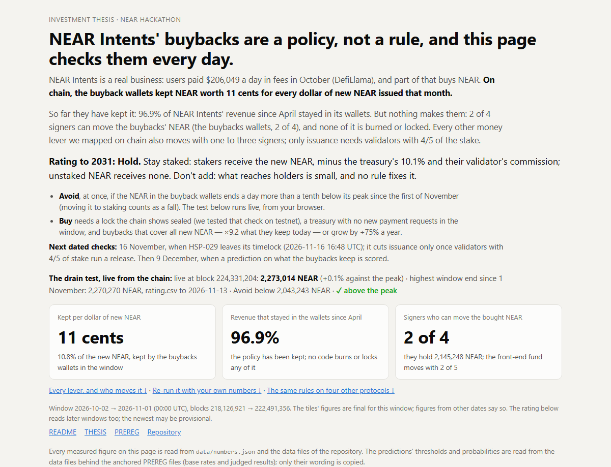
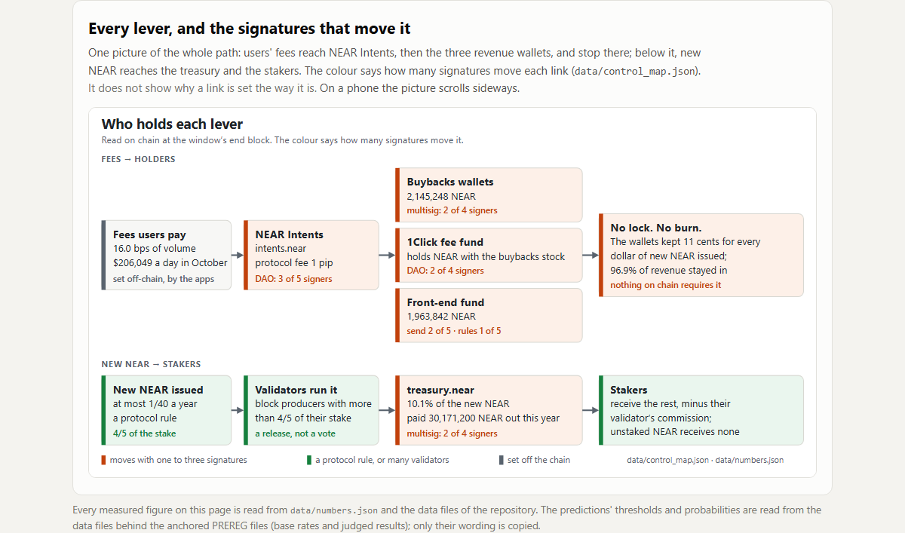
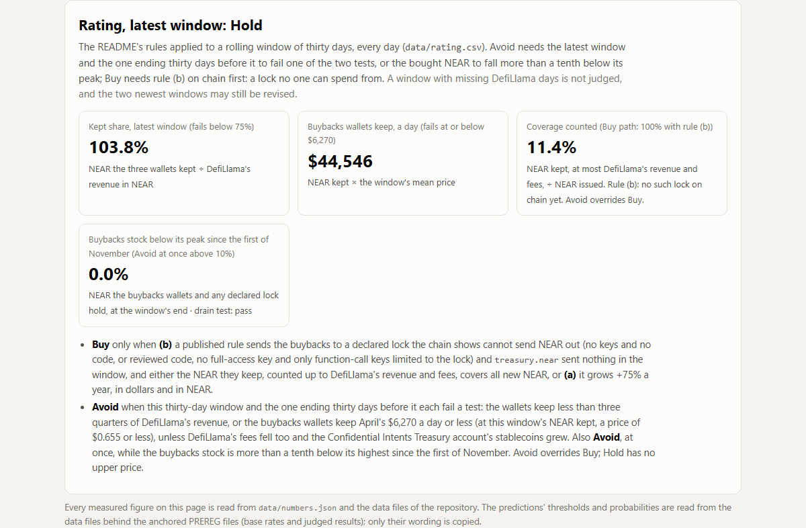
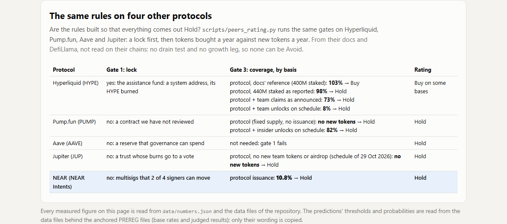

# NEAR to 2031: the buybacks are a policy, not a rule

[](https://github.com/nikolaskahris-png/near-thesis-data/actions/workflows/verify.yml)

**NEAR Intents' buybacks are a policy, not a rule, and this repository checks them every day.**

NEAR Intents is a real business: users paid <!--n:n2.fees_usd_per_day-->$206,049<!--/n--> a day in fees in October (DefiLlama), and part of that buys NEAR. On chain, the buyback wallets kept NEAR worth <!--n:iv.cents_per_new_dollar-->11 cents<!--/n--> for every $1 of new NEAR issued that month.

So far they have kept it: <!--n:f2.wallets_kept_share_of_revenue.2026-04_2026-10-->96.9%<!--/n--> of NEAR Intents' revenue since April stayed in its wallets. But nothing makes them: <!--n:c.buybacks_confirmations-->2 of 4<!--/n--> signers can move the buybacks' NEAR, and none of it is burned or locked. Every other money lever we mapped on chain also moves with 1 to 3 signers; only issuance needs validators with <!--n:c.issuance_upgrade_stake_threshold-->4/5<!--/n--> of the stake.

**Rating to 2031: Hold.** Stay staked: stakers receive the new NEAR, minus the treasury's <!--n:c.treasury_share_of_new_supply-->10.1%<!--/n--> and their validator's commission; unstaked NEAR receives none. Don't add: what reaches holders is small, and no rule fixes it.

**What would change it.** Code applies the rules every day. **Avoid** at once if the NEAR in the buyback wallets ends a day more than 10% below its peak since 1 November (the test reads the wallets' balance, so staking it counts as a fall). **Buy** needs a lock the chain shows sealed (we tested that check on testnet), a treasury with no new multisig requests in the window, and buybacks that cover all new NEAR or grow by <!--n:lr.required_growth.buybacks.A.2031-->+75%<!--/n--> a year ([every condition](#the-rating-as-rules)). Next dated checks: 16 November and 9 December.


## Why Hold

| Question | Answer | The number |
|---|---|---|
| How much of the new NEAR do the buybacks offset? | A small part | <!--n:n1.coverage_buybacks-->10.8%<!--/n--> of it, counted in NEAR on the two buybacks wallets |
| Does a rule guarantee it? | No: it is a choice | nothing locks or burns it, and <!--n:c.buybacks_confirmations-->2 of 4<!--/n--> signers can move it |
| Is the demand real? | Yes, but most fees stay with the apps that route swaps | users paid <!--n:n2.fees_usd_per_day-->$206,049<!--/n--> a day in fees (DefiLlama) |
| Are holders paid more elsewhere? | Yes | on DefiLlama's holders' revenue (NEAR: all three revenue wallets): NEAR <!--n:peer.near.holders_yield_on_mcap-->0.40%<!--/n--> of its value a year (almost all NEAR circulates), Hyperliquid <!--n:peer.hyperliquid.holders_yield_on_mcap-->4.09%<!--/n--> of circulating value, <!--n:peer.hyperliquid.holders_yield_on_fdv-->1.03%<!--/n--> fully diluted |
| Did the buybacks grow, or the price? | Both | NEAR averaged <!--n:n2.mean_price_usd-->$4.88<!--/n--> in the window, <!--n:lr.history.2026-04_2026-10.mean_price_multiple-->×3.6<!--/n--> April's; per day, October's buybacks kept <!--n:lr.history.2026-04_2026-10.buybacks_kept_near_multiple-->×2.1<!--/n--> April's NEAR, <!--n:lr.history.2026-04_2026-10.buybacks_kept_usd_multiple-->×7.5<!--/n--> its dollars |
| Is the chain's own use growing? | No, except NEAR Intents | leaving out each day's 10 busiest signers, daily transactions fell <!--n:bq.signers.without_top10_change-->-45%<!--/n--> in a year (<!--n:u.txns.change-->-83%<!--/n--> with them; BigQuery) |

**What staking does to your share:** your share of all NEAR grows +<!--n:iv.staked_share_growth-->2.44%<!--/n--> a year staked (before the validator's commission) and falls <!--n:iv.unstaked_share_change-->-2.40%<!--/n--> unstaked.


**What this repository adds:** a rating that is code and re-reads mainnet every day (Avoid can fire any day; Buy needs a lock that does not exist) · predictions hashed on chain before they are judged, one of them judged automatically by a daily GitHub Action · the same rules run on four other protocols · NEAR's own use counted from blocks through BigQuery, as the track asks ([claim E](#e-the-chain-is-used-less-and-its-use-pays-holders-almost-nothing)).

**[Live dashboard](https://nikolaskahris-png.github.io/near-thesis-data/dashboard/)** · [Try it in two minutes](#try-it-in-two-minutes) · [One-page thesis](THESIS.md) · [Every detail](docs/DETAILS.md) · [Terms](#terms) · Window: 2 October → 1 November 2026; any other date is named where used

<table>
  <tr>
    <td width="50%" valign="top"><a href="https://nikolaskahris-png.github.io/near-thesis-data/dashboard/"></a><br><sub>The rating, and the drain test reading NEAR mainnet live every day.</sub></td>
    <td width="50%" valign="top"><a href="https://nikolaskahris-png.github.io/near-thesis-data/dashboard/#pL"></a><br><sub>Every lever from fees to holders, and the signatures that move it.</sub></td>
  </tr>
  <tr>
    <td width="50%" valign="top"><a href="#the-rating-as-rules"></a><br><sub>Hold today; code states what would make it Buy or Avoid.</sub></td>
    <td width="50%" valign="top"><a href="EVIDENCE.md#the-same-rules-on-four-other-protocols"></a><br><sub>The same rules run on Hyperliquid, Pump.fun, Aave and Jupiter.</sub></td>
  </tr>
</table>

## Try it in two minutes

1. **Open the [dashboard](https://nikolaskahris-png.github.io/near-thesis-data/dashboard/).** You see the rating, Hold, and the drain test read live from NEAR mainnet: the NEAR the buybacks hold, against the line 10% below its peak.
2. **On the "Buybacks wallets" card, press Check live.** Your browser reads mainnet and compares with the saved answer.
3. **In "Re-run it", move the sliders.** They start at today's <!--n:n1.coverage_buybacks-->10.8%<!--/n-->. Press "Hypothetical: buybacks locked, fees ×9.2 → Buy" to see what Buy takes.
4. **Run `python scripts/rebuild.py`.** It ends with `REBUILD: PASS`: every number on this page recomputed offline, no network, no keys, and PREREG.md checked against the hash anchored on mainnet.

## The thesis in five claims

Sources for A–D: [long version](docs/DETAILS.md#v5-the-thesis-in-four-claims).

### A. The demand is real

NEAR Intents moved <!--n:d.ours_30d_usd-->$4.02B<!--/n--> in the 30 days to <!--n:d.window_end-->7 November<!--/n--> (after the window; DefiLlama), <!--n:d.parent_rank-->15th<!--/n--> among protocols by DEX volume.

**Against.** Volume and fees are DefiLlama's; NearBlocks, indexing the chain, sees <!--n:u.visible.before_private-->66%<!--/n--> of that volume before the private path.

Evidence, tables and checks: [EVIDENCE.md](EVIDENCE.md#a-the-demand-is-real)

### B. It is small

Each day the buybacks wallets keep <!--n:n1.buybacks_near_per_day-->9,570<!--/n--> NEAR, against <!--n:n1.new_near_per_day-->88,392<!--/n--> new NEAR issued: coverage <!--n:n1.coverage_buybacks-->10.8%<!--/n-->.

**Against.** Coverage is in NEAR and revenue in dollars, so coverage falls when the price rises; in dollars the buybacks kept <!--n:lr.history.2026-04_2026-10.buybacks_kept_usd_multiple-->×7.5<!--/n--> as much a day in October as in April.

Evidence, tables and checks: [EVIDENCE.md](EVIDENCE.md#b-it-is-small)

### C. It is a policy, not a rule

Nothing in code burns, locks or requires the buybacks. Each buybacks wallet moves with <!--n:c.buybacks_confirmations-->2 of 4<!--/n--> signers.

**Against.** The policy has been kept: April to October the three revenue wallets kept <!--n:f2.wallets_kept_share_of_revenue.2026-04_2026-10-->96.9%<!--/n--> of DefiLlama's revenue, so the gap costs Buy, not Hold.

Evidence, tables and checks: [EVIDENCE.md](EVIDENCE.md#c-it-is-a-policy-not-a-rule)

### D. It did not stop when the flow went private

From 27 October swaps began to settle privately on FAR. To 8 November, the NEAR kept a day by the three revenue wallets changed by <!--n:ps.change.kept_near_per_day-->-3%<!--/n--> (<!--n:ps.change.kept_usd_per_day-->-19%<!--/n--> in dollars, mostly the price). The NEAR figure is inside the noise (<!--n:ci.shift.kept_near.low-->-28%<!--/n--> to <!--n:ci.shift.kept_near.high-->+28%<!--/n-->); a stop would be near -100%.

**Against.** Thirteen days show capture did not stop, not that it held level; of five start dates tried, the worst gives <!--n:ps.cut.kept_near_lowest-->-13%<!--/n-->.

Evidence, tables and checks: [EVIDENCE.md](EVIDENCE.md#d-it-did-not-stop-when-the-flow-went-private)

### E. The chain is used less, and its use pays holders almost nothing

Leaving out each day's 10 busiest signers, daily transactions fell <!--n:bq.signers.without_top10_change-->-45%<!--/n--> in a year (<!--n:u.txns.change-->-83%<!--/n--> with them; NearBlocks and BigQuery agree on every day), and all gas paid in that year was <!--n:u.fee_share_of_issuance-->0.8%<!--/n--> of a year of new NEAR. Successful relay calls into NEAR Intents rose +<!--n:bq.paths.relay_ok_a_day_change-->125%<!--/n--> a day from October to 1–11 November, but these are calls, not dollars, and the rating does not use them.

**Against.** Fifty-two weeks give the organizers' lead test little power: "not detected" is not "no effect".

Evidence, tables and checks: [EVIDENCE.md](EVIDENCE.md#e-the-chain-is-used-less-and-its-use-pays-holders-almost-nothing)

## What a holder earns to 2031

Only staking moves your share of all NEAR. To 1 Jan 2031, with HSP-029 and a 10% commission: **+<!--n:iv.to2031.staked_share_change.hsp029_commission_10-->6.3%<!--/n-->** staked, <!--n:iv.to2031.unstaked_share_change.hsp029-->-7.4%<!--/n--> not staked. No price target ([paths to 2031](docs/DETAILS.md#v4-what-a-holder-earns-to-2031)).

NEAR is valued at <!--n:peer.near.mcap_to_revenue-->248×<!--/n--> the revenue DefiLlama counts for NEAR Intents (the three revenue wallets); Hyperliquid, Jupiter and Aave at <!--n:peer.jupiter.mcap_to_revenue-->24×<!--/n-->–<!--n:peer.aave.mcap_to_revenue-->39×<!--/n--> theirs. Layer-one tokens are priced on more than fees; that is most of NEAR's value, and this thesis does not rate it ([more](EVIDENCE.md#what-a-holder-earns-to-2031)).

## The rating as rules

`scripts/rating.py` applies them daily to each 30-day window ([`data/rating.csv`](data/rating.csv)). One question: does a rule, rather than a choice, pay holders for the NEAR issued?

| Rating | When | Read from |
|---|---|---|
| **Avoid** (overrides Buy) | **Either** the bought NEAR is more than 10% below its highest since 1 November (at once, until back within 10%).<br>**Or** this window and the one 30 days earlier each fail a test: (1) the three wallets keep under 75% of DefiLlama's revenue; (2) the buybacks keep April's <!--n:f2.buybacks_kept_usd_per_day.2026-04-->$6,270<!--/n--> a day or less, unless fees fell (or lack data) while the private path's stablecoins grew. | the chain; DefiLlama for test 1 |
| **Buy** | **All three:**<br>1. A published rule sends the buybacks to a lock, which we then declare in `daily.LOCKS` (none yet), and the chain shows it cannot send NEAR out: no contract and no keys, or a reviewed code hash (`AUDITED_CODE`, none yet) with no full-access key and every function-call key limited to the lock with a finite allowance. The code checks the declared lock, not how much NEAR is in it. Read on a real chain: `near-thesis-lock-1311.testnet`, a testnet account whose only key we deleted by hand, has <!--n:tl.access_keys-->0<!--/n--> keys and no contract and reads as <!--n:tl.sealed-->sealed<!--/n--> at block <!--n:tl.block_height-->277,435,278<!--/n--> (`scripts/testnet_lock.py`).<br>2. `treasury.near` opened no new multisig request in the window (its request nonce is the same at both ends; a request opened earlier and confirmed inside the window would not be seen).<br>3. The buybacks cover issuance, or at the yearly check on 1 November have grown <!--n:lr.required_growth.buybacks.A.2031-->+75%<!--/n--> a year, in dollars and in NEAR. A yearly pass then holds until the next check, without item 2 being checked again. | the chain; DefiLlama caps what counts |
| **Hold** | Everything else, unjudgeable windows included. | |

- **Is Hold built in?** Yes, until a lock exists: <!--n:sens.combinations-->54<!--/n--> threshold settings × 7 months (April to October) = <!--n:sens.month_ratings-->378<!--/n--> ratings, all Hold (<!--n:sens.hold-->378<!--/n-->). That is the finding: what holders lack is a rule. On the downside it is a live call: Avoid can fire any day (the drain test, added on 12 November; run on April to October at month ends it would not have fired, as the buybacks wallets' NEAR grew every month, `data/coverage_monthly.csv`), and the same rules give Hyperliquid, whose bought tokens sit at a keyless address, Buy at its docs' stake ([peers](EVIDENCE.md#the-same-rules-on-four-other-protocols)).
- **Price.** Until a lock exists, no price gives Buy; a lower price can only push toward Avoid (test 2). With a lock, the yearly check counts dollars too.

Backtest: [the rating in full](docs/DETAILS.md#the-rating-in-full). Four other protocols: [EVIDENCE.md](EVIDENCE.md#the-same-rules-on-four-other-protocols).

## What would change our mind

- **16 November:** PREREG predictions 1–3 are judged; HSP-029, the issuance cut, leaves its timelock at <!--n:f8.timelock_end_utc-->2026-11-16 16:48 UTC<!--/n-->; until then House of Stake's Security Council can still veto it. It cuts issuance only once validators run a release.
- **9 December 2026:** if from 9 November the buybacks keep less than half of <!--n:iv.buybacks_kept_usd_per_day-->$46,692<!--/n--> a day, PREREG-3's P6 (0.90) is scored wrong, and claim D with it.
- **From 11 December at the earliest:** the two window tests can give Avoid (the windows ending 1–10 November passed and are final).
- **Any day:** a drain gives Avoid.
- **Any day:** a sealed lock, no new treasury request and 100% counted coverage (best month so far <!--n:bt.highest_coverage_counted-->15.3%<!--/n-->) gives Buy.
- **Any three months running:** coverage of 25% or more ends "small" ([the full list](THESIS.md#what-would-change-our-mind)).
- **Predictions** are hashed on mainnet before they are judged ([all, with results](EVIDENCE.md#predictions-anchored-before-they-are-judged)).

**0.25** that the buybacks go to such a lock by 2031: our judgment, from three peers and NEAR's proposals so far ([sources](docs/DETAILS.md#how-likely-a-rule-is)).

## Check it with one command

Python 3.10+, standard library only, no network, no keys:

```
python scripts/rebuild.py
```

It runs every test, including an independent second implementation, and recomputes every number from the saved raw responses ([each step](AGENTS.md); [against the chain](docs/DETAILS.md#verify-live)).

## How NEAR is used

- **Read.** From mainnet by archival RPC: the buybacks wallets, new NEAR issued, signers and keys, `treasury.near`, protocol upgrades.
- **Written.** Each prediction file's SHA-256 is anchored in SocialDB (`social.near`) before it is judged.
- **Every day.** A GitHub Action re-reads the chain and re-runs the rating; the dashboard reads the drain test live.

## What we can't measure

The fees (NEAR's datasets on Dune; only revenue is checked on chain), whether DefiLlama's volume counts one or both legs of a swap (not checked), volume and fees on FAR, why NEAR moved, the NEAR AI credits' dollar value, and peers (from their docs, DefiLlama and CoinGecko).

## Terms

- **Buybacks wallets:** `buybacks.multisignature.near` and `1csfundsadmin.sputnik-dao.near`, where NEAR bought with NEAR Intents' fees is kept.
- **Front-end fund:** `fefundsadmin.sputnik-dao.near`, holding the fees of NEAR Intents' own front end; with the two above, the **three revenue wallets**.
- **Coverage:** NEAR the buybacks wallets keep (inflows less outflows) ÷ new NEAR issued (minted less gas burnt), over the same 30 days.
- **FAR:** a private instance of the NEAR protocol, run by a few validators ([docs](https://docs.near-intents.org/integration/market-makers/confidential-intents.md)); NEAR Intents' contract there is `intents.far`.
- More, including HSP-027 and HSP-029: [Terms](docs/DETAILS.md#terms).

## Timeline and disclosure

- Research: 22–31 October 2026, in private notes outside this repository. Code and data: from the first commit, 2026-10-31 13:51:52 UTC. The [rules](https://nearhackathon.com/HACKATHON.md) (FAQ Q-001) count work from the hackathon's announcement on 19 October: "Earlier commits are baseline".
- Sources: NEAR archival RPC, NearBlocks, NEAR's public BigQuery dataset, DefiLlama, SEC filings and NEAR's docs, linked where used. Raw responses are saved byte for byte; those listing people's accounts are kept private, with their SHA-256.
- Rules changed after anchoring: the drain test (Avoid on a fall of the bought NEAR) was added on 12 November, after the predictions in `PREREG*.md` were anchored, so it is not pre-registered. Every rule change is in the git history of `scripts/rating.py`.
- AI: code and text were written with Claude Code (Anthropic), directed by the author; those commits are marked `Co-Authored-By: Claude`. The demo video has no voice; its captions carry the narration.
- Libraries: none beyond the Python standard library. `docs/sign*.html` load NEAR Wallet Selector 10.1.4 from esm.sh.
- This is the author's only submission to NEAR HACKATHON.

License: [MIT](LICENSE).
