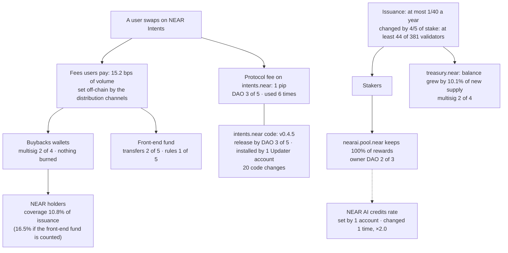

# near-thesis-data

[](https://github.com/nikolaskahris-png/near-thesis-data/actions/workflows/verify.yml)

**NEAR's value capture is real, small and discretionary.** Users pay real fees on NEAR Intents, but only a small
part reaches NEAR holders, and every link from the fee a user pays to the NEAR a holder keeps is set by a
few signers or by a company off-chain, not by code. Issuance, on the other side of the ledger, is a protocol rule.

**In short**

- **Verdict.** Hold NEAR staked, not for the fees it captures: supply grows
  <!--n:iv.issuance_rate_per_year-->2.46%<!--/n--> a year, staking pays about
  <!--n:iv.staking_yield_gross-->4.9%<!--/n--> before commissions, and the buybacks offset
  <!--n:iv.buybacks_offset_points_per_year-->0.27<!--/n--> of those points. The view turns positive only on the
  conditions in the [Investment view](#investment-view).
- **Measured.** Users pay <!--n:n2.fees_usd_per_day-->$197,837<!--/n--> a day in fees (DefiLlama, *provisional*). *Coverage*, the NEAR that
  the buybacks wallets (the two wallets that hold bought-back NEAR) keep ÷ the NEAR issued in the same days, is
  <!--n:n1.coverage_buybacks-->10.8%<!--/n-->; <!--n:n1.coverage_with_front_end-->16.5%<!--/n--> counting the
  front-end fund too (the near-intents.org front end's own fees, kept in a separate fund).
- **Ceiling.** If NEAR kept every fee, coverage would be <!--n:n2.max_coverage-->45.5%<!--/n--> (*provisional*). Covering all of
  issuance needs what the buybacks wallets keep to grow <!--n:iv.wallets_multiple_buybacks-->×9.2<!--/n-->, or, with
  every fee kept, fees to grow <!--n:iv.fees_multiple-->×2.2<!--/n-->.
- **Control.** Each link from fee to holder is set by a multisig, a DAO or a company off-chain; nothing
  bought is burned. The [control map](#the-control-map-who-can-change-each-link) shows who signs each link and how
  often they have used it.
- **Check.** Four offline commands that run in seconds, no network ([Check it in two minutes](#check-it-in-two-minutes)).
  Three predictions are anchored on chain and judged on 16 November 2026 ([Pre-registration](#pre-registration)).

Investment Thesis track, NEAR HACKATHON (1–14 November 2026). Every measured figure below comes from a script in
this repository and is copied into this file from [`data/numbers.json`](data/numbers.json) by
`scripts/build_numbers.py`: each one carries a hidden marker with its key (view the source of this file), and
`build_numbers.py --check README.md` fails if any figure differs. Sources: NEAR archival RPC, the NearBlocks API,
DefiLlama, and one off-chain read of a NEAR AI Cloud setting. Public responses are saved byte for byte under
`data/raw/`; responses that list people's accounts are kept private, with their SHA-256 ([Method](#method)).
Block heights, dates, protocol constants and figures quoted from other projects' docs are written as they are.

> **Status: v1, 2 November 2026.** Measurement window 2 October → 1 November 2026 (00:00 UTC), blocks
> 218,126,921 → 222,491,356. Numbers 1 and 3 are final for this window. Number 2 and every DefiLlama-based
> figure are **provisional** until DefiLlama's data settles (rule in [Method](#method)).

## The three numbers

| # | What an investor watches | Value | Window or block | Reproduce (no network) |
|---|---|---|---|---|
| 1 | New NEAR supply covered by the buybacks wallets | **<!--n:n1.coverage_buybacks-->10.8%<!--/n-->** (<!--n:n1.buybacks_near_per_day-->9,570<!--/n--> of <!--n:n1.new_near_per_day-->88,392<!--/n--> NEAR a day) · with the front-end fund **<!--n:n1.coverage_with_front_end-->16.5%<!--/n-->** | 2 Oct → 1 Nov 2026, blocks 218,126,921 → 222,491,356 | `python scripts/daily.py --verify` |
| 2 | The ceiling: all fees recorded by DefiLlama ÷ issuance | **<!--n:n2.max_coverage-->45.5%<!--/n-->** · equilibrium price **<!--n:n2.equilibrium_price_usd-->$2.24<!--/n-->** · *provisional* | same window, complete DefiLlama days only | `python scripts/fees.py --verify data/fees_2026-10-02_2026-11-01.json` |
| 3 | How widely the NEAR AI farm is spread (NEAR staked through `stake.dao`, paid in credits instead of NEAR) | **<!--n:n3.stakers_active-->112<!--/n-->** active accounts · largest **<!--n:n3.largest_share-->73.3%<!--/n-->** · top 10 <!--n:n3.top10_share-->96.4%<!--/n--> · median outside the top 10 <!--n:n3.outside_top10_median_near-->60<!--/n--> NEAR | block 222,491,356 (1 Nov 2026 00:00 UTC) | `python scripts/stakers.py --verify` |

- **1.** Balance change of `buybacks.multisignature.near` + `1csfundsadmin.sputnik-dao.near` (the 1Click fund that
  collected fees until April 2026 and later moved its NEAR to the buybacks wallet; summing the two cancels that
  internal move) ÷ change of `total_supply` in the two block headers. wNEAR that the buybacks wallet and the
  front-end fund hold inside `intents.near` counts as held. The front-end fund is `fefundsadmin.sputnik-dao.near`
  (<!--n:n1.front_end_near_per_day-->4,985<!--/n--> NEAR a day): near-intents.org's fees, collected by the front
  end's operator. Balances are net: anything paid out is already subtracted.
- **2.** Mean over counted days of (fees of the day ÷ NEAR price at 12:00 UTC; mean price
  <!--n:n2.mean_price_usd-->$4.90<!--/n-->) ÷ new NEAR per day. Equilibrium
  price = fees per day ÷ new NEAR per day. At HSP-029's target rate (issuance × 16/25, the end of its ramp), the ceiling would be
  <!--n:n2.hsp029_max_coverage-->71.1%<!--/n--> and the equilibrium price <!--n:n2.hsp029_equilibrium_price_usd-->$3.50<!--/n-->.
- **3.** Every account that ever called `stake` on `stake.dao` is read with `get_farm_position` at the block:
  <!--n:n3.stakers_ever-->188<!--/n--> have entered the farm, <!--n:n3.stakers_left-->76<!--/n--> of them
  (<!--n:n3.left_share_of_ever-->40.4%<!--/n-->) have left. The active positions add up exactly to the farm's
  `total_farm_shares` (<!--n:n3.farm_total_near-->1,364,348<!--/n--> NEAR); the run fails otherwise.
  *Why the farm only:* NEAR AI Agents subscriptions are locks on the same contract, but their status does not
  follow their term: of <!--n:f7.locks_active-->43<!--/n--> locks marked Active, <!--n:f7.locks_active_within_term-->11<!--/n-->
  are within their term, and <!--n:f7.locks_past_end-->75<!--/n--> of all <!--n:f7.locks-->86<!--/n--> are past their
  `end_ns`. Counting the farm or an Active lock gives <!--n:n3.farm_or_active_lock_accounts-->145<!--/n--> accounts; the
  farm or any lock, <!--n:n3.farm_or_any_lock_accounts-->181<!--/n-->. The farm is the definition that adds up exactly;
  the rule was fixed in `PREREG.md` after measuring all three on 31 October.

## Investment view

*Dated 2 November 2026. Horizon: 12 months, to November 2027. Thresholds are the author's choice; every figure
in them is measured.*

**Verdict: hold NEAR staked with a validator; do not hold it for fee capture.** Today fees do not pay a holder
back for issuance: the buybacks absorb a small part of new NEAR, and they are a choice of a few signers, not a rule.
Holding NEAR for the long term is a bet that the three conditions below come
true, not a claim on today's fees. At the end block <!--n:c.issuance_staked_share-->45.2%<!--/n--> of supply
(<!--n:c.issuance_total_stake_near-->592,027,869<!--/n--> NEAR) is staked with validators. What each holder gets:

| Holder | NEAR received | What changes |
|---|---|---|
| Not staked | none | owns a smaller share as supply grows <!--n:iv.issuance_rate_per_year-->2.46%<!--/n--> a year; the buybacks offset <!--n:iv.buybacks_offset_points_per_year-->0.27<!--/n--> points of it |
| Staked with a validator | about <!--n:iv.staking_yield_gross-->4.9%<!--/n--> a year, before the validator's commission | keeps pace with issuance |
| Staked in the NEAR AI farm | none: `nearai.pool.near` keeps <!--n:c.nearai_pool_reward_fee-->100%<!--/n--> of rewards | <!--n:f6.units_per_near_year-->0.24<!--/n--> reward units per NEAR a year, <!--n:f6.usd_per_reward_unit-->$1.00<!--/n--> of credits each (off-chain setting) |

The staking yield is new NEAR per year not kept by `treasury.near`, divided by the validators' stake; validator
commissions and downtime lower it.

| Condition | Today | Turns positive when | How far | Measured by |
|---|---|---|---|---|
| **(a)** Coverage | <!--n:n1.coverage_buybacks-->10.8%<!--/n--> (<!--n:n1.coverage_with_front_end-->16.5%<!--/n--> with the front-end fund) | the buybacks wallets keep as much NEAR as is issued (100%) | what they keep must grow <!--n:iv.wallets_multiple_buybacks-->×9.2<!--/n--> (<!--n:iv.wallets_multiple_with_front_end-->×6.1<!--/n--> with the front-end fund) at today's issuance and price; if NEAR kept every fee, fees must grow <!--n:iv.fees_multiple-->×2.2<!--/n--> | `data/history.csv`, every day |
| **(b)** A rule, not a choice | bought NEAR held by a <!--n:c.buybacks_confirmations-->2 of 4<!--/n--> multisig, nothing burned | bought NEAR moves by a published rule to an account no one can spend from, or the protocol fee on `intents.near` is routed there | no rule yet ([Path to rules](#path-to-rules)) | `scripts/control_map.py` |
| **(c)** Stake spread | the largest account holds <!--n:n3.largest_share-->73.3%<!--/n--> of the NEAR AI farm | the largest account holds less than half | prediction 1 expects at least 70% on 16 November | `scripts/stakers.py` |

**Weight of each condition.** (a) and (b) decide value. (c) is a signal, not a lever: the farm holds
<!--n:iv.farm_share_of_stake-->0.23%<!--/n--> of all stake, and stake cannot offset issuance in any case, because
stakers are the ones who receive the new NEAR. Buybacks offset it because they pay for NEAR with money from
outside: the fees users pay.

**Break-even prices** (*provisional*). Fees buy as many NEAR a day as are issued when NEAR costs
<!--n:n2.equilibrium_price_usd-->$2.24<!--/n--> or less, if NEAR kept every fee; with today's revenue only (the part
DefiLlama counts as NEAR's, front-end fund included), when it costs <!--n:iv.revenue_equilibrium_price_usd-->$0.81<!--/n-->
or less.

**At HSP-029's target rate** (1.6% a year instead of 2.5%: issuance ×16/25), what the wallets keep must grow
<!--n:iv.hsp029_wallets_multiple_with_front_end-->×3.9<!--/n--> (front-end fund included), or, with every fee kept,
fees <!--n:iv.hsp029_fees_multiple-->×1.4<!--/n-->. The proposal reaches that rate at the end of a 24-month linear
ramp that starts one quarter after ratification, and only once validators adopt it, so the target lies beyond this
view's 12-month horizon (proposal text on `vote.dao`, `get_proposal` 29).

**What would make it worse:** the buybacks wallets pay NEAR out (number 1 falls while DefiLlama revenue does not),
or monthly coverage drops back to its April level (<!--n:f1.coverage_buybacks.2026-04-->5.3%<!--/n-->).

**When to check:** 16 November 2026 (the three predictions); every month from `data/history.csv`; in full in
November 2027. DefiLlama-based multiples (fees ×) are *provisional* like number 2.

## Check it in two minutes

Python 3.12 (`python` below; `python3` on some systems), standard library only, no network, no keys:

```
python -m unittest discover -s tests              # every script's logic on fixed inputs
python scripts/build_numbers.py --verify           # every script's offline check, then numbers.json rebuilds the same
python scripts/build_numbers.py --check README.md  # every marked number in this file matches numbers.json
python scripts/check_prereg.py --file              # PREREG.md matches the anchored SHA-256 (saved copy)
```

The second command ends with `VERIFY: PASS (PUBLIC_FULL)`: every number recomputed with no network and without
the private originals ([Method](#method)). The `verify` badge runs these, and the check of
`data/upgrade_watch.csv`, on every push. Five live read-only calls, and a re-measurement of numbers 1 and 3 from
the chain, are in [Verify live](#verify-live).

## The control map: who can change each link

Multisigs and DAOs are a common way to run protocol funds. This repository only measures what a holder relies
on today, and shows for each link the mechanism NEAR already has to turn it into a rule ([Path to rules](#path-to-rules)).

From the fee a user pays to the NEAR a holder keeps. Every value is read at block 222,491,356 by
`scripts/control_map.py` (`data/control_map.json`); "used" comes from every proposal of the five DAOs involved,
read by `scripts/control_history.py` (`data/control_history.json`), and key changes from NearBlocks' key
history, checked against the chain at the end block.



**Links that decide value.**

| Link | Today | Who can change it | Signatures | Used |
|---|---|---|---|---|
| Fees users pay | <!--n:n2.fees_bps-->15.2<!--/n--> bps of volume (DefiLlama) | The distribution channels, off-chain. 1Click's terms let its operator change fees "at any time on a prospective basis" ([terms](https://docs.near-intents.org/near-intents/integration/distribution-channels/1click-terms-of-service)) | not on chain | not visible on chain |
| Protocol fee (`intents.near` `fee`) | <!--n:c.intents_fee_pips-->1 pip<!--/n--> = <!--n:c.intents_fee_percent-->0.0001%<!--/n--> | `intents.sputnik-dao.near` (role DAO); FeesManager role: <!--n:c.intents_fees_manager_accounts-->0<!--/n--> accounts | <!--n:c.intents_fee_change-->3 of 5<!--/n--> | `set_fee` <!--n:h.set_fee-->3<!--/n-->, `set_fee_collector` <!--n:h.set_fee_collector-->3<!--/n--> (<!--n:h.fee.first-->2024-11-07<!--/n--> → <!--n:h.fee.last-->2025-10-02<!--/n-->) |
| Buybacks wallet (`buybacks.multisignature.near`) | holds the bought NEAR; nothing is burned | its multisig members (<!--n:c.buybacks_full_access_keys-->0<!--/n--> full-access keys) | <!--n:c.buybacks_confirmations-->2 of 4<!--/n--> | keys unchanged since <!--n:h.keys.buybacks.last_change-->2026-03-18<!--/n--> |
| 1Click fund (`1csfundsadmin.sputnik-dao.near`) | counted with the buybacks wallet in number 1 | DAO: transfers / its own rules | <!--n:c.wallet_1cs_transfer-->2 of 4<!--/n--> / <!--n:c.wallet_1cs_rules-->2 of 4<!--/n--> | — |
| Front-end fund (`fefundsadmin.sputnik-dao.near`) | <!--n:f9.front_end_share_of_wallets-->34.2%<!--/n--> of what the three wallets kept | DAO: transfers / its own rules, upgrades and members. One Admin can change the rules alone, so one key can also move the funds, in two steps | <!--n:c.front_end_transfer-->2 of 5<!--/n--> / <!--n:c.front_end_rules-->1 of 5<!--/n--> | — |
| Issuance (`max_inflation_rate`) | <!--n:c.issuance_max_inflation_rate-->1/40<!--/n--> a year | a new nearcore release, run by validators with <!--n:c.issuance_upgrade_stake_threshold-->4/5<!--/n--> of stake | at least <!--n:c.issuance_validators_to_pass_upgrade-->44<!--/n--> of <!--n:c.issuance_validators-->381<!--/n--> validators (the largest); the <!--n:c.issuance_validators_to_block_upgrade-->5<!--/n--> largest can block; largest holds <!--n:c.issuance_largest_validator_share-->5.6%<!--/n--> | see HSP-027 below |
| Protocol treasury (`treasury.near`) | its balance grew by <!--n:c.treasury_share_of_new_supply-->10.1%<!--/n--> of new supply (<!--n:c.treasury_near_received-->268,973<!--/n--> NEAR in the window) | its multisig members | <!--n:c.treasury_confirmations-->2 of 4<!--/n--> | keys last changed <!--n:h.keys.treasury.last_change-->2025-09-05<!--/n--> |
| House of Stake voting (`vote.dao`) | decides what reaches a vote | owner `hos-root.sputnik-dao.near`; <!--n:c.hsp_reviewers-->5<!--/n--> reviewers choose what is put to a vote | <!--n:c.hsp_owner_rules-->3 of 5<!--/n--> | reviewers, council or guardians changed <!--n:h.voting.approved_actions-->5<!--/n--> times (<!--n:h.voting.first-->2026-02-09<!--/n--> → <!--n:h.voting.last-->2026-07-22<!--/n-->) |
| NEAR AI pool rewards (`nearai.pool.near`) | the pool keeps <!--n:c.nearai_pool_reward_fee-->100%<!--/n--> of staking rewards | its owner, a DAO with no access keys | <!--n:c.nearai_pool_owner_transfer-->2 of 3<!--/n--> | <!--n:h.staking.approved_actions-->57<!--/n--> staking actions by the owner |
| NEAR AI credits rate (`stake.dao` `edit_price`) | <!--n:f6.units_per_near_year-->0.24<!--/n--> reward units per staked NEAR per year | one catalog manager of the pool, named by the owner's DAO (<!--n:h.catalog_manager_added-->1<!--/n--> proposal) | 1 | changed <!--n:f6.rate_changes-->1<!--/n--> time: <!--n:f6.change1.utc-->2026-09-29 14:21 UTC<!--/n-->, <!--n:f6.change1.ratio-->×2.0<!--/n-->, without a proposal |

**Contract-level admin scope.** These do not set value; they say what the same signers can do to the contracts.

| Link | Who can change it | Signatures | Used |
|---|---|---|---|
| `intents.near` code | `ctl-intents.near` holds the Upgrader role on `intents.near`. On that controller the intents DAO adds a release, the <!--n:c.intents_code_updater_accounts-->1<!--/n--> account with the Updater role installs it, and <!--n:c.intents_code_downgrader_accounts-->2<!--/n--> accounts can roll back | <!--n:c.intents_code_add_release-->3 of 5<!--/n-->, then 1 account | <!--n:c.intents_code_changes-->20<!--/n--> code changes (<!--n:h.intents_code_downgrades-->1<!--/n--> downgrade), last <!--n:c.intents_code_last_change_utc-->2026-10-07<!--/n--> (v<!--n:c.intents_code_version-->0.4.5<!--/n-->) |
| User funds on `intents.near` | intents DAO proposals (`ft_force_withdraw`, `mt_force_transfer`, force lock/unlock) | DAO | <!--n:h.user_funds.approved_actions-->12<!--/n--> actions: force-withdraw <!--n:h.ft_force_withdraw-->9<!--/n-->, force-transfer <!--n:h.mt_force_transfer-->1<!--/n-->, the rest force lock or unlock (<!--n:h.user_funds.first-->2025-01-14<!--/n--> → <!--n:h.user_funds.last-->2026-06-10<!--/n-->) |
| Pause of `intents.near` features | intents DAO | DAO | <!--n:h.pause.approved_actions-->7<!--/n--> actions (<!--n:h.pause.first-->2026-01-15<!--/n--> → <!--n:h.pause.last-->2026-10-07<!--/n-->) |
| Roles on the map's contracts | the DAOs above | DAO | <!--n:h.roles.approved_actions-->58<!--/n--> actions, <!--n:h.intents_acl_grant_role-->12<!--/n--> role grants on `intents.near` |
| Farm contract (`stake.dao`) | either of its <!--n:c.farm_contract_full_access_keys-->2<!--/n--> full-access keys (upgrade, owner methods); <!--n:c.farm_contract_guardians-->5<!--/n--> guardians can pause | 1 key | keys unchanged since <!--n:h.keys.stake_dao.last_change-->2026-07-29<!--/n--> |

The history counts approved proposals by kind (<!--n:h.proposals_total-->390<!--/n--> proposals read in all); dates
are submission dates, because Sputnik DAO stores no approval time. For user funds the history records only the
mechanism and how often it was used: each proposal states its own reason, which this repository does not
characterize.

## Findings

**1. Coverage has been below a quarter of issuance in every month since April.** From the wallets alone: balances
and block headers, independent of DefiLlama (`scripts/coverage.py`, `data/coverage_monthly.json`).

| | Apr | May | Jun | Jul | Aug | Sep | Oct |
|---|---|---|---|---|---|---|---|
| Buybacks wallets | <!--n:f1.coverage_buybacks.2026-04-->5.3%<!--/n--> | <!--n:f1.coverage_buybacks.2026-05-->8.4%<!--/n--> | <!--n:f1.coverage_buybacks.2026-06-->8.5%<!--/n--> | <!--n:f1.coverage_buybacks.2026-07-->6.2%<!--/n--> | <!--n:f1.coverage_buybacks.2026-08-->10.2%<!--/n--> | <!--n:f1.coverage_buybacks.2026-09-->15.3%<!--/n--> | <!--n:f1.coverage_buybacks.2026-10-->10.9%<!--/n--> |
| With the front-end fund | <!--n:f1.coverage_with_front_end.2026-04-->5.7%<!--/n--> | <!--n:f1.coverage_with_front_end.2026-05-->11.9%<!--/n--> | <!--n:f1.coverage_with_front_end.2026-06-->11.2%<!--/n--> | <!--n:f1.coverage_with_front_end.2026-07-->9.1%<!--/n--> | <!--n:f1.coverage_with_front_end.2026-08-->14.8%<!--/n--> | <!--n:f1.coverage_with_front_end.2026-09-->21.3%<!--/n--> | <!--n:f1.coverage_with_front_end.2026-10-->16.5%<!--/n--> |

Months run from the first block at or after 00:00 UTC of each 1st, so October here is 1 Oct–1 Nov (number 1 is
2 Oct–1 Nov). Over 2 Oct–1 Nov, DefiLlama's revenue ÷ issuance gives <!--n:n2.defillama_revenue_coverage-->16.7%<!--/n--> against
<!--n:n1.coverage_with_front_end-->16.5%<!--/n--> from the wallets. DefiLlama counts inflows to the same wallets and we measure
their balances, so the two agreeing means almost nothing flowed out.

**2. October's revenue rose in dollars but bought fewer NEAR, because the NEAR price rose faster.** From September
to October, revenue rose <!--n:f2.change.2026-09_2026-10.revenue_usd-->+17%<!--/n-->
(<!--n:f2.revenue_usd_per_day.2026-09-->$61,317<!--/n--> → <!--n:f2.revenue_usd_per_day.2026-10-->$71,501<!--/n--> a day) and the mean NEAR price
<!--n:f2.change.2026-09_2026-10.mean_price-->+50%<!--/n--> (<!--n:f2.mean_price_usd.2026-09-->$3.28<!--/n--> → <!--n:f2.mean_price_usd.2026-10-->$4.90<!--/n-->),
so the NEAR that revenue buys fell <!--n:f2.change.2026-09_2026-10.revenue_near-->-23%<!--/n-->. Coverage fell with it:
<!--n:f1.coverage_buybacks.2026-09-->15.3%<!--/n--> → <!--n:f1.coverage_buybacks.2026-10-->10.9%<!--/n--> for the buybacks wallets,
<!--n:f1.coverage_with_front_end.2026-09-->21.3%<!--/n--> → <!--n:f1.coverage_with_front_end.2026-10-->16.5%<!--/n--> with the front-end fund. The
wallets kept <!--n:f2.wallets_kept_share_of_revenue.2026-09-->98%<!--/n--> and <!--n:f2.wallets_kept_share_of_revenue.2026-10-->99%<!--/n--> of
that revenue, so no outflow explains the drop: revenue is in dollars, issuance in NEAR. Over the longer run the
take rate (revenue ÷ fees; revenue includes the front-end fund) rose from <!--n:f2.take_rate.2026-04-->8.1%<!--/n--> in April to
<!--n:f2.take_rate.2026-10-->36.1%<!--/n--> in October, while fees per dollar of volume stayed between <!--n:f2.fees_bps.2026-08-->13.8<!--/n--> and
<!--n:f2.fees_bps.2026-09-->15.3<!--/n--> bps from August to October. *Provisional, like every DefiLlama figure.*

**3. Since the farm opened, the NEAR held by the NEAR AI pool's owner changed by <!--n:f4.since_stake_dao.owner_near_change-->-401,848<!--/n--> NEAR.**
From the creation of `stake.dao` (<!--n:f4.stake_dao_start_utc-->2026-07-28<!--/n-->; first `stake` call <!--n:f4.first_stake_utc-->2026-07-30<!--/n-->) to
block 222,491,356 (`scripts/treasury_flows.py`, `data/treasury_flows.json`), the owner, a DAO that acts only
through proposals:

- approved unstaking <!--n:f4.since_stake_dao.unstaked_near-->425,334<!--/n--> NEAR and sending out
  <!--n:f4.since_stake_dao.near_sent_out-->423,980<!--/n--> NEAR (<!--n:f4.since_stake_dao.near_to_payments_account-->280,338<!--/n--> to its own
  payments account) and <!--n:f4.since_stake_dao.usdc_sent_out-->$365,000<!--/n--> in USDC;
- held <!--n:f4.since_stake_dao.owner_near_start-->1,336,984<!--/n--> → <!--n:f4.since_stake_dao.owner_near_end-->935,136<!--/n--> NEAR, liquid and in
  every pool;
- through its payments account, swapped <!--n:f4.since_stake_dao.swaps_near_given-->139,546<!--/n--> NEAR for
  <!--n:f4.since_stake_dao.swaps_usd_received-->$296,652<!--/n--> in <!--n:f4.since_stake_dao.swaps-->7<!--/n--> swaps on NEAR Intents (mean price
  <!--n:f4.since_stake_dao.swaps_mean_price_usd-->$2.13<!--/n-->).

In the same period users' stake in the farm, which did not exist before `stake.dao`, reached
<!--n:n3.farm_total_near-->1,364,348<!--/n--> NEAR. The two are separate figures, not a net: users' stake can be withdrawn, and the
purpose of each payment is not measured. *1 January to 1 November 2026:* the owner's NEAR
<!--n:f4.y2026.owner_near_start-->1,795,378<!--/n--> → <!--n:f4.y2026.owner_near_end-->935,136<!--/n-->; swaps <!--n:f4.y2026.swaps_near_given-->237,732<!--/n--> NEAR →
<!--n:f4.y2026.swaps_usd_received-->$481,611<!--/n-->.

**4. The same account has been the largest in the farm since <!--n:f5.largest_same_account_since-->2026-08-15<!--/n-->, with between
<!--n:f5.largest_share.2026-10-15-->58.9%<!--/n--> and <!--n:f5.largest_share.2026-08-15-->76.9%<!--/n--> of it.** First block of the 1st and the
15th (`scripts/stakers.py`):

| | 1 Aug | 15 Aug | 1 Sep | 15 Sep | 1 Oct | 15 Oct | 1 Nov |
|---|---|---|---|---|---|---|---|
| Active accounts | <!--n:f5.stakers_active.2026-08-01-->16<!--/n--> | <!--n:f5.stakers_active.2026-08-15-->46<!--/n--> | <!--n:f5.stakers_active.2026-09-01-->51<!--/n--> | <!--n:f5.stakers_active.2026-09-15-->73<!--/n--> | <!--n:f5.stakers_active.2026-10-01-->88<!--/n--> | <!--n:f5.stakers_active.2026-10-15-->99<!--/n--> | <!--n:f5.stakers_active.2026-11-01-->112<!--/n--> |
| Largest account's share | <!--n:f5.largest_share.2026-08-01-->36.2%<!--/n--> | <!--n:f5.largest_share.2026-08-15-->76.9%<!--/n--> | <!--n:f5.largest_share.2026-09-01-->76.1%<!--/n--> | <!--n:f5.largest_share.2026-09-15-->75.7%<!--/n--> | <!--n:f5.largest_share.2026-10-01-->74.1%<!--/n--> | <!--n:f5.largest_share.2026-10-15-->58.9%<!--/n--> | <!--n:f5.largest_share.2026-11-01-->73.3%<!--/n--> |

On 1 August the largest was another account. The largest of 1 November held <!--n:f5.largest_near.2026-10-15-->500,000<!--/n--> NEAR
on 15 October and <!--n:f5.largest_near.2026-11-01-->1,000,000<!--/n--> on 1 November; its lower share on 15 October came from other
accounts' new stake. Outside the top 10 on 1 November: <!--n:n3.outside_top10_accounts-->102<!--/n--> accounts with
<!--n:n3.outside_top10_near-->48,611<!--/n--> NEAR in all.

**5. The credits rate is a setting, changed once by one account** (`scripts/farm_rate.py`, `data/farm_rate.json`).
The farm pays reward units, not dollars: the contract has no USD conversion. The rate was
<!--n:f6.change1.units_per_near_year_before-->0.12<!--/n--> units per staked NEAR per year until <!--n:f6.change1.utc-->2026-09-29 14:21 UTC<!--/n-->, then
<!--n:f6.change1.units_per_near_year_after-->0.24<!--/n--> (<!--n:f6.change1.ratio-->×2.0<!--/n-->), through <!--n:f6.edit_price_receipts_all_time-->1<!--/n-->
`edit_price` call, the only one in the contract's history. It was signed by the pool's catalog manager, not by the
pool owner's DAO, and needed no proposal. At today's rate the largest position receives
<!--n:f6.largest_units_per_day-->657.1<!--/n--> units a day. Off-chain, NEAR AI Cloud pays <!--n:f6.usd_per_reward_unit-->$1.00<!--/n--> of credits
per unit (read on 2026-11-01 20:58:37 UTC in a signed-in session, saved in `data/offchain/`), so
<!--n:f6.largest_usd_per_day-->$657.1<!--/n--> of credits a day for that position; whether the credits are used is not visible.

**6. NEAR AI Agents subscriptions are a separate product.** They are locks on `stake.dao`: <!--n:f7.locks-->86<!--/n--> locks
from <!--n:f7.lock_accounts-->83<!--/n--> accounts; NEAR in Active locks is <!--n:f7.active_lock_near_vs_farm-->1.1%<!--/n--> of the farm. Why
they are kept out of number 3 is under [the three numbers](#the-three-numbers).

**7. Of what the three wallets kept, <!--n:f9.front_end_share_of_wallets-->34.2%<!--/n--> went to the front-end fund, which
DefiLlama counts as buybacks.** It holds near-intents.org's fees, not bought-back NEAR; NEAR's docs publish where
these fees go ([fees](https://docs.near-intents.org/resources/fees)). This is why number 1 is given both ways.
NEAR's own dashboard ([revenue.near.org](https://revenue.near.org/), read on 23 October 2026) shows less NEAR in
the buybacks wallet than `view_account` returns: it books the two transfers from `1csfundsadmin.sputnik-dao.near`
to the buybacks wallet (July and September 2026) under 1Click. Number 1 adds the two wallets, so that move cancels
out.

## Path to rules

Each link that decides value can become a rule with a mechanism NEAR already has. Governance has started on this
path: HSP-027 (remove the developer gas rebate; `vote.dao` proposal 27) passed on 3 July 2026, and
[HSP-029](https://gov.houseofstake.org/proposals/29) proposes the same path for issuance (2.5% → 1.6% a year on a
24-month per-epoch ramp, starting one quarter after ratification); its vote closes on
2 November 2026 16:48:08 UTC and its result will be added here from `scripts/hsp029.py`. A House of Stake vote
changes nothing on chain by itself (`actions: null`): it takes a nearcore release that validators with
<!--n:c.issuance_upgrade_stake_threshold-->4/5<!--/n--> of stake run. HSP-027 is protocol version 87 in nearcore
2.14.0, and mainnet validators can start voting for it on 4 November 2026 00:00 UTC
([`core/primitives/src/version.rs`](https://github.com/near/nearcore/blob/2.14.0/core/primitives/src/version.rs)).
`scripts/upgrade_watch.py` records every day in `data/upgrade_watch.csv` how much stake signals version 87, so
"passed" versus "in force" is measured live during the hackathon.

| Link | What would make it a rule | Trade-off |
|---|---|---|
| Fees users pay | Part of the fee charged as the protocol fee on `intents.near` (up to 100% is allowed; today <!--n:c.intents_fee_pips-->1 pip<!--/n-->), with `fee_collector` set to the buybacks wallet or a locked account | The fee can still change by DAO vote (<!--n:c.intents_fee_change-->3 of 5<!--/n-->), but visibly and with a history |
| Buybacks wallet | Move bought NEAR on a published schedule to an account with no keys and no code, or to a contract with no withdraw method | Native NEAR cannot be burned by a call: locking lowers circulating supply, not `total_supply` |
| Issuance | Already a protocol rule; HSP-029 would lower it if validators adopt it | <!--n:c.issuance_validators_to_block_upgrade-->5<!--/n--> validators are enough to block |
| Protocol treasury | A public spending rule voted as an HSP, or a lower share through the protocol | How the treasury spends is not measured here |
| NEAR AI credits rate | A formula in the contract (the docs say the budget depends on APY and price), or changes only by DAO proposal with a delay | The rate follows neither today: it changed once, by hand |
| Front-end and 1Click funds, pool rewards | Their DAOs' spending and fee choices written as public rules (for example, an HSP), not decided proposal by proposal | Less room to adjust |
| `intents.near` code | A published delay between a release and its installation | A delay would also slow urgent fixes; pausing would stay immediate |

**The same map for three peers.** *From their docs and press, not verified on their chains.*

| | NEAR | Hyperliquid (HYPE) | Aave (AAVE) | Jupiter (JUP) |
|---|---|---|---|---|
| Who buys the token | multisig <!--n:c.buybacks_confirmations-->2 of 4<!--/n--> | the L1 itself, from a system address with no private key | a finance committee multisig, 3 of 4 | the team |
| Rule or choice | choice ("No specific mechanism is guaranteed or committed to", [NEAR, Feb 2026](https://near.org/blog/evolving-near-tokenomics)) | protocol rule, 97–99% of fees | governance programme, $50M a year | 50% of revenue, team commitment |
| Where bought tokens go | held in the wallet, can be moved | locked; treated as burned after a validator vote (Dec 2025) | Ecosystem Reserve, not burned | locked 3 years; burns by DAO vote |
| How a rule changes | no buyback rule to change: the wallet's signers decide (issuance: nearcore release + <!--n:c.issuance_upgrade_stake_threshold-->4/5<!--/n--> of stake) | validators by stake | on-chain vote with a 3- or 10-day timelock | JUP DAO |

This compares mechanisms, not quality: Hyperliquid is an L1 with a built-in exchange, a different model.
Sources: [The Block](https://www.theblock.co/post/383091), [Aave docs](https://aave.com/docs/ecosystem/aave),
DefiLlama token rights pages for Aave and Jupiter.

## Pre-registration

Three predictions, judged on 16 November 2026, are in [`PREREG.md`](PREREG.md). The file was anchored on
NEAR mainnet before judging: its SHA-256 is stored in SocialDB (`social.near`) under the key
`samerice7976.near/thesis/prereg/1`, written by transaction
[`8fZ8VTUyM1UjnybqPd1QCQi4c3y75dDRGR5TjkNGgnPL`](https://nearblocks.io/txns/8fZ8VTUyM1UjnybqPd1QCQi4c3y75dDRGR5TjkNGgnPL)
from `samerice7976.near`. The transaction was included in block 222,606,824 (2026-11-01 18:30:38 UTC)
and executed by `social.near` in block 222,606,825 (18:30:39 UTC). `PREREG.md` has not changed since. Prediction 2's
window had already opened, at 2026-11-01 00:00 UTC; `PREREG.md` states what had been read by then.

Anchored SHA-256: `d3f48ed9172b1785b4dcf290b84e9a06c870b8b9b5481c6d40e51a4605b1d494`

| # | Prediction | Holds if | Baseline |
|---|---|---|---|
| 1 | The largest account keeps at least 70% of the NEAR AI farm on 16 Nov | share ≥ 0.70 | <!--n:n3.largest_share-->73.3%<!--/n--> |
| 2 | Net inflows to the buybacks wallet, 1–15 Nov, stay below a quarter of new supply | ratio < 0.25 | <!--n:n1.coverage_buybacks-->10.8%<!--/n--> (2 Oct–1 Nov; `1csfundsadmin` did not change in the window, so this equals the buybacks wallet alone) |
| 3 | Fewer than 150 accounts are active in the NEAR AI farm on 16 Nov | count < 150 | <!--n:n3.stakers_active-->112<!--/n--> |

Exact rules, timing and void conditions are in `PREREG.md`. The results will be published whatever they are.

```
python scripts/check_prereg.py --file     # no network: PREREG.md against the saved anchored SHA-256
python scripts/check_prereg.py            # 4 read-only RPC calls: SocialDB record, transaction, its blocks
python scripts/check_prereg.py --verify   # no network: the same checks from the saved responses
```

One call reads the stored record directly: the last line of [Verify live](#verify-live).

The second command compares three things: the file's SHA-256, the record stored in SocialDB now, and the
record inside the transaction's own arguments. It also checks the signer and that no receipt failed.

## Method

- **One window for every flow.** Issuance, wallets and fees are all measured between the first blocks at or after
  00:00 UTC of 2 October and 1 November 2026 (`scripts/lock_window.py`, `data/window_2026-10-02_2026-11-01.json`:
  each boundary block is saved with the block before it, and `prev_hash` proves nothing lies between them).
  Number 3, the control map and the NEAR AI flows are read at the window's end block.
- **treasury.near from balances.** Its share of new supply (<!--n:c.treasury_share_of_new_supply-->10.1%<!--/n-->)
  is its balance change ÷ the change of `total_supply`. The RPC's `protocol_reward_rate` field reads `0/1` at the
  end block, so it is saved but not used. HSP-029's author measured the same split independently, 10.13% over
  28 days, and reports the same `0/1` (proposal text on `vote.dao`).
- **Issuance only over 30 days or more.** `total_supply` rises at the end of each epoch, so a single day can read
  far from the mean; over 30 days the error is about one epoch (about ±1%). The one exception is prediction 2,
  which covers 15 days (about ±2%).
- **DefiLlama figures are final only when they settle.** A day counts only if its fees are at least 20% of the
  window's median day. A figure is final only 48 hours or more after the window ends, and when a pull at least
  24 hours earlier gives the same fees and prices (DefiLlama fills recent days late and corrects old ones).
- **Private raw files.** Answers that list people's accounts (stakers and locks of `stake.dao`, DAO members,
  proposal texts, validators, voters) stay out of the repository; the public files keep their SHA-256 and the
  exact request. Each one has a redacted copy under `data/raw/redacted/` (number 3: the lists inside
  `data/stakers/`) with only the fields the computation reads and people as tags (`scripts/privacy.py`). Every
  number is computed from these copies, so the offline check recomputes all of them; with the originals present
  it also checks that they give the same copies, byte for byte. `--archival` re-fetches the originals.
- **No names.** In the current files an account of a person appears only as a tag: `sha256:` and the first 16
  hex characters of the SHA-256 of its account ID, so anyone can check a known account by hashing it. Tags are
  pseudonyms, not anonymity: the same accounts are public on chain and on NearBlocks. Until commit `7851eb5`
  (2 November 2026) the raw `stake.dao` responses, with account IDs, were in the repository; they remain in its
  git history. One exception:
  `PREREG.md` names the implicit account of the largest farm position, which prediction 1 needs. DAOs, contracts
  and validator pools are named by their account.

## Verify live

Five read-only calls to a public NEAR RPC, no key, in bash (Linux, macOS, or on Windows WSL or Git Bash;
PowerShell quotes differently). Each prints the contract's answer.

```
RPC=https://rpc.mainnet.fastnear.com
q() { curl -s $RPC -H 'Content-Type: application/json' -d "{\"jsonrpc\":\"2.0\",\"id\":1,\"method\":\"query\",\"params\":{\"request_type\":\"call_function\",\"finality\":\"final\",\"account_id\":\"$1\",\"method_name\":\"$2\",\"args_base64\":\"$3\"}}" | python3 -c "import json,sys; print(bytes(json.load(sys.stdin)['result']['result']).decode())"; }

q intents.near fee e30=                                  # protocol fee in pips
q buybacks.multisignature.near get_num_confirmations e30= # signatures the buybacks wallet needs
q nearai.pool.near get_reward_fee_fraction e30=          # share of rewards the NEAR AI pool keeps
q stake.dao get_farm_pool eyJwcmljZV9pZCI6InByaWNlX1F6bVN2eGJacWRiVjBYYkc2VkQ2S2tiQiJ9   # farm total and reward rate
q social.near get eyJrZXlzIjpbInNhbWVyaWNlNzk3Ni5uZWFyL3RoZXNpcy9wcmVyZWcvMS8qKiJdfQ==   # the pre-registration record
```

At block 222,491,356 the saved answers (`data/raw/control/`) to the first three were `1`, `2` and
`{"numerator":100,"denominator":100}`; the fourth matches `data/raw/stakedao/`, and the fifth must contain the
SHA-256 above. The base64 arguments are `{}`, `{"price_id":"price_QzmSvxbZqdbV0XbG6VD6KkbB"}` and
`{"keys":["samerice7976.near/thesis/prereg/1/**"]}`. Live answers can differ from the
locked block; that difference is the point of checking.

To re-measure numbers 1 and 3 at the locked end block, into a temporary folder, and compare with the saved
files (network, no keys, a few minutes; last line `REMEASURE: SAME`):

```
python scripts/remeasure.py
```

To re-fetch the locked blocks themselves from an archival RPC:

```
python scripts/control_map.py --verify --archival
python scripts/control_history.py --verify --archival
python scripts/treasury_flows.py --verify --archival
```

## What we can't measure

- **Confidential volume.** Part of NEAR Intents volume is confidential and reported separately by NearStats.
- **DefiLlama's volume** comes from a NEAR dataset on Dune and cannot be rebuilt from the chain here. Solver
  spreads and gas are not in the fees.
- **Credits in dollars.** The conversion from reward units to credits is an off-chain NEAR AI Cloud setting, read
  only with a signed-in session, and can change with no trace on chain. Whether credits are used is not visible.
- **The largest farm position.** Who holds it, and where its NEAR came from, is not visible to us on chain.
- **How `treasury.near` spends** its share of issuance: not measured yet.
- **Whether HSP-027 is in force** before validators adopt version 87; until then it is "passed", not "in force".
- **Peers** are compared from their docs and press, not from their chains.

## Terms

| Term | Meaning here |
|---|---|
| Issuance, new NEAR | the change of `total_supply` between two block headers, per day |
| Coverage | NEAR the wallets kept ÷ new NEAR, over the same window |
| Dilution | total supply grows by <!--n:n1.new_near_per_day-->88,392<!--/n--> NEAR a day whatever the buybacks do, because bought NEAR is held, not burned; buybacks lower only the supply outside their wallets |
| Buybacks wallets | `buybacks.multisignature.near` + `1csfundsadmin.sputnik-dao.near`; they hold bought NEAR |
| Front-end fund | `fefundsadmin.sputnik-dao.near`: fees of the near-intents.org front end |
| Fees, revenue | DefiLlama's figures for NEAR Intents: what users pay, and the part DefiLlama counts as NEAR's |
| Take rate | revenue ÷ fees |
| bps, pip | 1 bps = 0.01%; 1 pip = 0.0001% (the unit of the `intents.near` fee) |
| k of n | k signatures out of n members are needed to act; for the two multisigs, n counts member keys |
| Farm | NEAR staked through `stake.dao` into the NEAR AI pool, paid in reward units |
| Reward unit | what the farm pays; NEAR AI Cloud turns it into credits off-chain |
| Locks | NEAR AI Agents subscriptions on the same contract, not counted in the farm |
| Window | 2 Oct → 1 Nov 2026, 00:00 UTC, blocks 218,126,921 → 222,491,356 |
| Provisional | a DefiLlama figure that has not yet settled ([Method](#method)) |

## Repository

| Path | What it is |
|---|---|
| `data/numbers.json` | every number in this file, with its source file and that file's SHA-256 |
| `data/raw/` | every public RPC, NearBlocks and DefiLlama response, byte for byte |
| `data/raw/redacted/` | redacted copies of the responses that name people, which the numbers are computed from |
| `data/history.csv` | one row a day from the `daily` workflow (00:15 UTC): number 1 over the last 30 days |
| `data/upgrade_watch.csv` | one row a day: stake signalling the next protocol version |
| `scripts/` | one script per number or finding; each has `--verify` and a test in `tests/` |
| `PREREG.md` | the three predictions, anchored on chain |
| `docs/sign.html` | the page used once to sign the anchoring transaction |
| `AGENTS.md`, `CLAUDE.md` | the checking steps for automated reviewers (identical files) |

Data sources: FastNEAR RPC and archival RPC, NearBlocks API, DefiLlama (`api.llama.fi`, `coins.llama.fi`), and one
read of NEAR AI Cloud's farm setting in a signed-in session (`data/offchain/`). No API keys.

## Timeline and disclosure

- Research into data sources: 22–31 October 2026, in private notes that are not part of this repository.
- Code and data: from the first commit, 2026-10-31 13:51:52 UTC. The hackathon counts work from its announcement
  on 19 October; there is no earlier code.
- Libraries: none beyond the Python standard library. `docs/sign.html` loads NEAR Wallet Selector 10.1.4 from esm.sh.
- This is the author's only submission to NEAR HACKATHON.

License: [MIT](LICENSE).
