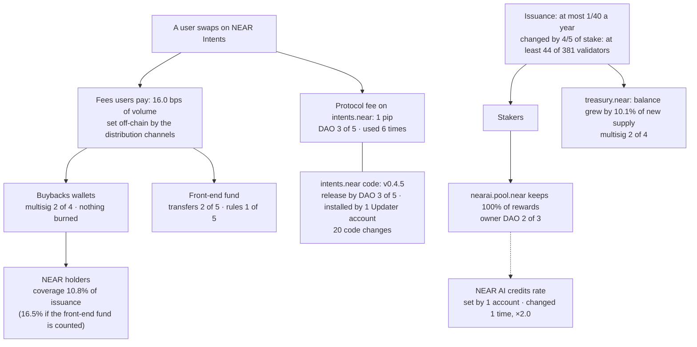

# Details

Companion to the [README](../README.md). Every marked figure here is checked against `data/numbers.json` in the same
way: `python scripts/build_numbers.py --check docs/DETAILS.md`.

## The numbers: two of value, one signal

| # | What it measures | Value | On chain? | Reproduce (no network) |
|---|---|---|---|---|
| 1 | Coverage: NEAR kept by the buybacks wallets ÷ NEAR issued, same days | **<!--n:n1.coverage_buybacks-->10.8%<!--/n-->** (<!--n:n1.buybacks_near_per_day-->9,570<!--/n--> of <!--n:n1.new_near_per_day-->88,392<!--/n--> NEAR a day) · with the front-end fund **<!--n:n1.coverage_with_front_end-->16.5%<!--/n-->** | yes: balances and block headers | `python scripts/daily.py --verify` |
| 2 | The ceiling: all fees recorded by DefiLlama ÷ issuance | **<!--n:n2.max_coverage-->47.9%<!--/n-->** · equilibrium price **<!--n:n2.equilibrium_price_usd-->$2.33<!--/n-->** | no: fees from a Dune dataset, prices from DefiLlama | `python scripts/fees.py --verify data/fees_2026-10-02_2026-11-01.json` |
| — | At stake: NEAR the wallets hold, movable by their signers | **<!--n:n1.wallets_held_near-->4,109,089<!--/n-->** (buybacks <!--n:n1.buybacks_held_near-->2,145,248<!--/n-->, front-end fund <!--n:n1.front_end_held_near-->1,963,842<!--/n-->) | yes | `python scripts/daily.py --verify` |
| 3 | Signal: how widely the NEAR AI farm is spread | **<!--n:n3.stakers_active-->112<!--/n-->** active accounts · largest **<!--n:n3.largest_share-->73.3%<!--/n-->** · top 10 <!--n:n3.top10_share-->96.4%<!--/n--> · median outside the top 10 <!--n:n3.outside_top10_median_near-->60<!--/n--> NEAR | yes | `python scripts/stakers.py --verify` |

- **1.** Balance change of `buybacks.multisignature.near` + `1csfundsadmin.sputnik-dao.near` ÷ change of
  `total_supply` between the two block headers. The front-end fund, `fefundsadmin.sputnik-dao.near`
  (<!--n:n1.front_end_near_per_day-->4,985<!--/n--> NEAR a day), holds near-intents.org's own fees, not bought-back NEAR, but DefiLlama
  counts it as buybacks: it is <!--n:f9.front_end_share_of_wallets-->34.2%<!--/n--> of what the three wallets kept, which is why number
  1 is given both ways ([fees](https://docs.near-intents.org/resources/fees)).
- **Outflow check, not a fee check.** DefiLlama's revenue ÷ issuance gives <!--n:n2.defillama_revenue_coverage-->16.5%<!--/n-->,
  as the wallets do. DefiLlama counts inflows to the same wallets and we measure their balances, so the match
  shows that almost nothing flowed out: from April to October the three wallets kept <!--n:f2.wallets_kept_share_of_revenue.2026-04_2026-10-->96.9%<!--/n--> of that revenue.
  It does not check the fees themselves.
- **2.** Each day's fees converted at that day's NEAR price, ÷ new NEAR per day; the equilibrium price is the
  NEAR price at which a day's fees buy as many NEAR as are issued. At HSP-029's target rate (issuance ×16/25) the
  ceiling would be <!--n:n2.hsp029_max_coverage-->74.8%<!--/n-->. The NEAR Intents exploit of 1 October, about $3.8M through the Omni
  deposit and withdrawal system ([report](https://crypto-economy.com/near-intents-halts-after-3-8m-exploit-vows-full-compensation-amid-hack-wave/)),
  came a day before the window; the `intents.near` DAO paused features and installed new code from 1 to 7 October
  (`data/control_history.json`). Without 2–7 October the ceiling is <!--n:n2.max_coverage_without_2026-10-02_to_07-->47.9%<!--/n-->.
- **3.** A signal, not a lever: the farm is <!--n:iv.farm_share_of_stake-->0.23%<!--/n--> of all stake (finding 5). Every account
  that ever staked through `stake.dao`, read at the block: <!--n:n3.stakers_ever-->188<!--/n--> entered, <!--n:n3.stakers_left-->76<!--/n--> have left,
  and the active positions add up exactly to the farm's total (<!--n:n3.farm_total_near-->1,364,348<!--/n--> NEAR).

Full definitions: [the three numbers](#the-three-numbers).

## Investment view (the long version)

*Dated 6 November 2026. Horizon to 1 January 2031 (about four years from the window), checked every 12 months. Thresholds are the author's
choice; every figure in them is measured.*

### The rating in full

- **Hold:** keep NEAR you already own, staked with a validator. Staking pays about <!--n:iv.staking_yield_gross-->5.0%<!--/n--> a year
  before commission while supply grows <!--n:iv.issuance_rate_per_year-->2.46%<!--/n-->, so a staked holder's share of all NEAR rises. That
  protects the share, not the dollar value.
- **Not a Buy:** what holders get from fees covers a small part of issuance, and nothing obliges anyone to keep it.
- **Upgrade to Buy** when (b) holds and, at a yearly check, (a) and (a′) hold, or (b) holds and the buybacks cover
  issuance (below). Each check measures the same 30 days of its year
  (2 October to 1 November), like this window. (a) **In dollars:** what the buybacks wallets keep a
  day has grown at least <!--n:lr.required_growth.buybacks.A.2031-->+75%<!--/n--> a year from this window's <!--n:iv.buybacks_kept_usd_per_day-->$46,692<!--/n-->, so a falling price alone
  cannot meet it. (a′) **In NEAR:** the same growth, so a rising price has not used it up. <!--n:lr.required_growth.buybacks.A.2031-->+75%<!--/n--> a year is the pace that
  covers issuance on 1 January 2031 at today's issuance rule; once validators run HSP-029, the passed proposal that
  lowers issuance from 2.5% to 1.6% a year, it is <!--n:lr.required_growth.buybacks.B.2031-->+56%<!--/n--> (<!--n:lr.required_growth.with_front_end.A.2031-->+58%<!--/n--> and <!--n:lr.required_growth.with_front_end.B.2031-->+41%<!--/n--> counting the front-end fund, which
  keeps near-intents.org's own fees). (b) Keeping it is a published rule. The hurdle depends on the
  base: with HSP-029 in force, from the April–October average it is <!--n:lr.required_growth.buybacks.B.2031.base.2026-04_2026-10-->+62%<!--/n-->; from single months, <!--n:lr.required_growth.buybacks.B.2031.base_min-->+44%<!--/n--> to <!--n:lr.required_growth.buybacks.B.2031.base_max-->+85%<!--/n-->.
- **Downgrade to Avoid** if two 30-day windows in a row, the latest and the one ending 30 days before it, each fail
  either test: the wallets keep less than 75% of the revenue DefiLlama
  attributes to NEAR, both counted in NEAR (lowest month so far: April, <!--n:f2.wallets_kept_share_of_revenue.2026-04-->77%<!--/n-->; October <!--n:f2.wallets_kept_share_of_revenue.2026-10-->100%<!--/n-->), or what the
  buybacks wallets keep in dollars falls back to April's level (<!--n:f2.buybacks_kept_usd_per_day.2026-04-->$6,270<!--/n--> a day). A rising price alone cannot
  trigger either. NEAR moved from the wallets to an account declared as a lock (the published rule of (b)), after the
  declaration, counts as kept, not as an outflow (`LOCKS` in `scripts/daily.py`; none exists yet), so meeting (b) cannot
  trigger Avoid. What a lock already holds when it is declared counts as neither.
- **Buybacks cover issuance**, with (b): in a 30-day window the buybacks wallets keep at least as many NEAR as are
  issued, so coverage is 100% or more (<!--n:n1.coverage_buybacks-->10.8%<!--/n--> in this window), on the same basis as (a). Only fees count toward it: the NEAR kept is counted up to DefiLlama's revenue
  and fees for the window, in NEAR (`coverage_counted`). The revenue cap stops a move from the front-end fund, which
  DefiLlama leaves out; a transfer from outside counts as revenue, so only the fee cap limits it, and a window in which
  the protocol treasury (`treasury.near`) sent anything cannot reach Buy at all. Coverage counts NEAR, so a
  lower price raises it only through the dollars kept: if they hold at <!--n:iv.buybacks_kept_usd_per_day-->$46,692<!--/n--> a day, at <!--n:iv.buybacks_equilibrium_price_usd-->$0.53<!--/n--> (mean <!--n:n2.mean_price_usd-->$4.88<!--/n-->) they buy
  as many NEAR as are issued, the dollar test still passes, and with (b) the rating is Buy. That is intended: the
  buybacks then do offset issuance. If instead the NEAR kept stays near today's, a lower price leaves coverage where it
  is, and at <!--n:iv.buybacks_equilibrium_price_usd-->$0.53<!--/n--> the dollars kept would be below April's <!--n:f2.buybacks_kept_usd_per_day.2026-04-->$6,270<!--/n-->, failing Avoid's dollar test. (On DefiLlama's revenue instead, <!--n:iv.revenue_equilibrium_price_usd-->$0.80<!--/n-->.)
- **Applied every day:** `scripts/rating.py` applies these rules to each 30-day window in `data/history.csv` and
  writes [`data/rating.csv`](../data/rating.csv): the rating, both Avoid tests, the earlier window, (b) and coverage. It counts
  DefiLlama's days exactly as the window's figures do, and `--verify` recomputes it with no network.
- **Which rule wins:** Avoid overrides Buy. Hold has no upper price: a rising price lowers coverage, which the
  figures show, but the rating judges what NEAR captures and whether it is a rule, not valuation upside.

**The rules as `scripts/rating.py` applies them, every day:**

| | Rule |
|---|---|
| Window | 30 days ending at 00:00 UTC. One ends every day: each row of `data/history.csv` is one window. |
| Avoid test 1: kept share | NEAR the three wallets keep (buybacks wallet, 1Click fund, front-end fund) ÷ DefiLlama's revenue for NEAR in NEAR, each day's dollars at that day's price. Fails below 75%. Not judged if DefiLlama's revenue is zero or a day is missing: test 2 then decides alone, so the rule still works if the fees leave DefiLlama's view. |
| Avoid test 2: dollars | NEAR the buybacks wallets keep (buybacks wallet and 1Click fund, not the front-end fund) × the window's mean price. Fails at or below <!--n:f2.buybacks_kept_usd_per_day.2026-04-->$6,270<!--/n--> a day. |
| A window fails | if either test fails. |
| Avoid | the latest window fails, and so does the window that ended 30 days before it, whichever test each one failed. |
| Leaving Avoid | the rating is recomputed every day: once the latest window, or the one 30 days before it, passes, the rating is Hold again (or Buy). |
| Missing data | a window missing a DefiLlama day is `incomplete`: test 1 and coverage are not judged; test 2, read from the chain at the window's mean price, still is if every day has a price. With no price either, the window counts as neither pass nor fail. |
| Provisional | for 48 hours after its last day a window is judged but marked `provisional`, because DefiLlama revises recent days; every run re-fetches them, so the row settles by itself. |
| (b), read from the chain | a lock declared under a published rule (`LOCKS`) has, on the window's end block, no contract and no access keys, so no one can spend from it. Read for each window, so it is never true before the block where it became true. |
| Coverage counted | NEAR the buybacks wallets keep a day, at most DefiLlama's revenue and at most its fees for the window (both in NEAR), ÷ NEAR issued. The revenue cap stops moves between the three wallets, which DefiLlama leaves out; a transfer from outside counts as DefiLlama revenue, so only the fee cap limits it. A window missing a DefiLlama day is not judged. |
| `treasury.near` quiet | the protocol treasury sent nothing in the window: its multisig request nonce (`get_request_nonce`) is the same at both boundary blocks and it has no full-access key, read from the chain each day (`treasury_quiet` in `data/rating.csv`). With no full-access key, every transfer out of it needs a request, and the nonce counts every request ever made. A window not quiet, or not read, cannot reach Buy. |
| Buy | (b), `treasury.near` quiet in the window, and either its coverage counted is 100% or more, or (a) and (a′) hold at the yearly check, the window ending on 1 November. |
| Hurdle of (a) | from <!--n:iv.buybacks_kept_usd_per_day-->$46,692<!--/n--> a day: <!--n:lr.required_growth.buybacks.A.2031-->+75%<!--/n--> a year while validators do not run HSP-029, <!--n:lr.required_growth.buybacks.B.2031-->+56%<!--/n--> once they do (`HSP029_IN_FORCE`, set when `scripts/upgrade_watch.py` shows the release adopted). A pass at a yearly check holds until the next one. |
| Cannot be judged | Hold. Until 1 December 2026 no window has one 30 days before it in `history.csv`, so Avoid cannot fire before then. |

If NEAR kept every fee, fees counted in NEAR would need <!--n:lr.required_growth.all_fees.B.2031-->+9%<!--/n--> a year ([the model](#issuance-to-2031)).

**Why coverage, for a staked holder.** Coverage is the buyback yield divided by the issuance rate: the wallets keep <!--n:iv.buyback_yield_buybacks-->0.27%<!--/n--> of NEAR's value a year (<!--n:iv.buyback_yield_with_front_end-->0.41%<!--/n--> with the front-end fund), against <!--n:iv.issuance_rate_per_year-->2.46%<!--/n--> issued.
Staking moves issuance from unstaked holders to staked ones; buybacks are the only part of the return paid with
money from outside, so they are what all holders share. They burn nothing, so total supply grows by the full <!--n:iv.issuance_rate_per_year-->2.46%<!--/n--> and an unstaked holder's share of all NEAR changes <!--n:iv.unstaked_share_change-->-2.40%<!--/n--> a year whatever they do; while the wallets never sell, the NEAR outside them grows about <!--n:iv.net_dilution_buybacks-->2.20%<!--/n--> a year. Coverage
falls when the price rises and revenue does not: each dollar buys back a smaller part of a dearer NEAR. In dollars,
April to October: fees <!--n:lr.history.2026-04_2026-10.fees_usd_multiple-->×1.9<!--/n-->, revenue <!--n:lr.history.2026-04_2026-10.revenue_usd_multiple-->×8.2<!--/n-->, volume <!--n:lr.history.2026-04_2026-10.volume_usd_multiple-->×2.0<!--/n-->, kept by the buybacks wallets <!--n:lr.history.2026-04_2026-10.buybacks_kept_usd_multiple-->×7.5<!--/n--> (<!--n:lr.history.2026-04_2026-10.buybacks_kept_near_multiple-->×2.1<!--/n--> as much NEAR a day, at a <!--n:lr.history.2026-04_2026-10.mean_price_multiple-->×3.6<!--/n--> price); the NEAR price rose faster than fees, so fees counted in NEAR fell (<!--n:lr.history.2026-04_2026-10.fees_near_multiple-->×0.5<!--/n-->). The NEAR kept did not rise steadily: a day, month by month from April, <!--n:f1.buybacks_kept_near_per_day.2026-04-->4,675<!--/n-->, <!--n:f1.buybacks_kept_near_per_day.2026-05-->7,353<!--/n-->, <!--n:f1.buybacks_kept_near_per_day.2026-06-->7,463<!--/n-->, <!--n:f1.buybacks_kept_near_per_day.2026-07-->5,451<!--/n-->, <!--n:f1.buybacks_kept_near_per_day.2026-08-->8,972<!--/n-->, <!--n:f1.buybacks_kept_near_per_day.2026-09-->13,478<!--/n--> and <!--n:f1.buybacks_kept_near_per_day.2026-10-->9,589<!--/n--> NEAR, October <!--n:f1.change.2026-09_2026-10.buybacks_kept_near-->-29%<!--/n--> on September.

### Who gets what

At the end block <!--n:c.issuance_staked_share-->45.2%<!--/n--> of supply (<!--n:c.issuance_total_stake_near-->592,027,869<!--/n--> NEAR) is
staked with validators. What each holder gets:

| Holder | NEAR received | What changes |
|---|---|---|
| Not staked | none | owns a smaller share as supply grows <!--n:iv.issuance_rate_per_year-->2.46%<!--/n--> a year; the buybacks offset <!--n:iv.buybacks_offset_points_per_year-->0.27<!--/n--> points of it in the supply outside their wallets |
| Staked with a validator | about <!--n:iv.staking_yield_gross-->5.0%<!--/n--> a year, before the validator's commission | keeps pace with issuance |
| Staked in the NEAR AI farm | none: `nearai.pool.near` keeps <!--n:c.nearai_pool_reward_fee-->100%<!--/n--> of rewards | credits instead (finding 5) |

| Condition | Today | Met when | Measured by |
|---|---|---|---|
| **(a)** Coverage | <!--n:n1.coverage_buybacks-->10.8%<!--/n--> (<!--n:n1.coverage_with_front_end-->16.5%<!--/n--> with the front-end fund) | the wallets keep as much NEAR as is issued: what they keep grows <!--n:iv.wallets_multiple_buybacks-->×9.2<!--/n--> (<!--n:iv.wallets_multiple_with_front_end-->×6.1<!--/n-->), or, with every fee kept, fees <!--n:iv.fees_multiple-->×2.1<!--/n--> | `data/history.csv`, daily |
| **(b)** A rule, not a choice | a <!--n:c.buybacks_confirmations-->2 of 4<!--/n--> multisig, nothing burned | bought NEAR moves by a published rule to an account no one can spend from | `scripts/daily.py` (`sealed`: the lock's code and keys, every window) |
| (c) Signal: stake spread | largest account <!--n:n3.largest_share-->73.3%<!--/n--> of the farm | the largest holds less than half | `scripts/stakers.py` |

(a) and (b) decide value; (c) does not, because stake cannot offset issuance: stakers are the ones who receive
the new NEAR. Buybacks pay for NEAR with money from outside, the fees users pay, but they offset issuance only in
the supply outside their wallets, and only while the NEAR stays there: total supply grows either way.

**The lever model.** Coverage if each lever were pulled in turn; only the last step is a rule. The
[dashboard](https://nikolaskahris-png.github.io/near-thesis-data/dashboard/#p3b) re-runs it with your own assumptions.

| Step | Coverage | Who moves the lever |
|---|---|---|
| Today: the buybacks wallets keep <!--n:iv.wallets_share_of_fees_buybacks-->22.6%<!--/n--> of all fees | <!--n:n1.coverage_buybacks-->10.8%<!--/n--> | a <!--n:c.buybacks_confirmations-->2 of 4<!--/n--> multisig; a choice |
| + the front-end fund (the three wallets keep <!--n:iv.wallets_share_of_fees_with_front_end-->34.4%<!--/n--> of all fees in NEAR; not the take rate, which is revenue ÷ fees in dollars) | <!--n:n1.coverage_with_front_end-->16.5%<!--/n--> | its DAO, transfers <!--n:c.front_end_transfer-->2 of 5<!--/n-->; a choice |
| + every fee kept by NEAR | <!--n:n2.max_coverage-->47.9%<!--/n--> | the distribution channels off-chain, or the protocol fee by DAO (<!--n:c.intents_fee_change-->3 of 5<!--/n-->); a choice |
| + HSP-029 at the end of its 24-month ramp | <!--n:n2.hsp029_max_coverage-->74.8%<!--/n--> | validators with <!--n:c.issuance_upgrade_stake_threshold-->4/5<!--/n--> of stake; a rule once they run it |
| Full coverage | 100% | fees grow a further <!--n:iv.hsp029_fees_multiple-->×1.3<!--/n-->, or NEAR at or below <!--n:n2.hsp029_equilibrium_price_usd-->$3.64<!--/n--> |

### Issuance to 2031, in short

`scripts/longrun.py` steps total supply one epoch at a time under today's rule (A: at most 1/40 a year) and under
HSP-029 (B: 2.5% → 1.6% over 24 months, from <!--n:lr.activation_utc-->2027-02-14 16:48 UTC<!--/n-->, 90 days after its timelock ends),
holding the window's ratio of actual to maximum issuance. It forecasts no price, volume or fee: it gives the yearly
growth that the NEAR kept a day must reach to equal issuance on 1 January of each year.

| Covered on 1 January | Issuance a day, A → B | Buybacks wallets alone must grow, A / B | With the front-end fund, A / B | All fees in NEAR must grow, A / B |
|---|---|---|---|---|
| 2028 | <!--n:lr.issuance_per_day.A.2028-->90,968<!--/n--> → <!--n:lr.issuance_per_day.B.2028-->76,482<!--/n--> | <!--n:lr.required_growth.buybacks.A.2028-->+589%<!--/n--> / <!--n:lr.required_growth.buybacks.B.2028-->+494%<!--/n--> a year | <!--n:lr.required_growth.with_front_end.A.2028-->+381%<!--/n--> / <!--n:lr.required_growth.with_front_end.B.2028-->+315%<!--/n--> | <!--n:lr.required_growth.all_fees.A.2028-->+93%<!--/n--> / <!--n:lr.required_growth.all_fees.B.2028-->+66%<!--/n--> |
| 2029 | <!--n:lr.issuance_per_day.A.2029-->93,242<!--/n--> → <!--n:lr.issuance_per_day.B.2029-->61,230<!--/n--> | <!--n:lr.required_growth.buybacks.A.2029-->+186%<!--/n--> / <!--n:lr.required_growth.buybacks.B.2029-->+135%<!--/n--> a year | <!--n:lr.required_growth.with_front_end.A.2029-->+135%<!--/n--> / <!--n:lr.required_growth.with_front_end.B.2029-->+94%<!--/n--> | <!--n:lr.required_growth.all_fees.A.2029-->+44%<!--/n--> / <!--n:lr.required_growth.all_fees.B.2029-->+19%<!--/n--> |
| 2031 | <!--n:lr.issuance_per_day.A.2031-->97,948<!--/n--> → <!--n:lr.issuance_per_day.B.2031-->61,108<!--/n--> | <!--n:lr.required_growth.buybacks.A.2031-->+75%<!--/n--> / <!--n:lr.required_growth.buybacks.B.2031-->+56%<!--/n--> a year | <!--n:lr.required_growth.with_front_end.A.2031-->+58%<!--/n--> / <!--n:lr.required_growth.with_front_end.B.2031-->+41%<!--/n--> | <!--n:lr.required_growth.all_fees.A.2031-->+22%<!--/n--> / <!--n:lr.required_growth.all_fees.B.2031-->+9%<!--/n--> |

Keeping every fee instead of today's share can add <!--n:lr.take_rate_ceiling_multiple-->×2.9<!--/n-->, once; the rest must come from fees
that grow faster than the NEAR price. From April to October what the wallets kept rose <!--n:lr.history.2026-04_2026-10.kept_multiple-->×2.9<!--/n-->, but fees counted in NEAR fell (<!--n:lr.history.2026-04_2026-10.fees_near_multiple-->×0.5<!--/n-->): the rise came from the share
kept (take rate <!--n:lr.history.2026-04_2026-10.take_rate_multiple-->×4.2<!--/n-->), the lever with a ceiling. If HSP-029 starts six months late, covering
2029 needs <!--n:lr.required_growth.all_fees.B_late.2029-->+26%<!--/n--> a year instead of <!--n:lr.required_growth.all_fees.B.2029-->+19%<!--/n-->. For scale, HSP-027 took <!--n:pr.v87.days_from_hsp027_passed-->124<!--/n--> days from its vote to effect (finding 3); the model's start for HSP-029 is a
shorter span from its vote. The model's HSP-029 cut over six years, <!--n:lr.not_issued_B.6y-->66.35M<!--/n--> NEAR, is within <!--n:lr.not_issued_B_vs_proposal.6y-->+0.4%<!--/n--> of the proposal's own figure.

**The base matters.** The table starts from the window's level, October. Starting instead from each month since April,
the buybacks wallets' 2031 hurdle under HSP-029 runs from <!--n:lr.required_growth.buybacks.B.2031.base_min-->+44%<!--/n--> to <!--n:lr.required_growth.buybacks.B.2031.base_max-->+85%<!--/n--> a year; from the
April–October average, <!--n:lr.required_growth.buybacks.B.2031.base.2026-04_2026-10-->+62%<!--/n--> (with the front-end fund <!--n:lr.required_growth.with_front_end.B.2031.base.2026-04_2026-10-->+50%<!--/n-->). October sits
inside that range, and the April–October average asks for more than October does. Every year, month and column: [details](#issuance-to-2031).

**Scenarios in dollars.** If what is kept grows at a steady yearly rate in dollars from the window's level, issuance
on 1 January 2031 is covered at any NEAR price up to:

| Growth in dollars, a year | Buybacks wallets: HSP-029 (today's rule) | With the front-end fund | Every fee kept |
|---|---|---|---|
| flat | <!--n:lr.scenario.0.cover_price.buybacks.B.2031-->$0.76<!--/n--> (<!--n:lr.scenario.0.cover_price.buybacks.A.2031-->$0.48<!--/n-->) | <!--n:lr.scenario.0.cover_price.with_front_end.B.2031-->$1.16<!--/n--> | <!--n:lr.scenario.0.cover_price.all_fees.B.2031-->$3.37<!--/n--> |
| +25% | <!--n:lr.scenario.25.cover_price.buybacks.B.2031-->$1.94<!--/n--> (<!--n:lr.scenario.25.cover_price.buybacks.A.2031-->$1.21<!--/n-->) | <!--n:lr.scenario.25.cover_price.with_front_end.B.2031-->$2.94<!--/n--> | <!--n:lr.scenario.25.cover_price.all_fees.B.2031-->$8.54<!--/n--> |
| +50% | <!--n:lr.scenario.50.cover_price.buybacks.B.2031-->$4.14<!--/n--> (<!--n:lr.scenario.50.cover_price.buybacks.A.2031-->$2.58<!--/n-->) | <!--n:lr.scenario.50.cover_price.with_front_end.B.2031-->$6.30<!--/n--> | <!--n:lr.scenario.50.cover_price.all_fees.B.2031-->$18.27<!--/n--> |
| +100% | <!--n:lr.scenario.100.cover_price.buybacks.B.2031-->$13.73<!--/n--> (<!--n:lr.scenario.100.cover_price.buybacks.A.2031-->$8.56<!--/n-->) | <!--n:lr.scenario.100.cover_price.with_front_end.B.2031-->$20.88<!--/n--> | <!--n:lr.scenario.100.cover_price.all_fees.B.2031-->$60.57<!--/n--> |

Against a mean price of <!--n:n2.mean_price_usd-->$4.88<!--/n--> in the window. The rates are the author's choice and none is a forecast; for scale,
from April to October revenue grew <!--n:lr.history.2026-04_2026-10.revenue_usd_multiple-->×8.2<!--/n--> and fees <!--n:lr.history.2026-04_2026-10.fees_usd_multiple-->×1.9<!--/n--> in dollars, over six months that are not
annualized here.

**When to check:** 6, 8 and 16
November 2026 (the predictions), every day in `data/rating.csv`, and each November to 2031 against the [2031 table](#issuance-to-2031).

**Valuation, same window.** All NEAR in `total_supply` at the window's mean price
(<!--n:n2.mean_price_usd-->$4.88<!--/n-->) is worth <!--n:iv.supply_value_usd-->$6.39B<!--/n-->. CoinGecko's circulating supply equals total supply ([`data/raw/peers/`](../data/raw/peers/)), so NEAR's market cap
differs from this value only by the price.

| A year of | Dollars | Value ÷ that |
|---|---|---|
| Fees users pay (DefiLlama) | <!--n:iv.fees_usd_per_year-->$75.3M<!--/n--> | <!--n:iv.value_to_fees-->85×<!--/n--> |
| Revenue DefiLlama counts as NEAR's | <!--n:iv.revenue_usd_per_year-->$25.8M<!--/n--> | <!--n:iv.value_to_revenue-->248×<!--/n--> |
| NEAR kept by the three wallets, on chain | <!--n:iv.wallets_kept_usd_per_year-->$25.9M<!--/n--> | <!--n:iv.value_to_wallets_kept-->247×<!--/n--> |
| Issuance, for comparison | <!--n:iv.issuance_usd_per_year-->$157.5M<!--/n--> | — |

### Peers on one basis

DefiLlama's revenue and holders' revenue (what is paid to token holders: buybacks, or for an L1 the gas that is
burned) over the window's 30 days, a year, against each token's market cap at its mean price over the same 30 days:
CoinGecko's supply at <!--n:peer.value_as_of-->2026-11-06 20:31 UTC<!--/n--> × the daily prices NEAR's figures use (coins.llama.fi). Each row is DefiLlama's
revenue for that token (`scripts/peers.py`). The other L1s' rows are their chains' own revenue, without their apps;
NEAR's bold row adds Intents, part of whose fees buys NEAR back, so NEAR's L1 gas alone is shown too, like for like.

| Token | Market cap | Revenue a year | Market cap ÷ revenue | Paid to holders a year ÷ market cap |
|---|---|---|---|---|
| *Apps* | | | | |
| NEAR, Intents only | <!--n:peer.near.market_cap_usd-->$6.39B<!--/n--> | <!--n:peer.near.revenue_usd_per_year-->$25.8M<!--/n--> | <!--n:peer.near.mcap_to_revenue-->248×<!--/n--> | <!--n:peer.near.holders_yield_on_mcap-->0.40%<!--/n--> |
| Hyperliquid (HYPE) | <!--n:peer.hyperliquid.market_cap_usd-->$19.99B<!--/n--> | <!--n:peer.hyperliquid.revenue_usd_per_year-->$817.6M<!--/n--> | <!--n:peer.hyperliquid.mcap_to_revenue-->24×<!--/n--> | <!--n:peer.hyperliquid.holders_yield_on_mcap-->4.09%<!--/n--> |
| Aave (AAVE) | <!--n:peer.aave.market_cap_usd-->$2.41B<!--/n--> | <!--n:peer.aave.revenue_usd_per_year-->$61.3M<!--/n--> | <!--n:peer.aave.mcap_to_revenue-->39×<!--/n--> | <!--n:peer.aave.holders_yield_on_mcap-->0.00%<!--/n--> |
| Jupiter (JUP) | <!--n:peer.jupiter.market_cap_usd-->$1.04B<!--/n--> | <!--n:peer.jupiter.revenue_usd_per_year-->$43.8M<!--/n--> | <!--n:peer.jupiter.mcap_to_revenue-->24×<!--/n--> | <!--n:peer.jupiter.holders_yield_on_mcap-->2.10%<!--/n--> |
| *L1s* | | | | |
| **NEAR, Intents and L1 gas** | <!--n:peer.near_all.market_cap_usd-->$6.39B<!--/n--> | <!--n:peer.near_all.revenue_usd_per_year-->$27.4M<!--/n--> | <!--n:peer.near_all.mcap_to_revenue-->234×<!--/n--> | <!--n:peer.near_all.holders_yield_on_mcap-->0.43%<!--/n--> |
| NEAR, L1 gas only | <!--n:peer.near_l1.market_cap_usd-->$6.39B<!--/n--> | <!--n:peer.near_l1.revenue_usd_per_year-->$1.6M<!--/n--> | <!--n:peer.near_l1.mcap_to_revenue-->4,091×<!--/n--> | <!--n:peer.near_l1.holders_yield_on_mcap-->0.02%<!--/n--> |
| Aptos (APT) | <!--n:peer.aptos.market_cap_usd-->$684.0M<!--/n--> | <!--n:peer.aptos.revenue_usd_per_year-->$1.6M<!--/n--> | <!--n:peer.aptos.mcap_to_revenue-->426×<!--/n--> | <!--n:peer.aptos.holders_yield_on_mcap-->0.23%<!--/n--> |
| Solana (SOL) | <!--n:peer.solana.market_cap_usd-->$63.54B<!--/n--> | <!--n:peer.solana.revenue_usd_per_year-->$31.8M<!--/n--> | <!--n:peer.solana.mcap_to_revenue-->1,995×<!--/n--> | <!--n:peer.solana.holders_yield_on_mcap-->0.05%<!--/n--> |
| Ethereum (ETH) | <!--n:peer.ethereum.market_cap_usd-->$301.31B<!--/n--> | <!--n:peer.ethereum.revenue_usd_per_year-->$88.8M<!--/n--> | <!--n:peer.ethereum.mcap_to_revenue-->3,394×<!--/n--> | <!--n:peer.ethereum.holders_yield_on_mcap-->0.03%<!--/n--> |
| Sui (SUI) | <!--n:peer.sui.market_cap_usd-->$4.28B<!--/n--> | <!--n:peer.sui.revenue_usd_per_year-->$0.3M<!--/n--> | <!--n:peer.sui.mcap_to_revenue-->16,884×<!--/n--> | <!--n:peer.sui.holders_yield_on_mcap-->0.01%<!--/n--> |

The two groups point opposite ways. Against the apps, NEAR's value is many more years of its revenue and its
holders receive a fraction of what HYPE and JUP holders do. Against the L1s, NEAR with Intents has the lowest
market cap ÷ revenue of the five (<!--n:peer.near_l1.mcap_to_revenue-->4,091×<!--/n--> on L1 gas alone, above Ethereum), and DefiLlama counts the largest share for its holders (held in
wallets, not paid out). L1 tokens are not priced on
fees: Ethereum's market cap is <!--n:peer.ethereum.mcap_to_revenue-->3,394×<!--/n--> a year of its revenue. So the table does not say NEAR is mispriced. It says
that today's fee capture explains little of NEAR's value, which is the thesis, and that Intents gives NEAR
more revenue per dollar of value than the other L1s here, which is the bull case. No rating rule uses this table.

Value and revenue cover the same days, so NEAR's Intents row, <!--n:peer.near.mcap_to_revenue-->248×<!--/n-->, is the value ÷ revenue of the
[valuation](#investment-view-the-long-version) above (<!--n:iv.value_to_revenue-->248×<!--/n-->). NEAR's fees, revenue and mean price here equal the window's to 0.1%, a check of every build. At the fetch's
price (NEAR <!--n:peer.near.price_usd-->$3.71<!--/n-->, against a mean of <!--n:n2.mean_price_usd-->$4.88<!--/n-->) NEAR with Intents would be <!--n:peer.near_all.mcap_at_fetch_to_revenue-->178×<!--/n-->. NEAR's paid-to-holders figure is DefiLlama's:
it counts the front-end fund, and nothing is paid out (the NEAR stays in the wallets). Counted in NEAR, the buybacks wallets alone take in <!--n:iv.buyback_yield_buybacks-->0.27%<!--/n--> of all NEAR a year.
DefiLlama counts no holders' revenue for Aave, whose buybacks are paid from its treasury. Fees and fully diluted
values: [details](#peers).

## Path to rules

Each link that decides value can become a rule with a mechanism NEAR already has. Governance has started:
HSP-027 (remove the developer gas rebate) passed on 3 July 2026 (House of Stake; the vote is not saved here) and is protocol version 87, in effect on mainnet since block <!--n:pr.v87.first_height-->223,012,337<!--/n--> (<!--n:pr.v87.first_utc-->2026-11-04 11:46 UTC<!--/n-->), <!--n:pr.v87.days_from_hsp027_passed-->124<!--/n--> days after it passed; [HSP-029](https://gov.houseofstake.org/proposals/29) (issuance 2.5% → 1.6% a year over 24 months)
passed on 2 November and is in timelock until <!--n:f8.timelock_end_utc-->2026-11-16 16:48 UTC<!--/n-->. A vote changes nothing on
chain by itself: validators with <!--n:c.issuance_upgrade_stake_threshold-->4/5<!--/n--> of stake must run a release that includes it,
and `scripts/upgrade_watch.py` measures that every day. HSP-027's effect is small: at most <!--n:b.hsp027_extra_burn_max_near_per_day-->417<!--/n--> more NEAR burned a day, against <!--n:n1.buybacks_near_per_day-->9,570<!--/n--> kept by the buybacks wallets.

| Link | What would make it a rule | Trade-off |
|---|---|---|
| Fees users pay | Part of the fee charged as the protocol fee on `intents.near` (up to 100% is allowed; today <!--n:c.intents_fee_pips-->1 pip<!--/n-->), with `fee_collector` set to the buybacks wallet or a locked account | The fee can still change by DAO vote (<!--n:c.intents_fee_change-->3 of 5<!--/n-->), but visibly and with a history |
| Buybacks wallet | Move bought NEAR on a published schedule to an account with no keys and no code, or to a contract with no withdraw method | Native NEAR cannot be burned by a call: locking lowers circulating supply, not `total_supply` |
| Issuance | Already a protocol rule; HSP-029 would lower it if validators adopt it | <!--n:c.issuance_validators_to_block_upgrade-->5<!--/n--> validators are enough to block |
| Protocol treasury | A public spending rule voted as an HSP, or a lower share through the protocol | Today <!--n:c.treasury_confirmations-->2 of 4<!--/n--> keys approve each payment; <!--n:ts.year_out_near-->30,171,200<!--/n--> NEAR left in 2026 (finding 4) |
| Front-end and 1Click funds, pool rewards | Their DAOs' spending and fee choices written as public rules (for example, an HSP), not decided proposal by proposal | Less room to adjust |
| NEAR AI credits rate | A formula in the contract, or changes only by DAO proposal with a delay | The rate follows neither today: it changed once, by hand |
| `intents.near` code | A published delay between a release and its installation | A delay would also slow urgent fixes; pausing would stay immediate |

The same map for Hyperliquid, Aave and Jupiter, from their docs: [peers](#peers).

## The control map: who can change each link

Who can change each link, and how often they have, read at block 222,491,356 (`scripts/control_map.py`,
`scripts/control_history.py`). Multisigs and DAOs are a common way to run protocol funds; the point is what a
holder relies on today. The <!--n:c.dao_count-->5<!--/n--> DAOs have <!--n:c.dao_member_accounts-->22<!--/n--> member accounts; <!--n:c.dao_members_in_two_or_more-->0<!--/n--> sit in more than one. The remaining links (1Click fund, House of Stake, NEAR AI pool):
[details](#the-control-map-other-links).



| Link | Today | Who can change it | Signatures | Used |
|---|---|---|---|---|
| Fees users pay | <!--n:n2.fees_bps-->16.0<!--/n--> bps of volume (DefiLlama) | The distribution channels, off-chain. The 1Click terms let its operator change fees "at any time on a prospective basis" ([terms](https://docs.near-intents.org/near-intents/integration/distribution-channels/1click-terms-of-service)) | not on chain | not visible on chain |
| Protocol fee (`intents.near` `fee`) | <!--n:c.intents_fee_pips-->1 pip<!--/n--> = <!--n:c.intents_fee_percent-->0.0001%<!--/n--> | `intents.sputnik-dao.near` (role DAO); FeesManager role: <!--n:c.intents_fees_manager_accounts-->0<!--/n--> accounts | <!--n:c.intents_fee_change-->3 of 5<!--/n--> | `set_fee` <!--n:h.set_fee-->3<!--/n-->, `set_fee_collector` <!--n:h.set_fee_collector-->3<!--/n--> (<!--n:h.fee.first-->2024-11-07<!--/n--> → <!--n:h.fee.last-->2025-10-02<!--/n-->) |
| Buybacks wallet (`buybacks.multisignature.near`) | holds the bought NEAR; nothing is burned | its multisig members (<!--n:c.buybacks_full_access_keys-->0<!--/n--> full-access keys) | <!--n:c.buybacks_confirmations-->2 of 4<!--/n--> | keys unchanged since <!--n:h.keys.buybacks.last_change-->2026-03-18<!--/n--> |
| Front-end fund (`fefundsadmin.sputnik-dao.near`) | <!--n:f9.front_end_share_of_wallets-->34.2%<!--/n--> of what the three wallets kept | DAO: transfers / its own rules, upgrades and members. One Admin (a DAO role) can change the rules alone, so one key can also move the funds, in two steps | <!--n:c.front_end_transfer-->2 of 5<!--/n--> / <!--n:c.front_end_rules-->1 of 5<!--/n--> | — |
| Issuance (`max_inflation_rate`) | <!--n:c.issuance_max_inflation_rate-->1/40<!--/n--> a year | a new nearcore release, run by validators with <!--n:c.issuance_upgrade_stake_threshold-->4/5<!--/n--> of stake | at least <!--n:c.issuance_validators_to_pass_upgrade-->44<!--/n--> of <!--n:c.issuance_validators-->381<!--/n--> validators (the largest); the <!--n:c.issuance_validators_to_block_upgrade-->5<!--/n--> largest can block; largest holds <!--n:c.issuance_largest_validator_share-->5.6%<!--/n--> | see [Path to rules](#path-to-rules) |
| Protocol treasury (`treasury.near`) | its balance grew by <!--n:c.treasury_share_of_new_supply-->10.1%<!--/n--> of new supply (<!--n:c.treasury_near_received-->268,973<!--/n--> NEAR in the window) | its multisig members | <!--n:c.treasury_confirmations-->2 of 4<!--/n--> | keys last changed <!--n:h.keys.treasury.last_change-->2025-09-05<!--/n-->; paid out <!--n:ts.year_out_near-->30,171,200<!--/n--> NEAR in 2026 (finding 4) |

The same DAOs can upgrade, pause and move users' funds on `intents.near`: [admin scope](#contract-level-admin-scope).

## Findings

**1. Coverage has been below a quarter of issuance in every calendar month since April.** From the wallets alone:
balances and block headers, independent of DefiLlama (`scripts/coverage.py`). October here is the calendar month,
so it differs slightly from the window's <!--n:n1.coverage_buybacks-->10.8%<!--/n-->.

| | Apr | May | Jun | Jul | Aug | Sep | Oct |
|---|---|---|---|---|---|---|---|
| Buybacks wallets | <!--n:f1.coverage_buybacks.2026-04-->5.3%<!--/n--> | <!--n:f1.coverage_buybacks.2026-05-->8.4%<!--/n--> | <!--n:f1.coverage_buybacks.2026-06-->8.5%<!--/n--> | <!--n:f1.coverage_buybacks.2026-07-->6.2%<!--/n--> | <!--n:f1.coverage_buybacks.2026-08-->10.2%<!--/n--> | <!--n:f1.coverage_buybacks.2026-09-->15.3%<!--/n--> | <!--n:f1.coverage_buybacks.2026-10-->10.9%<!--/n--> |
| With the front-end fund | <!--n:f1.coverage_with_front_end.2026-04-->5.7%<!--/n--> | <!--n:f1.coverage_with_front_end.2026-05-->11.9%<!--/n--> | <!--n:f1.coverage_with_front_end.2026-06-->11.2%<!--/n--> | <!--n:f1.coverage_with_front_end.2026-07-->9.1%<!--/n--> | <!--n:f1.coverage_with_front_end.2026-08-->14.8%<!--/n--> | <!--n:f1.coverage_with_front_end.2026-09-->21.3%<!--/n--> | <!--n:f1.coverage_with_front_end.2026-10-->16.5%<!--/n--> |

**2. October's revenue rose in dollars but bought fewer NEAR, because the price rose faster.** September →
October (calendar months): revenue <!--n:f2.change.2026-09_2026-10.revenue_usd-->+15%<!--/n-->, mean NEAR price <!--n:f2.change.2026-09_2026-10.mean_price-->+49%<!--/n--> (<!--n:f2.mean_price_usd.2026-09-->$3.28<!--/n--> → <!--n:f2.mean_price_usd.2026-10-->$4.89<!--/n-->),
NEAR bought <!--n:f2.change.2026-09_2026-10.revenue_near-->-24%<!--/n-->. The wallets kept <!--n:f2.wallets_kept_share_of_revenue.2026-09-->98%<!--/n-->
and <!--n:f2.wallets_kept_share_of_revenue.2026-10-->100%<!--/n--> of that revenue, so the fall came from the price, not from an outflow.
April to October they kept <!--n:f2.wallets_kept_near.2026-04_2026-10-->2,434,241<!--/n--> of <!--n:f2.revenue_near.2026-04_2026-10-->2,511,525<!--/n--> NEAR;
the <!--n:f2.revenue_not_kept_near.2026-04_2026-10-->77,285<!--/n--> NEAR difference is not split between payments out, month-edge
timing and attribution. The take rate (revenue ÷ fees) rose from <!--n:f2.take_rate.2026-04-->8.1%<!--/n--> to <!--n:f2.take_rate.2026-10-->34.3%<!--/n--> while fees stayed at <!--n:f2.fees_bps.2026-08-->13.8<!--/n-->–<!--n:f2.fees_bps.2026-10-->16.0<!--/n--> bps of
volume from August.

**3. A passed vote is not yet a rule, and becoming one took months.** HSP-029 passed with <!--n:f8.against_votes-->1<!--/n--> vote against
(<!--n:f8.against_venear-->0<!--/n--> veNEAR, rounded), and <!--n:f8.fewest_voters_reaching_quorum-->6<!--/n--> voters held enough veNEAR to reach its quorum. veNEAR is the voting weight of NEAR
locked in House of Stake. At the vote's last block, 222,745,764 (`scripts/hsp029_voters.py`): <!--n:f8.voters-->36<!--/n--> voters, <!--n:f8.for_voters-->32<!--/n--> for, <!--n:f8.turnout_of_snapshot-->62.3%<!--/n--> of the snapshot's veNEAR, quorum <!--n:f8.quorum_required_venear-->1,846,161<!--/n-->; the 8 largest cast <!--n:f8.top8_share_of_votes_cast-->80.6%<!--/n--> of the votes. It executes nothing on chain:
issuance falls only when validators run a release that includes it ([Path to rules](#path-to-rules)). The vote before it
shows the wait: HSP-027 passed on 3 July 2026 and took effect at block <!--n:pr.v87.first_height-->223,012,337<!--/n--> (<!--n:pr.v87.first_utc-->2026-11-04 11:46 UTC<!--/n-->), <!--n:pr.v87.days_from_hsp027_passed-->124<!--/n--> days later, when validators had run nearcore 2.14.0 (prediction 4, [pre-registration](#pre-registration)).

**4. `treasury.near` receives 10% of the maximum issuance; in 2026 it paid out <!--n:ts.year_out_near-->30,171,200<!--/n--> NEAR, all in April and May.** `scripts/treasury_spend.py` reproduces its reward to the yocto at <!--n:ts.rule_exact-->101<!--/n--> of the <!--n:ts.rule_epochs-->101<!--/n--> epoch starts in the window (<!--n:ts.share_of_minted-->10.03%<!--/n--> of what is
minted, as validators below full uptime receive less). In 2026 it received <!--n:ts.year_treasury_in_near-->2,700,599<!--/n--> NEAR; <!--n:ts.out_near.2026-04-->9,800,000<!--/n--> left in April and <!--n:ts.out_near.2026-05-->20,371,200<!--/n--> in May, none in the window of number 1.
Its balance went from <!--n:ts.balance_start_near-->28,996,906<!--/n--> to <!--n:ts.balance_end_near-->1,526,304<!--/n-->. Each payment is a `confirm` on the multisig (<!--n:c.treasury_confirmations-->2 of 4<!--/n--> keys); receivers, blocks and amounts
(`scripts/treasury_exits.py`): [details](#treasurynear-payments). The purpose of each payment is not on
chain and is not characterized here. These payments move existing NEAR, so they do not change `total_supply`
or the model above; they change what circulates, which no figure here measures.

**5. The NEAR AI farm is concentrated, and its credits rate is a setting.** The farm stakes NEAR through
`stake.dao` into `nearai.pool.near` and pays reward units, which NEAR AI Cloud turns into credits at <!--n:f6.usd_per_reward_unit-->$1.00<!--/n--> each (off-chain setting). The same account has been the largest since <!--n:f5.largest_same_account_since-->2026-08-15<!--/n-->. One account changed the rate <!--n:f6.change1.ratio-->×2.0<!--/n--> on <!--n:f6.change1.utc-->2026-09-29 14:21 UTC<!--/n-->, the only `edit_price` call in the contract's history, without a proposal of the
owner's DAO. At the staking yield of <!--n:iv.staking_yield_gross-->5.0%<!--/n-->, credits pay more than a validator while NEAR is below <!--n:iv.farm_breakeven_price_usd-->$4.84<!--/n--> (before the change: <!--n:iv.farm_breakeven_price_before_usd-->$2.42<!--/n-->). History, the pool
owner's flows and the Agents subscriptions: [details](#the-near-ai-farm).

## Pre-registration

Eight predictions in three files, each anchored on NEAR mainnet before it is judged: each file's SHA-256 is stored in SocialDB
(`social.near`, key `samerice7976.near/thesis/prereg/<n>`). Results will be published whatever they are.

**[`PREREG-2.md`](../PREREG-2.md): when HSP-027 takes effect**, with a probability for each, so the result is scored.
Transaction [`EZ6mexrY…`](https://nearblocks.io/txns/EZ6mexrYfaMFivjLqccSjxGkTgWDEqUBUeiZDoAx9art), block <!--n:pr.anchor2.tx_block-->222,916,018<!--/n-->
(<!--n:pr.anchor2.tx_utc-->2026-11-03 19:48:55 UTC<!--/n-->), four hours before validators' voting for version 87 opened.

Anchored SHA-256: `545cf67530b37c902b2674cb4014818d3f79eb1718fe6bbab896a361e48ce0d3`

| # | Prediction | Holds if | Probability stated | Judged at |
|---|---|---|---|---|
| 4 | Protocol version 87 (HSP-027) is in effect on NEAR mainnet | `protocol_version` ≥ 87 | 0.85 | first block at or after 2026-11-06 00:00 UTC |
| 5 | Protocol version 88 is in effect on NEAR mainnet | `protocol_version` ≥ 88 | 0.75 | first block at or after 2026-11-08 00:00 UTC |

Prediction 4 was a calibration check on a scheduled event: nearcore 2.14.0 had set voting for version 87
from 4 November. It shows that each forecast is scored as stated, not skill at forecasting.
**Prediction 4 <!--n:pr.4.result-->holds<!--/n-->:** protocol version <!--n:pr.4.protocol_version-->87<!--/n--> at the judging block <!--n:pr.4.judging_height-->223,237,989<!--/n-->, Brier score <!--n:pr.4.brier-->0.0225<!--/n--> (0 is a perfect forecast; 0.25 is what always saying 0.5 scores). The first block with version 87 is <!--n:pr.v87.first_height-->223,012,337<!--/n-->, <!--n:pr.v87.first_utc-->2026-11-04 11:46 UTC<!--/n-->. Every response used is in `data/raw/prereg2/`; `python scripts/judge_prereg2.py --verify` recomputes the
result offline.
**Prediction 5 <!--n:pr.5.result-->holds<!--/n-->:** protocol version <!--n:pr.5.protocol_version-->88<!--/n--> at the judging block <!--n:pr.5.judging_height-->223,537,267<!--/n-->, Brier score <!--n:pr.5.brier-->0.0625<!--/n-->. The first block with version 88 is <!--n:pr.v88.first_height-->223,314,737<!--/n-->, <!--n:pr.v88.first_utc-->2026-11-06 12:17 UTC<!--/n-->. Mean Brier score over the <!--n:pr.judged-->2<!--/n--> predictions judged so far: <!--n:pr.brier_mean-->0.0425<!--/n-->.

**[`PREREG-3.md`](../PREREG-3.md): do the buybacks keep coming in the 30 days from 9 November?** Three predictions, judged after the hackathon (9 and 11 December), each with a probability measured from history, not judged (`scripts/base_rates.py`): the buybacks wallets keep at least half of the 2 October window's $46,691.40 a day (0.90), at least all of it (0.75), and DefiLlama has every day of the window (0.90). Transaction [`7JtbuonT…`](https://nearblocks.io/txns/7JtbuonTNMuegxfH3XTDUNwLczKEfpFzXjRFKzHprcgU), block <!--n:pr.anchor3.tx_block-->223,613,293<!--/n--> (<!--n:pr.anchor3.tx_utc-->2026-11-08 12:00:10 UTC<!--/n-->), before the window opened. Anchored SHA-256: `69e6d96deb9af52e7555470c9595396c3bbaa3fc6858311e4402e6b806ad58f3`.

**[`PREREG.md`](../PREREG.md): three predictions judged on 16 November 2026.** Transaction
[`8fZ8VTUy…`](https://nearblocks.io/txns/8fZ8VTUyM1UjnybqPd1QCQi4c3y75dDRGR5TjkNGgnPL), block <!--n:pr.anchor1.tx_block-->222,606,824<!--/n-->
(<!--n:pr.anchor1.tx_utc-->2026-11-01 18:30:38 UTC<!--/n-->); the file has not changed since. Prediction 2's window had opened at 00:00 UTC that day;
`PREREG.md` states what had been read by then.

Anchored SHA-256: `d3f48ed9172b1785b4dcf290b84e9a06c870b8b9b5481c6d40e51a4605b1d494`

| # | Prediction | Holds if | Baseline |
|---|---|---|---|
| 1 | The largest account keeps at least 70% of the NEAR AI farm on 16 Nov | share ≥ 0.70 | <!--n:n3.largest_share-->73.3%<!--/n--> |
| 2 | Net inflows to the buybacks wallet, 1–15 Nov, stay below a quarter of new supply | ratio < 0.25 | <!--n:n1.coverage_buybacks-->10.8%<!--/n--> (2 Oct–1 Nov; `1csfundsadmin` did not change in the window, so this equals the buybacks wallet alone) |
| 3 | Fewer than 150 accounts are active in the NEAR AI farm on 16 Nov | count < 150 | <!--n:n3.stakers_active-->112<!--/n--> |

These three are easy to check, not hard to pass: `PREREG.md` says how demanding each is. Rules, timing and void
conditions are in the files; `python scripts/check_prereg.py` checks PREREG.md's anchor live and `--anchor 2` PREREG-2.md's;
`--verify` checks the saved responses of each offline, and every build runs both.

## Where the treasury payout went

`scripts/treasury_trace.py` follows, on the chain, the NEAR that `treasury.near` paid out in April and May 2026
(<!--n:ts.year_out_near-->30,171,200<!--/n--> NEAR, found by `treasury_exits.py`): for each account on the path it bisects the balance
to single blocks with a change of at least 1,000 NEAR, then reads each change's transaction or receipt. Every step
is explained by its cause to within 1 NEAR.

- **Path 1, April:** the two multisigs `ecotreasury4` and `ecotreasury5` sent <!--n:tt.path1.multisigs_sent_near-->9,799,810<!--/n--> NEAR to one account in
  mid-May. It held them until 3 October, then sent them on with NEAR withdrawn from a staking pool; the largest
  transfer on this path was <!--n:tt.path1.largest_transfer_near-->21,433,900<!--/n--> NEAR, in early October.
- **Path 2, May:** the 13 May receiver's NEAR moved twice in late July, <!--n:tt.path2.moved_near-->20,371,000<!--/n--> NEAR, to an account with many
  other flows.
- On 1 November the three first receivers held <!--n:tt.first_receivers_held_near-->302<!--/n--> NEAR. We stop where NEAR mixes with other NEAR:
  tracing further would attribute to the treasury what is not its. No transfer was a stake.

Every step, with blocks, amounts and transaction hashes: [`data/treasury_trace.json`](../data/treasury_trace.json). Accounts
other than multisig and DAO contracts and staking pools appear as sha256 tags.

## The three numbers

- **1.** Balance change of `buybacks.multisignature.near` + `1csfundsadmin.sputnik-dao.near` (the 1Click fund that
  collected fees until April 2026 and later moved its NEAR to the buybacks wallet; summing the two cancels that
  internal move) ÷ change of `total_supply` in the two block headers. wNEAR that the buybacks wallet and the
  front-end fund hold inside `intents.near` counts as held. The front-end fund is `fefundsadmin.sputnik-dao.near`
  (<!--n:n1.front_end_near_per_day-->4,985<!--/n--> NEAR a day): near-intents.org's fees, collected by the front
  end's operator. Balances are net: anything paid out is already subtracted.
- **2.** Mean over counted days of (fees of the day ÷ NEAR price at 12:00 UTC; mean price <!--n:n2.mean_price_usd-->$4.88<!--/n-->) ÷ new NEAR per day. Equilibrium
  price = fees per day ÷ new NEAR per day. At HSP-029's target rate (issuance × 16/25, the end of its ramp), the ceiling would be <!--n:n2.hsp029_max_coverage-->74.8%<!--/n--> and the equilibrium price <!--n:n2.hsp029_equilibrium_price_usd-->$3.64<!--/n-->.
- **3.** Every account that ever called `stake` on `stake.dao` is read with `get_farm_position` at the block: <!--n:n3.stakers_ever-->188<!--/n--> have entered the farm, <!--n:n3.stakers_left-->76<!--/n--> of them
  (<!--n:n3.left_share_of_ever-->40.4%<!--/n-->) have left. The active positions add up exactly to the farm's
  `total_farm_shares` (<!--n:n3.farm_total_near-->1,364,348<!--/n--> NEAR); the run fails otherwise.
  *Why the farm only:* NEAR AI Agents subscriptions are locks on the same contract, but their status does not
  follow their term: of <!--n:f7.locks_active-->43<!--/n--> locks marked Active, <!--n:f7.locks_active_within_term-->11<!--/n-->
  are within their term, and <!--n:f7.locks_past_end-->75<!--/n--> of all <!--n:f7.locks-->86<!--/n--> are past their
  `end_ns`. Counting the farm or an Active lock gives <!--n:n3.farm_or_active_lock_accounts-->145<!--/n--> accounts; the
  farm or any lock, <!--n:n3.farm_or_any_lock_accounts-->181<!--/n-->. The farm is the definition that adds up exactly;
  the rule was fixed in `PREREG.md` after measuring all three on 31 October.

## Investment view: HSP-029 and the staking yield

The staking yield is gross NEAR minted per year (before gas is burnt, since validators are paid from minting)
minus what `treasury.near` keeps, divided by the validators' stake; validator commissions and downtime lower it.

**At HSP-029's target rate** (1.6% a year instead of 2.5%: issuance ×16/25), what the wallets keep must grow <!--n:iv.hsp029_wallets_multiple_with_front_end-->×3.9<!--/n--> (front-end fund included), or, with every fee kept,
fees <!--n:iv.hsp029_fees_multiple-->×1.3<!--/n-->. The proposal reaches that rate at the end of a 24-month linear
ramp that starts 90 days after ratification, and only once validators adopt it; year by year:
[Issuance to 2031](#issuance-to-2031) (proposal text on `vote.dao`, `get_proposal` 29).

## Issuance to 2031

`scripts/longrun.py`, called by `build_numbers.py`; every figure is an `lr.` key in `data/numbers.json` with its
assumptions. Rules: today, at most 1/40 of supply a year (A); HSP-029, `cap(t) = 2.5% − 0.9% × min(t, 24) / 24`, t in
months from activation, applied every epoch (B), from <!--n:lr.activation_utc-->2027-02-14 16:48 UTC<!--/n-->, 90 days after `vote.dao`'s timelock
ends; B late starts six months later (<!--n:lr.activation_late_utc-->2027-08-16 07:48 UTC<!--/n-->). Held at the window's level: actual ÷ maximum issuance
(<!--n:lr.k-->0.9855<!--/n-->), the epoch length (<!--n:lr.epoch_days-->0.2970<!--/n--> days) and what is kept a day. No price, volume or fee is forecast.

| 1 January | Path | Issuance a day | Buybacks wallets | With the front-end fund | All fees, in NEAR |
|---|---|---|---|---|---|
| 2028 | A | <!--n:lr.issuance_per_day.A.2028-->90,968<!--/n--> | <!--n:lr.required_growth.buybacks.A.2028-->+589%<!--/n--> a year (<!--n:lr.required_multiple.buybacks.A.2028-->×9.5<!--/n-->) | <!--n:lr.required_growth.with_front_end.A.2028-->+381%<!--/n--> a year (<!--n:lr.required_multiple.with_front_end.A.2028-->×6.3<!--/n-->) | <!--n:lr.required_growth.all_fees.A.2028-->+93%<!--/n--> a year (<!--n:lr.required_multiple.all_fees.A.2028-->×2.1<!--/n-->) |
| 2028 | B | <!--n:lr.issuance_per_day.B.2028-->76,482<!--/n--> | <!--n:lr.required_growth.buybacks.B.2028-->+494%<!--/n--> a year (<!--n:lr.required_multiple.buybacks.B.2028-->×8.0<!--/n-->) | <!--n:lr.required_growth.with_front_end.B.2028-->+315%<!--/n--> a year (<!--n:lr.required_multiple.with_front_end.B.2028-->×5.3<!--/n-->) | <!--n:lr.required_growth.all_fees.B.2028-->+66%<!--/n--> a year (<!--n:lr.required_multiple.all_fees.B.2028-->×1.8<!--/n-->) |
| 2028 | B late | — | <!--n:lr.required_growth.buybacks.B_late.2028-->+549%<!--/n--> a year (<!--n:lr.required_multiple.buybacks.B_late.2028-->×8.9<!--/n-->) | <!--n:lr.required_growth.with_front_end.B_late.2028-->+353%<!--/n--> a year (<!--n:lr.required_multiple.with_front_end.B_late.2028-->×5.8<!--/n-->) | <!--n:lr.required_growth.all_fees.B_late.2028-->+81%<!--/n--> a year (<!--n:lr.required_multiple.all_fees.B_late.2028-->×2.0<!--/n-->) |
| 2029 | A | <!--n:lr.issuance_per_day.A.2029-->93,242<!--/n--> | <!--n:lr.required_growth.buybacks.A.2029-->+186%<!--/n--> a year (<!--n:lr.required_multiple.buybacks.A.2029-->×9.7<!--/n-->) | <!--n:lr.required_growth.with_front_end.A.2029-->+135%<!--/n--> a year (<!--n:lr.required_multiple.with_front_end.A.2029-->×6.4<!--/n-->) | <!--n:lr.required_growth.all_fees.A.2029-->+44%<!--/n--> a year (<!--n:lr.required_multiple.all_fees.A.2029-->×2.2<!--/n-->) |
| 2029 | B | <!--n:lr.issuance_per_day.B.2029-->61,230<!--/n--> | <!--n:lr.required_growth.buybacks.B.2029-->+135%<!--/n--> a year (<!--n:lr.required_multiple.buybacks.B.2029-->×6.4<!--/n-->) | <!--n:lr.required_growth.with_front_end.B.2029-->+94%<!--/n--> a year (<!--n:lr.required_multiple.with_front_end.B.2029-->×4.2<!--/n-->) | <!--n:lr.required_growth.all_fees.B.2029-->+19%<!--/n--> a year (<!--n:lr.required_multiple.all_fees.B.2029-->×1.4<!--/n-->) |
| 2029 | B late | — | <!--n:lr.required_growth.buybacks.B_late.2029-->+150%<!--/n--> a year (<!--n:lr.required_multiple.buybacks.B_late.2029-->×7.3<!--/n-->) | <!--n:lr.required_growth.with_front_end.B_late.2029-->+106%<!--/n--> a year (<!--n:lr.required_multiple.with_front_end.B_late.2029-->×4.8<!--/n-->) | <!--n:lr.required_growth.all_fees.B_late.2029-->+26%<!--/n--> a year (<!--n:lr.required_multiple.all_fees.B_late.2029-->×1.6<!--/n-->) |
| 2031 | A | <!--n:lr.issuance_per_day.A.2031-->97,948<!--/n--> | <!--n:lr.required_growth.buybacks.A.2031-->+75%<!--/n--> a year (<!--n:lr.required_multiple.buybacks.A.2031-->×10.2<!--/n-->) | <!--n:lr.required_growth.with_front_end.A.2031-->+58%<!--/n--> a year (<!--n:lr.required_multiple.with_front_end.A.2031-->×6.7<!--/n-->) | <!--n:lr.required_growth.all_fees.A.2031-->+22%<!--/n--> a year (<!--n:lr.required_multiple.all_fees.A.2031-->×2.3<!--/n-->) |
| 2031 | B | <!--n:lr.issuance_per_day.B.2031-->61,108<!--/n--> | <!--n:lr.required_growth.buybacks.B.2031-->+56%<!--/n--> a year (<!--n:lr.required_multiple.buybacks.B.2031-->×6.4<!--/n-->) | <!--n:lr.required_growth.with_front_end.B.2031-->+41%<!--/n--> a year (<!--n:lr.required_multiple.with_front_end.B.2031-->×4.2<!--/n-->) | <!--n:lr.required_growth.all_fees.B.2031-->+9%<!--/n--> a year (<!--n:lr.required_multiple.all_fees.B.2031-->×1.4<!--/n-->) |
| 2031 | B late | — | <!--n:lr.required_growth.buybacks.B_late.2031-->+56%<!--/n--> a year (<!--n:lr.required_multiple.buybacks.B_late.2031-->×6.4<!--/n-->) | <!--n:lr.required_growth.with_front_end.B_late.2031-->+41%<!--/n--> a year (<!--n:lr.required_multiple.with_front_end.B_late.2031-->×4.2<!--/n-->) | <!--n:lr.required_growth.all_fees.B_late.2031-->+9%<!--/n--> a year (<!--n:lr.required_multiple.all_fees.B_late.2031-->×1.4<!--/n-->) |

Supply on 1 January 2031: <!--n:lr.supply.A.2031-01-01-->1,452,150,344<!--/n--> NEAR under A, <!--n:lr.supply.B.2031-01-01-->1,415,564,200<!--/n--> under B. Staking yield before
commission under B, holding the staked share: <!--n:lr.yield_gross.B.2028-->4.2%<!--/n--> in 2028, <!--n:lr.yield_gross.B.2029-->3.3%<!--/n--> in 2029, <!--n:lr.yield_gross.B.2031-->3.2%<!--/n--> in 2031 (today <!--n:iv.staking_yield_gross-->5.0%<!--/n-->).

**Cross-check with the proposal.** NEAR not issued under HSP-029, from activation: <!--n:lr.not_issued_B.2y-->12.24M<!--/n--> in two years and <!--n:lr.not_issued_B.6y-->66.35M<!--/n--> in six, against the proposal's <!--n:lr.hsp029_proposal.2y-->11.80M<!--/n--> and <!--n:lr.hsp029_proposal.6y-->66.10M<!--/n--> (<!--n:lr.not_issued_B_vs_proposal.2y-->+3.7%<!--/n-->, <!--n:lr.not_issued_B_vs_proposal.6y-->+0.4%<!--/n-->), which start
from an earlier block and supply. `build_numbers.py` fails if either differs by more than 10%.

**The base level.** The table above starts from what the wallets kept a day in the window. The same 2031 hurdles from
each calendar month's level, and from the day-weighted April–October average (`data/coverage_monthly.json`):

| Base | Buybacks wallets, HSP-029 | Buybacks wallets, today's rule | With the front-end fund, HSP-029 | With the front-end fund, today's rule |
|---|---|---|---|---|
| April | <!--n:lr.required_growth.buybacks.B.2031.base.2026-04-->+85%<!--/n--> | <!--n:lr.required_growth.buybacks.A.2031.base.2026-04-->+108%<!--/n--> | <!--n:lr.required_growth.with_front_end.B.2031.base.2026-04-->+83%<!--/n--> | <!--n:lr.required_growth.with_front_end.A.2031.base.2026-04-->+105%<!--/n--> |
| May | <!--n:lr.required_growth.buybacks.B.2031.base.2026-05-->+66%<!--/n--> | <!--n:lr.required_growth.buybacks.A.2031.base.2026-05-->+86%<!--/n--> | <!--n:lr.required_growth.with_front_end.B.2031.base.2026-05-->+53%<!--/n--> | <!--n:lr.required_growth.with_front_end.A.2031.base.2026-05-->+71%<!--/n--> |
| June | <!--n:lr.required_growth.buybacks.B.2031.base.2026-06-->+66%<!--/n--> | <!--n:lr.required_growth.buybacks.A.2031.base.2026-06-->+85%<!--/n--> | <!--n:lr.required_growth.with_front_end.B.2031.base.2026-06-->+55%<!--/n--> | <!--n:lr.required_growth.with_front_end.A.2031.base.2026-06-->+74%<!--/n--> |
| July | <!--n:lr.required_growth.buybacks.B.2031.base.2026-07-->+79%<!--/n--> | <!--n:lr.required_growth.buybacks.A.2031.base.2026-07-->+100%<!--/n--> | <!--n:lr.required_growth.with_front_end.B.2031.base.2026-07-->+63%<!--/n--> | <!--n:lr.required_growth.with_front_end.A.2031.base.2026-07-->+82%<!--/n--> |
| August | <!--n:lr.required_growth.buybacks.B.2031.base.2026-08-->+58%<!--/n--> | <!--n:lr.required_growth.buybacks.A.2031.base.2026-08-->+77%<!--/n--> | <!--n:lr.required_growth.with_front_end.B.2031.base.2026-08-->+45%<!--/n--> | <!--n:lr.required_growth.with_front_end.A.2031.base.2026-08-->+62%<!--/n--> |
| September | <!--n:lr.required_growth.buybacks.B.2031.base.2026-09-->+44%<!--/n--> | <!--n:lr.required_growth.buybacks.A.2031.base.2026-09-->+61%<!--/n--> | <!--n:lr.required_growth.with_front_end.B.2031.base.2026-09-->+33%<!--/n--> | <!--n:lr.required_growth.with_front_end.A.2031.base.2026-09-->+49%<!--/n--> |
| October | <!--n:lr.required_growth.buybacks.B.2031.base.2026-10-->+56%<!--/n--> | <!--n:lr.required_growth.buybacks.A.2031.base.2026-10-->+75%<!--/n--> | <!--n:lr.required_growth.with_front_end.B.2031.base.2026-10-->+41%<!--/n--> | <!--n:lr.required_growth.with_front_end.A.2031.base.2026-10-->+58%<!--/n--> |
| April–October average | <!--n:lr.required_growth.buybacks.B.2031.base.2026-04_2026-10-->+62%<!--/n--> | <!--n:lr.required_growth.buybacks.A.2031.base.2026-04_2026-10-->+82%<!--/n--> | <!--n:lr.required_growth.with_front_end.B.2031.base.2026-04_2026-10-->+50%<!--/n--> | <!--n:lr.required_growth.with_front_end.A.2031.base.2026-04_2026-10-->+68%<!--/n--> |

**April to October, measured.** What the wallets kept a day: <!--n:lr.history.2026-04_2026-10.kept_multiple-->×2.9<!--/n-->; all fees in NEAR: <!--n:lr.history.2026-04_2026-10.fees_near_multiple-->×0.5<!--/n-->; take rate: <!--n:lr.history.2026-04_2026-10.take_rate_multiple-->×4.2<!--/n-->; share of revenue the wallets kept: <!--n:lr.history.2026-04_2026-10.kept_share_multiple-->×1.3<!--/n-->. Six months are not annualized.

## The control map: other links

The links of the [control map](#the-control-map-who-can-change-each-link) that do not decide value directly.

| Link | Today | Who can change it | Signatures | Used |
|---|---|---|---|---|
| 1Click fund (`1csfundsadmin.sputnik-dao.near`) | counted with the buybacks wallet in number 1 | DAO: transfers / its own rules | <!--n:c.wallet_1cs_transfer-->2 of 4<!--/n--> / <!--n:c.wallet_1cs_rules-->2 of 4<!--/n--> | — |
| House of Stake voting (`vote.dao`) | decides what reaches a vote | owner `hos-root.sputnik-dao.near`; <!--n:c.hsp_reviewers-->5<!--/n--> reviewers choose what is put to a vote | <!--n:c.hsp_owner_rules-->3 of 5<!--/n--> | reviewers, council or guardians changed <!--n:h.voting.approved_actions-->5<!--/n--> times (<!--n:h.voting.first-->2026-02-09<!--/n--> → <!--n:h.voting.last-->2026-07-22<!--/n-->) |
| NEAR AI pool rewards (`nearai.pool.near`) | the pool keeps <!--n:c.nearai_pool_reward_fee-->100%<!--/n--> of staking rewards | its owner, a DAO with no access keys | <!--n:c.nearai_pool_owner_transfer-->2 of 3<!--/n--> | <!--n:h.staking.approved_actions-->57<!--/n--> staking actions by the owner |
| NEAR AI credits rate (`stake.dao` `edit_price`) | <!--n:f6.units_per_near_year-->0.24<!--/n--> reward units per staked NEAR per year | one catalog manager of the pool, named by the owner's DAO (<!--n:h.catalog_manager_added-->1<!--/n--> proposal) | 1 | changed <!--n:f6.rate_changes-->1<!--/n--> time: <!--n:f6.change1.utc-->2026-09-29 14:21 UTC<!--/n-->, <!--n:f6.change1.ratio-->×2.0<!--/n-->, without a proposal |

## Contract-level admin scope

**Contract-level admin scope.** These do not set value; they say what the same signers can do to the contracts.

| Link | Who can change it | Signatures | Used |
|---|---|---|---|
| `intents.near` code | `ctl-intents.near` holds the Upgrader role on `intents.near`. On that controller the intents DAO adds a release, the <!--n:c.intents_code_updater_accounts-->1<!--/n--> account with the Updater role installs it, and <!--n:c.intents_code_downgrader_accounts-->2<!--/n--> accounts can roll back | <!--n:c.intents_code_add_release-->3 of 5<!--/n-->, then 1 account | <!--n:c.intents_code_changes-->20<!--/n--> code changes (<!--n:h.intents_code_downgrades-->1<!--/n--> downgrade), last <!--n:c.intents_code_last_change_utc-->2026-10-07<!--/n--> (v<!--n:c.intents_code_version-->0.4.5<!--/n-->) |
| User funds on `intents.near` | intents DAO proposals (`ft_force_withdraw`, `mt_force_transfer`, force lock/unlock) | DAO | <!--n:h.user_funds.approved_actions-->12<!--/n--> actions: force-withdraw <!--n:h.ft_force_withdraw-->9<!--/n-->, force-transfer <!--n:h.mt_force_transfer-->1<!--/n-->, the rest force lock or unlock (<!--n:h.user_funds.first-->2025-01-14<!--/n--> → <!--n:h.user_funds.last-->2026-06-10<!--/n-->) |
| Pause of `intents.near` features | intents DAO | DAO | <!--n:h.pause.approved_actions-->7<!--/n--> actions (<!--n:h.pause.first-->2026-01-15<!--/n--> → <!--n:h.pause.last-->2026-10-07<!--/n-->) |
| Roles on the map's contracts | the DAOs above | DAO | <!--n:h.roles.approved_actions-->58<!--/n--> actions, <!--n:h.intents_acl_grant_role-->12<!--/n--> role grants on `intents.near` |
| Farm contract (`stake.dao`) | either of its <!--n:c.farm_contract_full_access_keys-->2<!--/n--> full-access keys (upgrade, owner methods); <!--n:c.farm_contract_guardians-->5<!--/n--> guardians can pause | 1 key | keys unchanged since <!--n:h.keys.stake_dao.last_change-->2026-07-29<!--/n--> |

The history counts approved proposals by kind (<!--n:h.proposals_total-->390<!--/n--> proposals read in all); dates
are submission dates, because Sputnik DAO stores no approval time. For user funds the history records only the
mechanism and how often it was used: each proposal states its own reason, which this repository does not
characterize.

## Peers

**The same map for three peers.** *From their docs and press, not verified on their chains.*

| | NEAR | Hyperliquid (HYPE) | Aave (AAVE) | Jupiter (JUP) |
|---|---|---|---|---|
| Who buys the token | multisig <!--n:c.buybacks_confirmations-->2 of 4<!--/n--> | the L1 itself, from a system address with no private key | a finance committee multisig, 3 of 4 | the team |
| Rule or choice | choice ("No specific mechanism is guaranteed or committed to", [NEAR, Feb 2026](https://near.org/blog/evolving-near-tokenomics)) | protocol rule, 97–99% of fees | governance programme, $50M a year | 50% of revenue, team commitment |
| Where bought tokens go | held in the wallet, can be moved | locked; treated as burned after a validator vote (Dec 2025) | Ecosystem Reserve, not burned | locked 3 years; burns by DAO vote |
| How a rule changes | no buyback rule to change: the wallet's signers decide (issuance: nearcore release + <!--n:c.issuance_upgrade_stake_threshold-->4/5<!--/n--> of stake) | validators by stake | on-chain vote with a 3- or 10-day timelock | JUP DAO |

This compares mechanisms, not quality: Hyperliquid is an L1 with a built-in exchange, a different model.
Sources: [The Block](https://www.theblock.co/post/383091), [Aave docs](https://aave.com/docs/ecosystem/aave),
DefiLlama token rights pages for Aave and Jupiter.

**The same numbers, in full.** DefiLlama flows over 2 October to 1 November 2026, a year (×365.25); values at each token's mean price over the
same days (CoinGecko's supply at <!--n:peer.value_as_of-->2026-11-06 20:31 UTC<!--/n--> × coins.llama.fi's daily prices; the values at the fetch are kept as `*_at_fetch`). `python scripts/peers.py --verify` recomputes them from `data/raw/peers/`.

| | Fees a year | Revenue a year | Paid to holders a year | Market cap | Fully diluted | Market cap ÷ fees | Fully diluted ÷ revenue |
|---|---|---|---|---|---|---|---|
| NEAR, Intents only | <!--n:peer.near.fees_usd_per_year-->$75.3M<!--/n--> | <!--n:peer.near.revenue_usd_per_year-->$25.8M<!--/n--> | <!--n:peer.near.holders_revenue_usd_per_year-->$25.8M<!--/n--> | <!--n:peer.near.market_cap_usd-->$6.39B<!--/n--> | <!--n:peer.near.fdv_usd-->$6.39B<!--/n--> | <!--n:peer.near.mcap_to_fees-->85×<!--/n--> | <!--n:peer.near.fdv_to_revenue-->248×<!--/n--> |
| NEAR, L1 gas | <!--n:peer.near_l1.fees_usd_per_year-->$2.2M<!--/n--> | <!--n:peer.near_l1.revenue_usd_per_year-->$1.6M<!--/n--> | <!--n:peer.near_l1.holders_revenue_usd_per_year-->$1.6M<!--/n--> | <!--n:peer.near_l1.market_cap_usd-->$6.39B<!--/n--> | <!--n:peer.near_l1.fdv_usd-->$6.39B<!--/n--> | <!--n:peer.near_l1.mcap_to_fees-->2,864×<!--/n--> | <!--n:peer.near_l1.fdv_to_revenue-->4,091×<!--/n--> |
| NEAR, both | <!--n:peer.near_all.fees_usd_per_year-->$77.5M<!--/n--> | <!--n:peer.near_all.revenue_usd_per_year-->$27.4M<!--/n--> | <!--n:peer.near_all.holders_revenue_usd_per_year-->$27.4M<!--/n--> | <!--n:peer.near_all.market_cap_usd-->$6.39B<!--/n--> | <!--n:peer.near_all.fdv_usd-->$6.39B<!--/n--> | <!--n:peer.near_all.mcap_to_fees-->82×<!--/n--> | <!--n:peer.near_all.fdv_to_revenue-->234×<!--/n--> |
| Hyperliquid (HYPE) | <!--n:peer.hyperliquid.fees_usd_per_year-->$1.04B<!--/n--> | <!--n:peer.hyperliquid.revenue_usd_per_year-->$817.6M<!--/n--> | <!--n:peer.hyperliquid.holders_revenue_usd_per_year-->$817.6M<!--/n--> | <!--n:peer.hyperliquid.market_cap_usd-->$19.99B<!--/n--> | <!--n:peer.hyperliquid.fdv_usd-->$79.44B<!--/n--> | <!--n:peer.hyperliquid.mcap_to_fees-->19×<!--/n--> | <!--n:peer.hyperliquid.fdv_to_revenue-->97×<!--/n--> |
| Aave (AAVE) | <!--n:peer.aave.fees_usd_per_year-->$467.9M<!--/n--> | <!--n:peer.aave.revenue_usd_per_year-->$61.3M<!--/n--> | <!--n:peer.aave.holders_revenue_usd_per_year-->$0<!--/n--> | <!--n:peer.aave.market_cap_usd-->$2.41B<!--/n--> | <!--n:peer.aave.fdv_usd-->$2.50B<!--/n--> | <!--n:peer.aave.mcap_to_fees-->5×<!--/n--> | <!--n:peer.aave.fdv_to_revenue-->41×<!--/n--> |
| Jupiter (JUP) | <!--n:peer.jupiter.fees_usd_per_year-->$175.7M<!--/n--> | <!--n:peer.jupiter.revenue_usd_per_year-->$43.8M<!--/n--> | <!--n:peer.jupiter.holders_revenue_usd_per_year-->$21.9M<!--/n--> | <!--n:peer.jupiter.market_cap_usd-->$1.04B<!--/n--> | <!--n:peer.jupiter.fdv_usd-->$2.15B<!--/n--> | <!--n:peer.jupiter.mcap_to_fees-->6×<!--/n--> | <!--n:peer.jupiter.fdv_to_revenue-->49×<!--/n--> |
| Ethereum (ETH) | <!--n:peer.ethereum.fees_usd_per_year-->$269.2M<!--/n--> | <!--n:peer.ethereum.revenue_usd_per_year-->$88.8M<!--/n--> | <!--n:peer.ethereum.holders_revenue_usd_per_year-->$88.8M<!--/n--> | <!--n:peer.ethereum.market_cap_usd-->$301.31B<!--/n--> | <!--n:peer.ethereum.fdv_usd-->$301.31B<!--/n--> | <!--n:peer.ethereum.mcap_to_fees-->1,119×<!--/n--> | <!--n:peer.ethereum.fdv_to_revenue-->3,394×<!--/n--> |
| Solana (SOL) | <!--n:peer.solana.fees_usd_per_year-->$267.9M<!--/n--> | <!--n:peer.solana.revenue_usd_per_year-->$31.8M<!--/n--> | <!--n:peer.solana.holders_revenue_usd_per_year-->$31.8M<!--/n--> | <!--n:peer.solana.market_cap_usd-->$63.54B<!--/n--> | <!--n:peer.solana.fdv_usd-->$68.58B<!--/n--> | <!--n:peer.solana.mcap_to_fees-->237×<!--/n--> | <!--n:peer.solana.fdv_to_revenue-->2,154×<!--/n--> |
| Sui (SUI) | <!--n:peer.sui.fees_usd_per_year-->$1.8M<!--/n--> | <!--n:peer.sui.revenue_usd_per_year-->$0.3M<!--/n--> | <!--n:peer.sui.holders_revenue_usd_per_year-->$0.3M<!--/n--> | <!--n:peer.sui.market_cap_usd-->$4.28B<!--/n--> | <!--n:peer.sui.fdv_usd-->$10.35B<!--/n--> | <!--n:peer.sui.mcap_to_fees-->2,401×<!--/n--> | <!--n:peer.sui.fdv_to_revenue-->40,793×<!--/n--> |
| Aptos (APT) | <!--n:peer.aptos.fees_usd_per_year-->$1.6M<!--/n--> | <!--n:peer.aptos.revenue_usd_per_year-->$1.6M<!--/n--> | <!--n:peer.aptos.holders_revenue_usd_per_year-->$1.6M<!--/n--> | <!--n:peer.aptos.market_cap_usd-->$684.0M<!--/n--> | <!--n:peer.aptos.fdv_usd-->$937.1M<!--/n--> | <!--n:peer.aptos.mcap_to_fees-->426×<!--/n--> | <!--n:peer.aptos.fdv_to_revenue-->584×<!--/n--> |

Hyperliquid's fully diluted value is several times its market cap, so on that basis its multiple is closer to NEAR's.
For NEAR, DefiLlama's holders' revenue is all of its revenue: NEAR Intents' revenue buys NEAR back. On chain, the three
wallets kept <!--n:iv.wallets_kept_usd_per_year-->$25.9M<!--/n--> a year, the same order.

## The NEAR AI farm

The NEAR AI farm is a signal, not a lever ([number 3](#the-numbers-two-of-value-one-signal)). The figures behind it:

**Since the farm opened, the NEAR held by the NEAR AI pool's owner changed by <!--n:f4.since_stake_dao.owner_near_change-->-401,848<!--/n--> NEAR.**
From the creation of `stake.dao` (<!--n:f4.stake_dao_start_utc-->2026-07-28<!--/n-->; first `stake` call <!--n:f4.first_stake_utc-->2026-07-30<!--/n-->) to
block 222,491,356 (`scripts/treasury_flows.py`, `data/treasury_flows.json`), the owner, a DAO that acts only
through proposals:

- approved unstaking <!--n:f4.since_stake_dao.unstaked_near-->425,334<!--/n--> NEAR and sending out <!--n:f4.since_stake_dao.near_sent_out-->423,980<!--/n--> NEAR (<!--n:f4.since_stake_dao.near_to_payments_account-->280,338<!--/n--> to its own
  payments account) and <!--n:f4.since_stake_dao.usdc_sent_out-->$365,000<!--/n--> in USDC;
- held <!--n:f4.since_stake_dao.owner_near_start-->1,336,984<!--/n--> → <!--n:f4.since_stake_dao.owner_near_end-->935,136<!--/n--> NEAR, liquid and in
  every pool;
- through its payments account, swapped <!--n:f4.since_stake_dao.swaps_near_given-->139,546<!--/n--> NEAR for <!--n:f4.since_stake_dao.swaps_usd_received-->$296,652<!--/n--> in <!--n:f4.since_stake_dao.swaps-->7<!--/n--> swaps on NEAR Intents (mean price <!--n:f4.since_stake_dao.swaps_mean_price_usd-->$2.13<!--/n-->).

In the same period users' stake in the farm reached <!--n:n3.farm_total_near-->1,364,348<!--/n--> NEAR. The two are separate figures,
not a net: users' stake can be withdrawn, and the purpose of each payment is not measured.

**The same account has been the largest in the farm since <!--n:f5.largest_same_account_since-->2026-08-15<!--/n-->, with between <!--n:f5.largest_share.2026-10-15-->58.9%<!--/n--> and <!--n:f5.largest_share.2026-08-15-->76.9%<!--/n--> of it.** First block of the 1st and the
15th (`scripts/stakers.py`):

| | 1 Aug | 15 Aug | 1 Sep | 15 Sep | 1 Oct | 15 Oct | 1 Nov |
|---|---|---|---|---|---|---|---|
| Active accounts | <!--n:f5.stakers_active.2026-08-01-->16<!--/n--> | <!--n:f5.stakers_active.2026-08-15-->46<!--/n--> | <!--n:f5.stakers_active.2026-09-01-->51<!--/n--> | <!--n:f5.stakers_active.2026-09-15-->73<!--/n--> | <!--n:f5.stakers_active.2026-10-01-->88<!--/n--> | <!--n:f5.stakers_active.2026-10-15-->99<!--/n--> | <!--n:f5.stakers_active.2026-11-01-->112<!--/n--> |
| Largest account's share | <!--n:f5.largest_share.2026-08-01-->36.2%<!--/n--> | <!--n:f5.largest_share.2026-08-15-->76.9%<!--/n--> | <!--n:f5.largest_share.2026-09-01-->76.1%<!--/n--> | <!--n:f5.largest_share.2026-09-15-->75.7%<!--/n--> | <!--n:f5.largest_share.2026-10-01-->74.1%<!--/n--> | <!--n:f5.largest_share.2026-10-15-->58.9%<!--/n--> | <!--n:f5.largest_share.2026-11-01-->73.3%<!--/n--> |

On 1 August the largest was another account. The largest of 1 November held <!--n:f5.largest_near.2026-10-15-->500,000<!--/n--> NEAR
on 15 October and <!--n:f5.largest_near.2026-11-01-->1,000,000<!--/n--> on 1 November; its lower share on 15 October came from other
accounts' new stake.

**The credits rate is a setting, changed once by one account** (`scripts/farm_rate.py`, `data/farm_rate.json`).
The farm pays reward units; the contract has no USD conversion. The rate went from <!--n:f6.change1.units_per_near_year_before-->0.12<!--/n--> to <!--n:f6.change1.units_per_near_year_after-->0.24<!--/n--> units per staked NEAR a year (<!--n:f6.change1.ratio-->×2.0<!--/n-->) on <!--n:f6.change1.utc-->2026-09-29 14:21 UTC<!--/n-->, through <!--n:f6.edit_price_receipts_all_time-->1<!--/n--> `edit_price` call, the only one in the contract's history, signed by the pool's catalog
manager without a proposal of the owner's DAO. NEAR AI Cloud pays <!--n:f6.usd_per_reward_unit-->$1.00<!--/n--> of credits per unit (an off-chain
setting read on 2026-11-01 in a signed-in session, saved in `data/offchain/`), so the largest position receives <!--n:f6.largest_usd_per_day-->$657.1<!--/n--> of credits a day; whether the credits are used is not visible. At the staking
yield of <!--n:iv.staking_yield_gross-->5.0%<!--/n-->, a staked NEAR earns as much in credits as in a validator's rewards (before
commission) at a NEAR price of <!--n:iv.farm_breakeven_price_usd-->$4.84<!--/n-->; with the rate before its only change, at <!--n:iv.farm_breakeven_price_before_usd-->$2.42<!--/n-->. The mean NEAR price was <!--n:f2.mean_price_usd.2026-08-->$1.74<!--/n--> in August, <!--n:f2.mean_price_usd.2026-09-->$3.28<!--/n--> in September and <!--n:f2.mean_price_usd.2026-10-->$4.89<!--/n--> in October: the
rate does not follow the price. "Only one call" relies on NearBlocks listing every receipt of `stake.dao`.

**NEAR AI Agents subscriptions are a separate product.** They are locks on `stake.dao`: <!--n:f7.locks-->86<!--/n--> locks
from <!--n:f7.lock_accounts-->83<!--/n--> accounts; NEAR in Active locks is <!--n:f7.active_lock_near_vs_farm-->1.1%<!--/n--> of the farm. Why
they are kept out of number 3: [details](#the-three-numbers).

## treasury.near payments

**`treasury.near` receives 10% of the maximum issuance; in 2026 it paid out <!--n:ts.year_out_near-->30,171,200<!--/n--> NEAR, all in April and May.** `scripts/treasury_spend.py` reproduces its reward to the yocto at <!--n:ts.rule_exact-->101<!--/n--> of the <!--n:ts.rule_epochs-->101<!--/n--> epoch starts in the window: floor(floor(supply × Δt / (40 × 365 days)) / 10),
10% of the maximum issuance (<!--n:ts.share_of_minted-->10.03%<!--/n--> of what is minted, as validators below full uptime receive less).
In 2026 it received <!--n:ts.year_treasury_in_near-->2,700,599<!--/n--> NEAR and <!--n:ts.year_out_near-->30,171,200<!--/n--> left it: <!--n:ts.out_near.2026-04-->9,800,000<!--/n--> in April and <!--n:ts.out_near.2026-05-->20,371,200<!--/n--> in May, none in the window of number 1. Its balance went from <!--n:ts.balance_start_near-->28,996,906<!--/n--> to <!--n:ts.balance_end_near-->1,526,304<!--/n-->. `scripts/treasury_exits.py` locates each of the <!--n:te.steps-->73<!--/n--> balance steps to the block and reads
the <!--n:te.transactions_read-->8<!--/n--> transactions of 1 NEAR or more (`data/treasury_exits.json`):

| Date (UTC) | Receiver | NEAR | Transfers |
|---|---|---|---|
| 2026-04-15 | `ecotreasury5.multisignature.near` | <!--n:te.to.ecotreasury5.amount-->4,900,000<!--/n--> | <!--n:te.to.ecotreasury5.transfers-->1<!--/n--> |
| 2026-04-15 | `ecotreasury4.multisignature.near` | <!--n:te.to.ecotreasury4.amount-->4,900,000<!--/n--> | <!--n:te.to.ecotreasury4.transfers-->1<!--/n--> |
| 2026-05-13 | one implicit account, `sha256:e630d735067c39fe` | <!--n:te.to.sha256_e630d735.amount-->20,371,200<!--/n--> | <!--n:te.to.sha256_e630d735.transfers-->5<!--/n--> |
| 2026-04-15 | `foundation.near` | <!--n:te.to.foundation.amount-->3<!--/n--> (3 NEAR came back to `treasury.near` 153 seconds later) | <!--n:te.to.foundation.transfers-->1<!--/n--> |

Each payment is a `confirm` on the multisig (<!--n:c.treasury_confirmations-->2 of 4<!--/n--> keys). Multisig, DAO and institutional
receivers are named; other accounts are shown as tags ([Method](#method)). The purpose of each payment is not on chain and is
not characterized here.

## More figures behind the findings

- **The pool owner, all of 2026** (1 January to 1 November): the NEAR AI pool owner's NEAR went from <!--n:f4.y2026.owner_near_start-->1,795,378<!--/n--> to <!--n:f4.y2026.owner_near_end-->935,136<!--/n-->; its payments account swapped <!--n:f4.y2026.swaps_near_given-->237,732<!--/n--> NEAR for <!--n:f4.y2026.swaps_usd_received-->$481,611<!--/n-->. A separate line because it starts before the farm existed.
- **The farm:** outside the top 10 on 1 November, <!--n:n3.outside_top10_accounts-->102<!--/n--> accounts with <!--n:n3.outside_top10_near-->48,611<!--/n--> NEAR in all.
- **The credits rate:** at today's rate the largest position receives <!--n:f6.largest_units_per_day-->657.1<!--/n--> reward units a day.
- **treasury.near:** on average <!--n:ts.unminted_share_of_max_mean-->0.29%<!--/n--> of the maximum issuance is not minted (validators below full
  uptime); `treasury.near` paid out in <!--n:ts.months_with_outflows-->2<!--/n--> months of 2026, and its other net flow in the window of
  number 1 was <!--n:ts.window_other_net_near-->0.000<!--/n--> NEAR.

## Method

**Status: v2.2, 7 November 2026.** Window 2 October → 1 November 2026 (00:00 UTC), blocks 218,126,921 →
222,491,356. Every on-chain and DefiLlama figure of the window is final: DefiLlama's data were fetched again 24 hours
later and no day had changed. The peer table and the demand ranking are single fetches, dated where they appear. The
dollar value of NEAR AI credits is an off-chain reading, marked as such.

- **One window for every flow.** Issuance, wallets and fees are all measured between the first blocks at or after
  00:00 UTC of 2 October and 1 November 2026 (`scripts/lock_window.py`, `data/window_2026-10-02_2026-11-01.json`:
  each boundary block is saved with the block before it, and `prev_hash` proves nothing lies between them).
  Number 3, the control map and the NEAR AI flows are read at the window's end block.
- **treasury.near from balances.** Its share of new supply (<!--n:c.treasury_share_of_new_supply-->10.1%<!--/n-->)
  is its balance change ÷ the change of `total_supply`. The RPC's `protocol_reward_rate` field reads `0/1` at the
  end block, so it is saved but not used. HSP-029's author measured the same split independently, 10.13% over
  28 days, and reports the same `0/1` (proposal text on `vote.dao`). Against gross issuance (below) the share is <!--n:ts.share_of_minted-->10.03%<!--/n--> (just above the protocol's 10%, because validators below full uptime receive less). Of new supply it is <!--n:c.treasury_share_of_new_supply-->10.1%<!--/n-->, higher still because new supply is net of gas burnt.
- **Issuance is net of gas burnt.** `total_supply(block) = total_supply(previous) + minted − balance_burnt of its
  new chunks` (nearcore 2.14.0, `core/primitives/src/block.rs`), and NEAR is minted only in the first block of an
  epoch. `scripts/burn.py` reads every epoch start in the window (<!--n:b.epochs-->101<!--/n-->): gross issuance <!--n:b.minted_near_per_day-->89,366<!--/n--> NEAR a day, gas burnt <!--n:b.burnt_near_per_day-->974<!--/n--> (<!--n:b.burnt_share_of_minted-->1.1%<!--/n-->), net <!--n:n1.new_near_per_day-->88,392<!--/n-->, exactly number 1. Gross issuance is <!--n:b.minted_share_of_max-->99.83%<!--/n--> of the 1/40 cap.
- **Issuance only over 30 days or more.** `total_supply` rises at the end of each epoch, so a single day can read
  far from the mean; over 30 days the error is about one epoch (about ±1%). The one exception is prediction 2,
  which covers 15 days (about ±2%).
- **DefiLlama figures are final only when they settle.** A day counts only if its fees are at least 20% of the
  window's median day. A figure is final only 48 hours or more after the window ends, and when a pull at least
  24 hours earlier gives the same fees and prices (DefiLlama fills recent days late and corrects old ones).
- **Private raw files.** Answers that list people's accounts (stakers and locks of `stake.dao`, DAO members,
  proposal texts, validators, voters) stay out of the repository; the public files keep their SHA-256 and the
  exact request. Each one has a redacted copy under `data/raw/redacted/` (number 3: the lists inside
  `data/stakers/`) with only the fields the computation reads and people as tags (`scripts/privacy.py`). Every
  number is computed from these copies, so the offline check recomputes all of them; with the originals present
  it also checks that they give the same copies, byte for byte. `--archival` re-fetches the originals.
- **No names.** In the current files an account of a person appears only as a tag: `sha256:` and the first 16
  hex characters of the SHA-256 of its account ID, so anyone can check a known account by hashing it. Tags are
  pseudonyms, not anonymity: the same accounts are public on chain and on NearBlocks. Until commit `7851eb5`
  (2 November 2026) the raw `stake.dao` responses, with account IDs, were in the repository; they remain in its
  git history. The same holds for HSP-029's `get_proposal` and `get_config` responses (proposer, reviewer, council
  and guardian accounts, and the proposal's text): they were in `data/raw/hos/` until 7 November 2026 and now read
  from redacted copies in `data/raw/redacted/hos/`. One exception:
  `PREREG.md` names the implicit account of the largest farm position, which prediction 1 needs. DAOs, contracts
  and validator pools are named by their account.

## Verify live

Five read-only calls to a public NEAR RPC, no key, in bash (Linux, macOS, or on Windows WSL or Git Bash;
PowerShell quotes differently). Each prints the contract's answer.

```
RPC=https://rpc.mainnet.fastnear.com
q() { curl -s $RPC -H 'Content-Type: application/json' -d "{\"jsonrpc\":\"2.0\",\"id\":1,\"method\":\"query\",\"params\":{\"request_type\":\"call_function\",\"finality\":\"final\",\"account_id\":\"$1\",\"method_name\":\"$2\",\"args_base64\":\"$3\"}}" | python3 -c "import json,sys; print(bytes(json.load(sys.stdin)['result']['result']).decode())"; }

q intents.near fee e30=                                  # protocol fee in pips
q buybacks.multisignature.near get_num_confirmations e30= # signatures the buybacks wallet needs
q nearai.pool.near get_reward_fee_fraction e30=          # share of rewards the NEAR AI pool keeps
q stake.dao get_farm_pool eyJwcmljZV9pZCI6InByaWNlX1F6bVN2eGJacWRiVjBYYkc2VkQ2S2tiQiJ9   # farm total and reward rate
q social.near get eyJrZXlzIjpbInNhbWVyaWNlNzk3Ni5uZWFyL3RoZXNpcy9wcmVyZWcvMS8qKiJdfQ==   # the pre-registration record
```

At block 222,491,356 the saved answers (`data/raw/control/`) to the first three were `1`, `2` and
`{"numerator":100,"denominator":100}`; the fourth matches `data/raw/stakedao/`, and the fifth must contain the
SHA-256 in [Pre-registration](#pre-registration) above. The base64 arguments are `{}`, `{"price_id":"price_QzmSvxbZqdbV0XbG6VD6KkbB"}` and
`{"keys":["samerice7976.near/thesis/prereg/1/**"]}`. Live answers can differ from the
locked block; that difference is the point of checking.

To re-measure numbers 1 and 3 at the locked end block, into a temporary folder, and compare with the saved
files (network, no keys, a few minutes; last line `REMEASURE: SAME`, or `REMEASURE: NOT RUN - ...` at once if
the network refuses the RPC host):

```
python scripts/remeasure.py
```

To re-fetch the locked blocks themselves from an archival RPC:

```
python scripts/control_map.py --verify --archival
python scripts/control_history.py --verify --archival
python scripts/treasury_flows.py --verify --archival
```

## Terms

| Term | Meaning here |
|---|---|
| Issuance, new NEAR | the change of `total_supply` between two block headers, per day: NEAR minted minus gas burnt |
| Coverage | NEAR the wallets kept ÷ new NEAR, over the same window |
| Dilution | total supply grows by <!--n:n1.new_near_per_day-->88,392<!--/n--> NEAR a day whatever the buybacks do, because bought NEAR is held, not burned; buybacks lower only the supply outside their wallets |
| Buybacks wallets | `buybacks.multisignature.near` + `1csfundsadmin.sputnik-dao.near`; they hold bought NEAR. An account declared as a lock under a published rule (`LOCKS` in `scripts/daily.py`; none yet) is added from its declaration, so NEAR moved there stays counted as kept; what it held when declared is its baseline, not kept. It meets (b) only while the chain shows it with no contract and no access keys (`daily.sealed`) |
| Front-end fund | `fefundsadmin.sputnik-dao.near`: fees of the near-intents.org front end |
| Fees, revenue | DefiLlama's figures for NEAR Intents: what users pay, and the part DefiLlama counts as NEAR's |
| Take rate | revenue ÷ fees |
| bps, pip | 1 bps = 0.01%; 1 pip = 0.0001% (the unit of the `intents.near` fee) |
| k of n | k signatures out of n members are needed to act; for the two multisigs, n counts member keys |
| Farm | NEAR staked through `stake.dao` into the NEAR AI pool, paid in reward units |
| Reward unit | what the farm pays; NEAR AI Cloud turns it into credits off-chain |
| Locks | NEAR AI Agents subscriptions on the same contract, not counted in the farm |
| Hold, Buy, Avoid | the README's rating. Hold: keep NEAR already owned, staked. Buy: add NEAR. Avoid: do not hold it for this thesis. Each change is tied to a measured condition |
| Ceiling | coverage if NEAR kept every fee DefiLlama records (number 2) |
| Equilibrium price | the NEAR price at which a day's fees (or revenue) buy as many NEAR as are issued that day |
| 1Click | the NEAR Intents swap service whose fees reach the 1Click fund and the buybacks wallet |
| Admin | a role in a Sputnik DAO that can change the DAO's rules |
| House of Stake, HSP | NEAR's governance on `vote.dao`; an HSP is one of its proposals |
| veNEAR | voting weight of NEAR locked in House of Stake |
| Epoch | the protocol period at whose start NEAR is minted; 101 in the window |
| Window | 2 Oct → 1 Nov 2026, 00:00 UTC, blocks 218,126,921 → 222,491,356 |
| Final, provisional | a DefiLlama figure is final once a fetch at least 24 hours after an earlier one changes no day of the window; until then it is provisional ([Method](#method)) |

## Repository

| Path | What it is |
|---|---|
| `data/numbers.json` | every number in the README and this file, with its source file and that file's SHA-256 |
| `data/raw/` | every public RPC, NearBlocks and DefiLlama response, byte for byte |
| `data/raw/sources/`, `data/sources.json` | the web pages the text quotes, saved byte for byte with their SHA-256; `scripts/quotes.py --verify` finds each quote in its page offline |
| `data/raw/redacted/` | redacted copies of the responses that name people, which the numbers are computed from |
| `data/history.csv` | one row a day from the `daily` workflow (00:15 UTC): number 1 over the last 30 days. `daily.py --verify` recomputes every row from its day file and compares it with this file; it writes nothing. Days after the window are pinned only by the SHA-256 in their own day file: a re-fetch from an archival RPC is what proves them |
| `data/demand.json` | NEAR Intents' volume over the 30 days before the fetch, ranked among DefiLlama's "Bridge" volume list and its bridge-aggregator list, and against every protocol in the volume list (`scripts/demand.py`). Aggregators may route orders through NEAR Intents, so their volumes can overlap with it; the ranking compares sizes and adds nothing up. DefiLlama's bridges dataset (Across, Relay, deBridge, Stargate) counts deposits, needs a paid key for detail, and is not compared |
| `data/backtest.csv` | the rating rules (`rating.evaluate`) on each calendar month April–October 2026, from `coverage_monthly.json` and the DefiLlama responses that `data/fees_2026-10-02_2026-11-01.json` lists; `data/backtest.json` has the summary, the (a) pace sensitivity and the differences from `rating.py` (calendar months, `treasury.near` not read, (b) from `daily.LOCKS`). `backtest.py --verify` recomputes both |
| `data/rating.csv` | one row per row of `history.csv`: the rating (Hold / Buy / Avoid) from the README's rules, with each test, written by `scripts/rating.py` in the `daily` workflow. It also fills `max_coverage_defillama`, which `history.csv` leaves empty. Rows are `provisional` for 48 h after their last day and `incomplete` while DefiLlama lacks a day; `rating.py --verify` recomputes the file from `history.csv` and the responses listed in `data/rating.json` |
| `data/upgrade_watch.csv` | one row a day: stake signalling the next protocol version |
| `dashboard/` | static page (`index.html`, `app.js`, `style.css`, no libraries) that reads every figure from `data/`; `tests/test_dashboard.py` fails if it shows a number written by hand |
| `scripts/` | one script per number or finding; each has `--verify` and a test in `tests/` |
| `docs/DETAILS.md` | this file: method, live checks, terms, layout |
| `PREREG.md` | the three predictions, anchored on chain |
| `PREREG-2.md` | predictions 4 and 5 (protocol versions 87 and 88), anchored on chain on 3 November |
| `PREREG-3.md` | predictions 6 to 8 (what the buybacks keep, 9 November to 9 December; DefiLlama's days), anchored on chain on 8 November |
| `THESIS.md` | the thesis on one page: claim, evidence for and against, what would change it |
| `docs/sign.html`, `docs/sign-2.html`, `docs/sign-3.html` | the pages used once each to sign the three anchoring transactions |
| `AGENTS.md`, `CLAUDE.md` | the checking steps for automated reviewers (identical files) |

Data sources: FastNEAR RPC and archival RPC, NearBlocks API, DefiLlama (`api.llama.fi`, `coins.llama.fi`), and one
read of NEAR AI Cloud's farm setting in a signed-in session (`data/offchain/`). No API keys.
