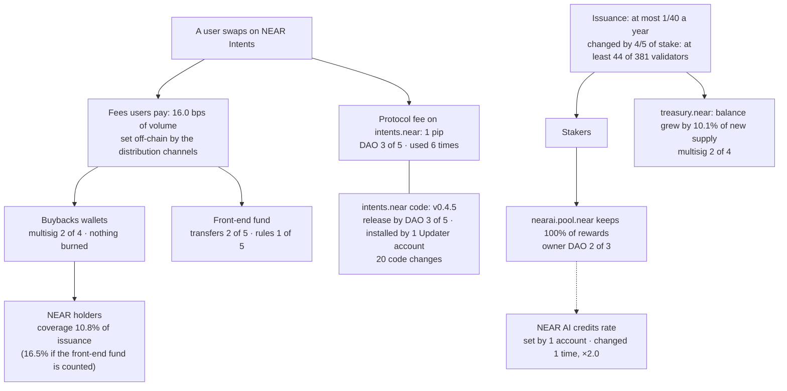

# Details

Companion to the [README](../README.md). Every marked figure here is checked against `data/numbers.json` in the same
way: `python scripts/build_numbers.py --check docs/DETAILS.md`.

## The numbers: two of value, one signal

| # | What it measures | Value | On chain? | Reproduce (no network) |
|---|---|---|---|---|
| 1 | Coverage: NEAR kept by the buybacks wallets ÷ NEAR issued, same days | **<!--n:n1.coverage_buybacks-->10.8%<!--/n-->** (<!--n:n1.buybacks_near_per_day-->9,570<!--/n--> of <!--n:n1.new_near_per_day-->88,392<!--/n--> NEAR a day) · with the front-end fund **<!--n:n1.coverage_with_front_end-->16.5%<!--/n-->** | yes: balances and block headers | `python scripts/daily.py --verify` |
| 2 | The ceiling: all fees recorded by DefiLlama ÷ issuance | **<!--n:n2.max_coverage-->47.9%<!--/n-->** · equilibrium price **<!--n:n2.equilibrium_price_usd-->$2.33<!--/n-->** | no: fees from a Dune dataset, prices from DefiLlama | `python scripts/fees.py --verify data/fees_2026-10-02_2026-11-01.json` |
| — | At stake: NEAR the wallets hold, movable by their signers | **<!--n:n1.wallets_held_near-->4,109,089<!--/n-->** (buybacks <!--n:n1.buybacks_held_near-->2,145,248<!--/n-->, front-end fund <!--n:n1.front_end_held_near-->1,963,842<!--/n-->) | yes | `python scripts/daily.py --verify` |
| 3 | Signal: how widely the NEAR AI farm is spread | **<!--n:n3.stakers_active-->112<!--/n-->** active accounts · largest **<!--n:n3.largest_share-->73.3%<!--/n-->** · top 10 <!--n:n3.top10_share-->96.4%<!--/n--> · median outside the top 10 <!--n:n3.outside_top10_median_near-->60<!--/n--> NEAR | yes, from a redacted list whose total equals the farm's; the raw positions are private | `python scripts/stakers.py --verify` |

- **1.** Balance change of `buybacks.multisignature.near` + `1csfundsadmin.sputnik-dao.near` ÷ change of
  `total_supply` between the two block headers. The front-end fund, `fefundsadmin.sputnik-dao.near`
  (<!--n:n1.front_end_near_per_day-->4,985<!--/n--> NEAR a day), holds near-intents.org's own fees, not bought-back NEAR, but DefiLlama
  counts it as buybacks: it is <!--n:f9.front_end_share_of_wallets-->34.2%<!--/n--> of what the three wallets kept, which is why number
  1 is given both ways ([fees](https://docs.near-intents.org/resources/fees)).
- **Outflow check, not a fee check.** DefiLlama's revenue ÷ issuance gives <!--n:n2.defillama_revenue_coverage-->16.5%<!--/n-->,
  as the wallets do. DefiLlama counts inflows to the same wallets and we measure their balances, so the match
  shows that almost nothing flowed out: from April to October the three wallets kept <!--n:f2.wallets_kept_share_of_revenue.2026-04_2026-10-->96.9%<!--/n--> of that revenue.
  It does not check the fees themselves.
- **2.** Each day's fees converted at that day's NEAR price, ÷ new NEAR per day; the equilibrium price is the
  NEAR price at which a day's fees buy as many NEAR as are issued. At HSP-029's target rate (issuance ×16/25) the
  ceiling would be <!--n:n2.hsp029_max_coverage-->74.8%<!--/n-->. The NEAR Intents exploit of 1 October, through the Omni
  deposit and withdrawal system (a press [report](https://crypto-economy.com/near-intents-halts-after-3-8m-exploit-vows-full-compensation-amid-hack-wave/); its figures are not checked here),
  came a day before the window; the `intents.near` DAO paused features and installed new code from 1 to 7 October
  (`data/control_history.json`). Without 2–7 October the ceiling is <!--n:n2.max_coverage_without_2026-10-02_to_07-->47.9%<!--/n-->.
- **3.** A signal, not a lever: the farm is <!--n:iv.farm_share_of_stake-->0.23%<!--/n--> of all stake (finding 5). Every account
  that ever staked through `stake.dao`, read at the block: <!--n:n3.stakers_ever-->188<!--/n--> entered, <!--n:n3.stakers_left-->76<!--/n--> have left,
  and the active positions add up exactly to the farm's total (<!--n:n3.farm_total_near-->1,364,348<!--/n--> NEAR).

Full definitions: [the three numbers](#the-three-numbers).

## Investment view (the long version)

*Dated 8 November 2026. Horizon to 1 January 2031 (about four years from the window), checked every 12 months. Thresholds are the author's
choice; every figure in them is measured.*

### The rating in full

- **Hold:** keep NEAR you already own, staked with a validator. Staking pays about <!--n:iv.staking_yield_gross-->5.0%<!--/n--> a year
  before commission while supply grows <!--n:iv.issuance_rate_per_year-->2.46%<!--/n-->, so a staked holder's share of all NEAR rises. That
  protects the share, not the dollar value.
- **Not a Buy:** what holders get from fees covers a small part of issuance, and nothing obliges anyone to keep it.
- **Upgrade to Buy** when (b) holds and, at a yearly check, (a) and (a′) hold, or (b) holds and the buybacks cover
  issuance (below). Each check measures the same 30 days of its year
  (2 October to 1 November), like this window. (a) **In dollars:** what the buybacks wallets keep a
  day has grown at least <!--n:lr.required_growth.buybacks.A.2031-->+75%<!--/n--> a year from this window's <!--n:iv.buybacks_kept_usd_per_day-->$46,692<!--/n-->, so a falling price alone
  cannot meet it. (a′) **In NEAR:** the same growth, so a rising price has not used it up. <!--n:lr.required_growth.buybacks.A.2031-->+75%<!--/n--> a year is the pace that
  covers issuance on 1 January 2031 at today's issuance rule; once validators run HSP-029, the passed proposal that
  lowers issuance from 2.5% to 1.6% a year, it is <!--n:lr.required_growth.buybacks.B.2031-->+56%<!--/n--> (<!--n:lr.required_growth.with_front_end.A.2031-->+58%<!--/n--> and <!--n:lr.required_growth.with_front_end.B.2031-->+41%<!--/n--> counting the front-end fund, which
  keeps near-intents.org's own fees). (b) Keeping it is a published rule. The hurdle depends on the
  base: with HSP-029 in force, from the April–October average it is <!--n:lr.required_growth.buybacks.B.2031.base.2026-04_2026-10-->+62%<!--/n-->; from single months, <!--n:lr.required_growth.buybacks.B.2031.base_min-->+44%<!--/n--> to <!--n:lr.required_growth.buybacks.B.2031.base_max-->+85%<!--/n-->.
- **Downgrade to Avoid** at once if the buybacks stock at the window's end (buybacks wallet, its wNEAR in Intents, 1Click fund, any declared lock: `buybacks_end` in `history.csv`) is more than 10% below its highest window end since 1 November 2026 (the drain test), and stay Avoid until it is back within 10%; or if two 30-day windows in a row, the latest and the one ending 30 days before it, each fail
  either test: the wallets keep less than 75% of the revenue DefiLlama
  attributes to NEAR, both counted in NEAR (lowest month so far: April, <!--n:f2.wallets_kept_share_of_revenue.2026-04-->77%<!--/n-->; October <!--n:f2.wallets_kept_share_of_revenue.2026-10-->100%<!--/n-->), or what the
  buybacks wallets keep in dollars falls back to April's level (<!--n:f2.buybacks_kept_usd_per_day.2026-04-->$6,270<!--/n--> a day). A rising price alone cannot
  trigger either; a falling one can trigger the second: at this window's NEAR kept a day, it fails at a price of
  <!--n:iv.avoid_test2_price_usd-->$0.655<!--/n--> or less (<!--n:iv.avoid_test2_price_change-->-86.6%<!--/n--> from the window's mean), whatever the take rate. The second test is not judged when
  DefiLlama's fees fell too and the Confidential Intents Treasury account grew (the private path, below). NEAR moved from the wallets to an account declared as a lock (the published rule of (b)), after the
  declaration, counts as kept, not as an outflow (`LOCKS` in `scripts/daily.py`; none exists yet), so meeting (b) cannot
  trigger Avoid. What a lock already holds when it is declared counts as neither.
- **Buybacks cover issuance**, with (b): in a 30-day window the buybacks wallets keep at least as many NEAR as are
  issued, so coverage is 100% or more (<!--n:n1.coverage_buybacks-->10.8%<!--/n--> in this window), on the same basis as (a). Only fees count toward it: the NEAR kept is counted up to DefiLlama's revenue
  and fees for the window, in NEAR (`coverage_counted`). The revenue cap stops a move from the front-end fund, which
  DefiLlama leaves out; a transfer from outside counts as revenue, so only the fee cap limits it, and a window in which
  the protocol treasury (`treasury.near`) sent anything cannot reach Buy at all. Coverage counts NEAR, so a
  lower price raises it only through the dollars kept: if they hold at <!--n:iv.buybacks_kept_usd_per_day-->$46,692<!--/n--> a day, at <!--n:iv.buybacks_equilibrium_price_usd-->$0.53<!--/n--> (mean <!--n:n2.mean_price_usd-->$4.88<!--/n-->) they buy
  as many NEAR as are issued, the dollar test still passes, and with (b) the rating is Buy. That is intended: the
  buybacks then do offset issuance. If instead the NEAR kept stays near today's, a lower price leaves coverage where it
  is, and at <!--n:iv.buybacks_equilibrium_price_usd-->$0.53<!--/n--> the dollars kept would be below April's <!--n:f2.buybacks_kept_usd_per_day.2026-04-->$6,270<!--/n-->, failing Avoid's dollar test. (On DefiLlama's revenue instead, <!--n:iv.revenue_equilibrium_price_usd-->$0.80<!--/n-->.)
- **Applied every day:** `scripts/rating.py` applies these rules to each 30-day window in `data/history.csv` and
  writes [`data/rating.csv`](../data/rating.csv): the rating, both Avoid tests, the earlier window, (b) and coverage. It counts
  DefiLlama's days exactly as the window's figures do, and `--verify` recomputes it with no network.
- **Which rule wins:** Avoid overrides Buy. Hold has no upper price: a rising price lowers coverage, which the
  figures show, but the rating judges what NEAR captures and whether it is a rule, not valuation upside.

**The rules as `scripts/rating.py` applies them, every day:**

| | Rule |
|---|---|
| Window | 30 days ending at 00:00 UTC. One ends every day: each row of `data/history.csv` is one window. |
| Avoid test 1: kept share | NEAR the three wallets keep (buybacks wallet, 1Click fund, front-end fund) ÷ DefiLlama's revenue for NEAR in NEAR, each day's dollars at that day's price. Fails below 75%. Not judged if DefiLlama's revenue is zero or a day is missing: test 2 then decides alone, so the rule still works if the fees leave DefiLlama's view. |
| Avoid test 2: dollars | NEAR the buybacks wallets keep (buybacks wallet and 1Click fund, not the front-end fund) × the window's mean price. Fails at or below <!--n:f2.buybacks_kept_usd_per_day.2026-04-->$6,270<!--/n--> a day, so at this window's NEAR kept it fails at a price of <!--n:iv.avoid_test2_price_usd-->$0.655<!--/n--> or less. Not judged on the private path (below). |
| A window fails | if either test fails. |
| Avoid | the latest window fails, and so does the window that ended 30 days before it, whichever test each one failed. |
| Avoid, drain test | the buybacks stock at the window's end (buybacks wallet, its wNEAR in Intents, 1Click fund, any declared lock: `buybacks_end` in `history.csv`) is more than 10% below its highest window end since 1 November 2026. No earlier window is needed. Monthly backtest rows carry no stock and are not judged on it. |
| Leaving Avoid | the rating is recomputed every day: once the latest window, or the one 30 days before it, passes, and the stock is back within 10% of its peak, the rating is Hold again (or Buy). |
| Missing data | a window missing a DefiLlama day is `incomplete`: test 1 and coverage are not judged; test 2, read from the chain at the window's mean price, still is if every day has a price. With no price either, the window counts as neither pass nor fail. |
| Private path | test 2 below its floor is `not judged` instead of `fail` when DefiLlama's fees in dollars a day are below the earlier window's (or the earlier window has none, or a day is missing) **and** the stablecoins of the Confidential Intents Treasury account (`data/confidential_treasury.json`, the account that backs balances on FAR) are higher at the window's end than at its start. Capture that moved to FAR and capture that stopped look the same on mainnet; this keeps the first from being rated as the second. It needs evidence: a window whose ends were not read stays a fail. The account is read every day from 2 October 2026 (`confidential_treasury_daily.json` after 8 November, by the daily workflow). If DefiLlama's fees held, a fall in what the buybacks keep fails whatever FAR holds. |
| Provisional | for 48 hours after its last day a window is judged but marked `provisional`, because DefiLlama revises recent days; every run re-fetches them, so the row settles by itself. |
| (b), read from the chain | a lock declared under a published rule (`LOCKS`) cannot send NEAR out on the window's end block (`daily.lock_sealed`): either no contract and no access keys, or code whose hash is in `AUDITED_CODE` and no full-access key. Function-call keys may stay with reviewed code: they cannot transfer NEAR or attach a deposit ([NEAR docs](https://docs.near.org/protocol/access-keys)). An account running a global contract shows an empty `code_hash`, so the global fields are read too; a global contract named by account never counts, because that account can replace it. A hash is listed only with a public review showing that no call can make the lock transfer, attach a deposit, delete itself, add a key or deploy code. `AUDITED_CODE` is empty. Read for each window, so it is never true before the block where it became true, and it stops being true when the code or the keys change. |
| Coverage counted | NEAR the buybacks wallets keep a day, at most DefiLlama's revenue and at most its fees for the window (both in NEAR), ÷ NEAR issued. The revenue cap stops moves between the three wallets, which DefiLlama leaves out; a transfer from outside counts as DefiLlama revenue, so only the fee cap limits it. A window missing a DefiLlama day is not judged. |
| `treasury.near` quiet | the protocol treasury sent nothing in the window: its multisig request nonce (`get_request_nonce`) is the same at both boundary blocks and it has no full-access key, read from the chain each day (`treasury_quiet` in `data/rating.csv`). With no full-access key, every transfer out of it needs a request, and the nonce counts every request ever made. A window not quiet, or not read, cannot reach Buy. |
| Buy | (b), `treasury.near` quiet in the window, and either its coverage counted is 100% or more, or (a) and (a′) hold at the yearly check, the window ending on 1 November. |
| Hurdle of (a) | from <!--n:iv.buybacks_kept_usd_per_day-->$46,692<!--/n--> a day: <!--n:lr.required_growth.buybacks.A.2031-->+75%<!--/n--> a year while validators do not run HSP-029, <!--n:lr.required_growth.buybacks.B.2031-->+56%<!--/n--> once they do (`HSP029_IN_FORCE`, set when `scripts/upgrade_watch.py` shows the release adopted). A pass at a yearly check holds until the next one. |
| Cannot be judged | Hold. Until 1 December 2026 no window has one 30 days before it in `history.csv`, so the two window tests cannot fire before then; the windows ending 1–9 November passed and are final, so in fact not before 10 December. The drain test can fire any day. |

If NEAR kept every fee, fees counted in NEAR would need <!--n:lr.required_growth.all_fees.B.2031-->+9%<!--/n--> a year with HSP-029, <!--n:lr.required_growth.all_fees.A.2031-->+22%<!--/n--> at today's rule ([the model](#issuance-to-2031)).

**Why coverage, for a staked holder.** Coverage is the buyback yield divided by the issuance rate: the wallets keep <!--n:iv.buyback_yield_buybacks-->0.27%<!--/n--> of NEAR's value a year (<!--n:iv.buyback_yield_with_front_end-->0.41%<!--/n--> with the front-end fund), against <!--n:iv.issuance_rate_per_year-->2.46%<!--/n--> issued.
Staking moves issuance from unstaked holders to staked ones; buybacks are the only part of the return paid with
money from outside, so they are what all holders share. They burn nothing, so total supply grows by the full <!--n:iv.issuance_rate_per_year-->2.46%<!--/n--> and an unstaked holder's share of all NEAR changes <!--n:iv.unstaked_share_change-->-2.40%<!--/n--> a year whatever they do; while the wallets never sell, the NEAR outside them grows about <!--n:iv.net_dilution_buybacks-->2.20%<!--/n--> a year. Coverage
falls when the price rises and revenue does not: each dollar buys back a smaller part of a dearer NEAR. In dollars,
April to October: fees <!--n:lr.history.2026-04_2026-10.fees_usd_multiple-->×1.9<!--/n-->, revenue <!--n:lr.history.2026-04_2026-10.revenue_usd_multiple-->×8.2<!--/n-->, volume <!--n:lr.history.2026-04_2026-10.volume_usd_multiple-->×2.0<!--/n-->, kept by the buybacks wallets <!--n:lr.history.2026-04_2026-10.buybacks_kept_usd_multiple-->×7.5<!--/n--> (<!--n:lr.history.2026-04_2026-10.buybacks_kept_near_multiple-->×2.1<!--/n--> as much NEAR a day, at a <!--n:lr.history.2026-04_2026-10.mean_price_multiple-->×3.6<!--/n--> price); the NEAR price rose faster than fees, so fees counted in NEAR fell (<!--n:lr.history.2026-04_2026-10.fees_near_multiple-->×0.5<!--/n-->). The NEAR kept did not rise steadily: a day, month by month from April, <!--n:f1.buybacks_kept_near_per_day.2026-04-->4,675<!--/n-->, <!--n:f1.buybacks_kept_near_per_day.2026-05-->7,353<!--/n-->, <!--n:f1.buybacks_kept_near_per_day.2026-06-->7,463<!--/n-->, <!--n:f1.buybacks_kept_near_per_day.2026-07-->5,451<!--/n-->, <!--n:f1.buybacks_kept_near_per_day.2026-08-->8,972<!--/n-->, <!--n:f1.buybacks_kept_near_per_day.2026-09-->13,478<!--/n--> and <!--n:f1.buybacks_kept_near_per_day.2026-10-->9,589<!--/n--> NEAR, October <!--n:f1.change.2026-09_2026-10.buybacks_kept_near-->-29%<!--/n--> on September.

### Who gets what

At the end block <!--n:c.issuance_staked_share-->45.2%<!--/n--> of supply (<!--n:c.issuance_total_stake_near-->592,027,869<!--/n--> NEAR) is
staked with validators. What each holder gets:

| Holder | NEAR received | What changes |
|---|---|---|
| Not staked | none | owns a smaller share as supply grows <!--n:iv.issuance_rate_per_year-->2.46%<!--/n--> a year; the buybacks offset <!--n:iv.buybacks_offset_points_per_year-->0.27<!--/n--> points of it in the supply outside their wallets |
| Staked with a validator | about <!--n:iv.staking_yield_gross-->5.0%<!--/n--> a year, before the validator's commission | keeps pace with issuance |
| Staked in the NEAR AI farm | none: `nearai.pool.near` keeps <!--n:c.nearai_pool_reward_fee-->100%<!--/n--> of rewards | credits instead (finding 5) |

| Condition | Today | Met when | Measured by |
|---|---|---|---|
| Coverage | <!--n:n1.coverage_buybacks-->10.8%<!--/n--> (<!--n:n1.coverage_with_front_end-->16.5%<!--/n--> with the front-end fund) | the wallets keep as much NEAR as is issued: what they keep grows <!--n:iv.wallets_multiple_buybacks-->×9.2<!--/n--> (<!--n:iv.wallets_multiple_with_front_end-->×6.1<!--/n-->), or, with every fee kept, fees <!--n:iv.fees_multiple-->×2.1<!--/n--> | `data/history.csv`, daily |
| **(b)** A rule, not a choice | a <!--n:c.buybacks_confirmations-->2 of 4<!--/n--> multisig, nothing burned | bought NEAR moves by a published rule to an account no one can spend from | `scripts/daily.py` (`sealed`: the lock's code and keys, every window) |
| (c) Signal: stake spread | largest account <!--n:n3.largest_share-->73.3%<!--/n--> of the farm | the largest holds less than half | `scripts/stakers.py` |

Coverage, the growth test (a) and the rule (b) decide the rating; (c) does not, because stake cannot offset issuance: stakers are the ones who receive
the new NEAR. Buybacks pay for NEAR with money from outside, the fees users pay, but they offset issuance only in
the supply outside their wallets, and only while the NEAR stays there: total supply grows either way.

**The lever model.** Coverage if each lever were pulled in turn; only the last step is a rule. The
[dashboard](https://nikolaskahris-png.github.io/near-thesis-data/dashboard/#p3b) re-runs it with your own assumptions.

| Step | Coverage | Who moves the lever |
|---|---|---|
| Today: the buybacks wallets keep <!--n:iv.wallets_share_of_fees_buybacks-->22.6%<!--/n--> of all fees | <!--n:n1.coverage_buybacks-->10.8%<!--/n--> | a <!--n:c.buybacks_confirmations-->2 of 4<!--/n--> multisig; a choice |
| + the front-end fund (the three wallets keep <!--n:iv.wallets_share_of_fees_with_front_end-->34.4%<!--/n--> of all fees in NEAR; not the take rate, which is revenue ÷ fees in dollars) | <!--n:n1.coverage_with_front_end-->16.5%<!--/n--> | its DAO, transfers <!--n:c.front_end_transfer-->2 of 5<!--/n-->; a choice |
| + every fee kept by NEAR | <!--n:n2.max_coverage-->47.9%<!--/n--> | the distribution channels off-chain, or the protocol fee by DAO (<!--n:c.intents_fee_change-->3 of 5<!--/n-->); a choice |
| + HSP-029 at the end of its 24-month ramp | <!--n:n2.hsp029_max_coverage-->74.8%<!--/n--> | validators with <!--n:c.issuance_upgrade_stake_threshold-->4/5<!--/n--> of stake; a rule once they run it |
| Full coverage | 100% | fees grow a further <!--n:iv.hsp029_fees_multiple-->×1.3<!--/n-->, or NEAR at or below <!--n:n2.hsp029_equilibrium_price_usd-->$3.64<!--/n--> |

### Issuance to 2031, in short

`scripts/longrun.py` steps total supply one epoch at a time under today's rule (A: at most 1/40 a year) and under
HSP-029 (B: 2.5% → 1.6% over 24 months, from <!--n:lr.activation_utc-->2027-02-14 16:48 UTC<!--/n-->, 90 days after its timelock ends),
holding the window's ratio of actual to maximum issuance. It forecasts no price, volume or fee: it gives the yearly
growth that the NEAR kept a day must reach to equal issuance on 1 January of each year.

| Covered on 1 January | Issuance a day, A → B | Buybacks wallets alone must grow, A / B | With the front-end fund, A / B | All fees in NEAR must grow, A / B |
|---|---|---|---|---|
| 2028 | <!--n:lr.issuance_per_day.A.2028-->90,968<!--/n--> → <!--n:lr.issuance_per_day.B.2028-->76,482<!--/n--> | <!--n:lr.required_growth.buybacks.A.2028-->+589%<!--/n--> / <!--n:lr.required_growth.buybacks.B.2028-->+494%<!--/n--> a year | <!--n:lr.required_growth.with_front_end.A.2028-->+381%<!--/n--> / <!--n:lr.required_growth.with_front_end.B.2028-->+315%<!--/n--> | <!--n:lr.required_growth.all_fees.A.2028-->+93%<!--/n--> / <!--n:lr.required_growth.all_fees.B.2028-->+66%<!--/n--> |
| 2029 | <!--n:lr.issuance_per_day.A.2029-->93,242<!--/n--> → <!--n:lr.issuance_per_day.B.2029-->61,230<!--/n--> | <!--n:lr.required_growth.buybacks.A.2029-->+186%<!--/n--> / <!--n:lr.required_growth.buybacks.B.2029-->+135%<!--/n--> a year | <!--n:lr.required_growth.with_front_end.A.2029-->+135%<!--/n--> / <!--n:lr.required_growth.with_front_end.B.2029-->+94%<!--/n--> | <!--n:lr.required_growth.all_fees.A.2029-->+44%<!--/n--> / <!--n:lr.required_growth.all_fees.B.2029-->+19%<!--/n--> |
| 2031 | <!--n:lr.issuance_per_day.A.2031-->97,948<!--/n--> → <!--n:lr.issuance_per_day.B.2031-->61,108<!--/n--> | <!--n:lr.required_growth.buybacks.A.2031-->+75%<!--/n--> / <!--n:lr.required_growth.buybacks.B.2031-->+56%<!--/n--> a year | <!--n:lr.required_growth.with_front_end.A.2031-->+58%<!--/n--> / <!--n:lr.required_growth.with_front_end.B.2031-->+41%<!--/n--> | <!--n:lr.required_growth.all_fees.A.2031-->+22%<!--/n--> / <!--n:lr.required_growth.all_fees.B.2031-->+9%<!--/n--> |

Keeping every fee instead of today's share can add <!--n:lr.take_rate_ceiling_multiple-->×2.9<!--/n-->, once; the rest must come from fees
that grow faster than the NEAR price. From April to October what the wallets kept rose <!--n:lr.history.2026-04_2026-10.kept_multiple-->×2.9<!--/n-->, but fees counted in NEAR fell (<!--n:lr.history.2026-04_2026-10.fees_near_multiple-->×0.5<!--/n-->): the rise came from the share
kept (take rate <!--n:lr.history.2026-04_2026-10.take_rate_multiple-->×4.2<!--/n-->), the lever with a ceiling. If HSP-029 starts six months late, covering
2029 needs <!--n:lr.required_growth.all_fees.B_late.2029-->+26%<!--/n--> a year instead of <!--n:lr.required_growth.all_fees.B.2029-->+19%<!--/n-->. For scale, HSP-027 took <!--n:pr.v87.days_from_hsp027_passed-->124<!--/n--> days from its vote to effect (finding 3); the model's start for HSP-029 is a
shorter span from its vote. The model's HSP-029 cut over six years, <!--n:lr.not_issued_B.6y-->66.35M<!--/n--> NEAR, is within <!--n:lr.not_issued_B_vs_proposal.6y-->+0.4%<!--/n--> of the proposal's own figure.

**The base matters.** The table starts from the window's level, October. Starting instead from each month since April,
the buybacks wallets' 2031 hurdle under HSP-029 runs from <!--n:lr.required_growth.buybacks.B.2031.base_min-->+44%<!--/n--> to <!--n:lr.required_growth.buybacks.B.2031.base_max-->+85%<!--/n--> a year; from the
April–October average, <!--n:lr.required_growth.buybacks.B.2031.base.2026-04_2026-10-->+62%<!--/n--> (with the front-end fund <!--n:lr.required_growth.with_front_end.B.2031.base.2026-04_2026-10-->+50%<!--/n-->). October sits
inside that range, and the April–October average asks for more than October does. Every year, month and column: [details](#issuance-to-2031).

**Scenarios in dollars.** If what is kept grows at a steady yearly rate in dollars from the window's level, issuance
on 1 January 2031 is covered at any NEAR price up to:

| Growth in dollars, a year | Buybacks wallets: HSP-029 (today's rule) | With the front-end fund | Every fee kept |
|---|---|---|---|
| flat | <!--n:lr.scenario.0.cover_price.buybacks.B.2031-->$0.76<!--/n--> (<!--n:lr.scenario.0.cover_price.buybacks.A.2031-->$0.48<!--/n-->) | <!--n:lr.scenario.0.cover_price.with_front_end.B.2031-->$1.16<!--/n--> | <!--n:lr.scenario.0.cover_price.all_fees.B.2031-->$3.37<!--/n--> |
| +25% | <!--n:lr.scenario.25.cover_price.buybacks.B.2031-->$1.94<!--/n--> (<!--n:lr.scenario.25.cover_price.buybacks.A.2031-->$1.21<!--/n-->) | <!--n:lr.scenario.25.cover_price.with_front_end.B.2031-->$2.94<!--/n--> | <!--n:lr.scenario.25.cover_price.all_fees.B.2031-->$8.54<!--/n--> |
| +50% | <!--n:lr.scenario.50.cover_price.buybacks.B.2031-->$4.14<!--/n--> (<!--n:lr.scenario.50.cover_price.buybacks.A.2031-->$2.58<!--/n-->) | <!--n:lr.scenario.50.cover_price.with_front_end.B.2031-->$6.30<!--/n--> | <!--n:lr.scenario.50.cover_price.all_fees.B.2031-->$18.27<!--/n--> |
| +100% | <!--n:lr.scenario.100.cover_price.buybacks.B.2031-->$13.73<!--/n--> (<!--n:lr.scenario.100.cover_price.buybacks.A.2031-->$8.56<!--/n-->) | <!--n:lr.scenario.100.cover_price.with_front_end.B.2031-->$20.88<!--/n--> | <!--n:lr.scenario.100.cover_price.all_fees.B.2031-->$60.57<!--/n--> |

Against a mean price of <!--n:n2.mean_price_usd-->$4.88<!--/n--> in the window. The rates are the author's choice and none is a forecast; for scale,
from April to October revenue grew <!--n:lr.history.2026-04_2026-10.revenue_usd_multiple-->×8.2<!--/n--> and fees <!--n:lr.history.2026-04_2026-10.fees_usd_multiple-->×1.9<!--/n--> in dollars, over six months that are not
annualized here.

**When to check:** 6, 8 and 16
November and 9 and 11 December 2026 (the predictions), every day in `data/rating.csv`, and each November to 2031 against the [2031 table](#issuance-to-2031).

**Valuation, same window.** All NEAR in `total_supply` at the window's mean price
(<!--n:n2.mean_price_usd-->$4.88<!--/n-->) is worth <!--n:iv.supply_value_usd-->$6.39B<!--/n-->. CoinGecko's circulating supply equals total supply ([`data/raw/peers/`](../data/raw/peers/)), so NEAR's market cap
differs from this value only by the price.

| A year of | Dollars | Value ÷ that |
|---|---|---|
| Fees users pay (DefiLlama) | <!--n:iv.fees_usd_per_year-->$75.3M<!--/n--> | <!--n:iv.value_to_fees-->85×<!--/n--> |
| Revenue DefiLlama counts as NEAR's | <!--n:iv.revenue_usd_per_year-->$25.8M<!--/n--> | <!--n:iv.value_to_revenue-->248×<!--/n--> |
| NEAR kept by the three wallets, on chain | <!--n:iv.wallets_kept_usd_per_year-->$25.9M<!--/n--> | <!--n:iv.value_to_wallets_kept-->247×<!--/n--> |
| Issuance, for comparison | <!--n:iv.issuance_usd_per_year-->$157.5M<!--/n--> | — |

### Three paths to 2031

What a holder's dollars do from the window to 1 January 2031 is (1 + the change in their share of all NEAR) × (the
value of all NEAR in 2031 ÷ its value now) − 1. The share change is measured (+<!--n:iv.to2031.staked_share_change-->10.6%<!--/n--> staked, <!--n:iv.to2031.unstaked_share_change-->-9.6%<!--/n--> not
staked, at today's rates). The value is not, so the README sets out three paths, each built only from figures here
(`sc.*` in `numbers.json`, `scripts/build_numbers.py`). They are stated, not forecast, and carry no probability.

| Path | How the value of all NEAR in 2031 is set | Value | Change | Staked, $ | Not staked, $ |
|---|---|---|---|---|---|
| Bear | the buybacks stop; NEAR is valued on its L1 gas revenue alone (<!--n:peer.near_l1.revenue_usd_per_year-->$1.6M<!--/n--> a year, held) at <!--n:sc.l1_peer_median_multiple-->2,695×<!--/n-->, the median market cap ÷ revenue of Aptos, Solana, Ethereum and Sui in the table below | <!--n:sc.bear.value_usd-->$4.21B<!--/n--> | <!--n:sc.bear.value_change-->-34%<!--/n--> | <!--n:sc.bear.staked_usd_change-->-27%<!--/n--> | <!--n:sc.bear.unstaked_usd_change-->-40%<!--/n--> |
| Base | unchanged in dollars | <!--n:sc.base.value_usd-->$6.39B<!--/n--> | <!--n:sc.base.value_change-->0%<!--/n--> | +<!--n:sc.base.staked_usd_change-->11%<!--/n--> | <!--n:sc.base.unstaked_usd_change-->-10%<!--/n--> |
| Bull | Intents' revenue grows at Buy's (a) pace, <!--n:lr.required_growth.buybacks.A.2031-->+75%<!--/n--> a year (<!--n:sc.bull.capture_multiple-->×10.2<!--/n--> by 2031), gas revenue held, and the value stays at <!--n:peer.near_all.mcap_to_revenue-->234×<!--/n--> a year of revenue | <!--n:sc.bull.value_usd-->$62.04B<!--/n--> | +<!--n:sc.bull.value_change-->871%<!--/n--> | +<!--n:sc.bull.staked_usd_change-->973%<!--/n--> | +<!--n:sc.bull.unstaked_usd_change-->777%<!--/n--> |

"Now" is the window's mean price (<!--n:peer.near_all.market_cap_usd-->$6.39B<!--/n-->). At the price of the peers fetch (<!--n:peer.near_all.market_cap_at_fetch_usd-->$4.86B<!--/n-->) the bear path is
<!--n:sc.bear.value_change.at_fetch-->-13%<!--/n--> (<!--n:sc.bear.staked_usd_change.at_fetch-->-4%<!--/n--> staked, <!--n:sc.bear.unstaked_usd_change.at_fetch-->-22%<!--/n--> not staked); base and bull are ratios to "now" and do not change. Limits: the bear
path holds gas revenue and the peers' multiples at the window's; the bull path holds NEAR's multiple, which
counts Intents; neither includes HSP-029 or a price for the NEAR the wallets hold.

### Why public coverage figures differ

Other submissions report 12% to 19% for what holders get against new NEAR. The figures differ by definition, each read from that repository's README at the commit linked:

| Repository | Figure | What is counted | Against | Period |
|---|---|---|---|---|
| This one | <!--n:n1.coverage_buybacks-->10.8%<!--/n--> | NEAR the two buybacks wallets kept | the change in total supply (issuance net of burned gas) | 2 Oct – 1 Nov |
| This one, three wallets | <!--n:n1.coverage_with_front_end-->16.5%<!--/n--> | the same, plus the front-end fund | the same | the same |
| [NePu](https://github.com/Axlnd3r/NePu/blob/eb9fe84/README.md) | 12 cents per dollar | buybacks or gas burn | new NEAR issued, in dollars | 30 days to 31 Oct |
| [NearThesis](https://github.com/AbdeldjalilChougui/NearThesis/blob/786865e/README.md) | 18.6% | dollars burned plus dollars of Intents buybacks | dollars issued (change in supply plus burn), day by day | 90 days |
| [near-thesis-lab](https://github.com/wwaterfall2027/near-thesis-lab/blob/f0dc113/README.md) | 19% | annualised 30-day captured revenue | net new NEAR × price | 30 days |

Like for like with the three wallets, ours is the 16.5%. The others are higher because they add burned gas or count revenue rather than the wallets' balances, over other days.

### Peers on one basis

DefiLlama's revenue and holders' revenue (what is paid to token holders: buybacks, or for an L1 the gas that is
burned) over the window's 30 days, a year, against each token's market cap at its mean price over the same 30 days:
CoinGecko's supply at <!--n:peer.value_as_of-->2026-11-06 20:31 UTC<!--/n--> (its market cap ÷ its price at that fetch) × the daily prices NEAR's figures use (coins.llama.fi). Each row is DefiLlama's
revenue for that token (`scripts/peers.py`). The other L1s' rows are their chains' own revenue, without their apps;
NEAR's bold row adds Intents, part of whose fees buys NEAR back, so NEAR's L1 gas alone is shown too, like for like.

| Token | Market cap | Revenue a year | Market cap ÷ revenue | Paid to holders a year ÷ market cap |
|---|---|---|---|---|
| *Apps* | | | | |
| NEAR, Intents only | <!--n:peer.near.market_cap_usd-->$6.39B<!--/n--> | <!--n:peer.near.revenue_usd_per_year-->$25.8M<!--/n--> | <!--n:peer.near.mcap_to_revenue-->248×<!--/n--> | <!--n:peer.near.holders_yield_on_mcap-->0.40%<!--/n--> |
| Hyperliquid (HYPE) | <!--n:peer.hyperliquid.market_cap_usd-->$19.99B<!--/n--> | <!--n:peer.hyperliquid.revenue_usd_per_year-->$817.6M<!--/n--> | <!--n:peer.hyperliquid.mcap_to_revenue-->24×<!--/n--> | <!--n:peer.hyperliquid.holders_yield_on_mcap-->4.09%<!--/n--> |
| Aave (AAVE) | <!--n:peer.aave.market_cap_usd-->$2.41B<!--/n--> | <!--n:peer.aave.revenue_usd_per_year-->$61.3M<!--/n--> | <!--n:peer.aave.mcap_to_revenue-->39×<!--/n--> | <!--n:peer.aave.holders_yield_on_mcap-->0.00%<!--/n--> |
| Jupiter (JUP) | <!--n:peer.jupiter.market_cap_usd-->$1.04B<!--/n--> | <!--n:peer.jupiter.revenue_usd_per_year-->$43.8M<!--/n--> | <!--n:peer.jupiter.mcap_to_revenue-->24×<!--/n--> | <!--n:peer.jupiter.holders_yield_on_mcap-->2.10%<!--/n--> |
| *L1s* | | | | |
| **NEAR, Intents and L1 gas** | <!--n:peer.near_all.market_cap_usd-->$6.39B<!--/n--> | <!--n:peer.near_all.revenue_usd_per_year-->$27.4M<!--/n--> | <!--n:peer.near_all.mcap_to_revenue-->234×<!--/n--> | <!--n:peer.near_all.holders_yield_on_mcap-->0.43%<!--/n--> |
| NEAR, L1 gas only | <!--n:peer.near_l1.market_cap_usd-->$6.39B<!--/n--> | <!--n:peer.near_l1.revenue_usd_per_year-->$1.6M<!--/n--> | <!--n:peer.near_l1.mcap_to_revenue-->4,091×<!--/n--> | <!--n:peer.near_l1.holders_yield_on_mcap-->0.02%<!--/n--> |
| Aptos (APT) | <!--n:peer.aptos.market_cap_usd-->$684.0M<!--/n--> | <!--n:peer.aptos.revenue_usd_per_year-->$1.6M<!--/n--> | <!--n:peer.aptos.mcap_to_revenue-->426×<!--/n--> | <!--n:peer.aptos.holders_yield_on_mcap-->0.23%<!--/n--> |
| Solana (SOL) | <!--n:peer.solana.market_cap_usd-->$63.54B<!--/n--> | <!--n:peer.solana.revenue_usd_per_year-->$31.8M<!--/n--> | <!--n:peer.solana.mcap_to_revenue-->1,995×<!--/n--> | <!--n:peer.solana.holders_yield_on_mcap-->0.05%<!--/n--> |
| Ethereum (ETH) | <!--n:peer.ethereum.market_cap_usd-->$301.31B<!--/n--> | <!--n:peer.ethereum.revenue_usd_per_year-->$88.8M<!--/n--> | <!--n:peer.ethereum.mcap_to_revenue-->3,394×<!--/n--> | <!--n:peer.ethereum.holders_yield_on_mcap-->0.03%<!--/n--> |
| Sui (SUI) | <!--n:peer.sui.market_cap_usd-->$4.28B<!--/n--> | <!--n:peer.sui.revenue_usd_per_year-->$0.3M<!--/n--> | <!--n:peer.sui.mcap_to_revenue-->16,884×<!--/n--> | <!--n:peer.sui.holders_yield_on_mcap-->0.01%<!--/n--> |

The two groups point opposite ways. Against the apps, NEAR's value is many more years of its revenue and its
holders receive a fraction of what HYPE and JUP holders do. Against the L1s, NEAR with Intents has the lowest
market cap ÷ revenue of the five (<!--n:peer.near_l1.mcap_to_revenue-->4,091×<!--/n--> on L1 gas alone, above Ethereum), and DefiLlama counts the largest share for its holders (held in
wallets, not paid out). L1 tokens are not priced on
fees: Ethereum's market cap is <!--n:peer.ethereum.mcap_to_revenue-->3,394×<!--/n--> a year of its revenue. So the table does not say NEAR is mispriced. It says
that today's fee capture explains little of NEAR's value, which is the thesis, and that Intents gives NEAR
more revenue per dollar of value than the other L1s here, which is the bull case. No rating rule uses this table. The README names the gap to Hyperliquid as one reason not to add NEAR now: a judgment, not a rule. Hyperliquid's market cap counts its circulating tokens only; on fully diluted value its holders' revenue is <!--n:peer.hyperliquid.holders_yield_on_fdv-->1.03%<!--/n--> a year, NEAR's <!--n:peer.near.holders_yield_on_fdv-->0.40%<!--/n-->.

Value and revenue cover the same days, so NEAR's Intents row, <!--n:peer.near.mcap_to_revenue-->248×<!--/n-->, is the value ÷ revenue of the
[valuation](#investment-view-the-long-version) above (<!--n:iv.value_to_revenue-->248×<!--/n-->). NEAR's fees, revenue and mean price here equal the window's to 0.1%, a check of every build. At the fetch's
price (NEAR <!--n:peer.near.price_usd-->$3.71<!--/n-->, against a mean of <!--n:n2.mean_price_usd-->$4.88<!--/n-->) NEAR with Intents would be <!--n:peer.near_all.mcap_at_fetch_to_revenue-->178×<!--/n-->. NEAR's paid-to-holders figure is DefiLlama's:
it counts the front-end fund, and nothing is paid out (the NEAR stays in the wallets). Counted in NEAR, the buybacks wallets alone take in <!--n:iv.buyback_yield_buybacks-->0.27%<!--/n--> of all NEAR a year.
DefiLlama counts no holders' revenue for Aave, whose buybacks are paid from its treasury. Fees and fully diluted
values: [details](#peers).

### The same rules on four other protocols

Are the rules built so that everything comes out Hold? `scripts/peers_rating.py` applies the same tests to Hyperliquid, Pump.fun, Aave and Jupiter, and prints each before the rating. Their inputs come from their docs, the press and DefiLlama, over the same window; we did not read their chains. Tokens bought a year are DefiLlama's holders' revenue a year divided by the mean price.

| | Gate 1: lock | Bought a year | New a year (basis) | Gate 3: coverage | Rating |
|---|---|---|---|---|---|
| Hyperliquid | <!--n:sr.hyperliquid.lock-->yes<!--/n--> | <!--n:sr.hyperliquid.bought_per_year-->9.79M<!--/n--> HYPE | <!--n:sr.hyperliquid.basis1.new_per_year-->9.48M<!--/n--> (staking, docs' 400M) | <!--n:sr.hyperliquid.basis1.coverage-->103%<!--/n--> | <!--n:sr.hyperliquid.basis1.rating-->Buy<!--/n--> |
| | | | <!--n:sr.hyperliquid.basis2.new_per_year-->9.94M<!--/n--> (staking, 440M reported) | <!--n:sr.hyperliquid.basis2.coverage-->98%<!--/n--> | <!--n:sr.hyperliquid.basis2.rating-->Hold<!--/n--> |
| | | | <!--n:sr.hyperliquid.basis3.new_per_year-->13.4M<!--/n--> (+ team claims as announced) | <!--n:sr.hyperliquid.basis3.coverage-->73%<!--/n--> | <!--n:sr.hyperliquid.basis3.rating-->Hold<!--/n--> |
| | | | <!--n:sr.hyperliquid.basis4.new_per_year-->128.5M<!--/n--> (+ team unlocks on schedule) | <!--n:sr.hyperliquid.basis4.coverage-->8%<!--/n--> | <!--n:sr.hyperliquid.basis4.rating-->Hold<!--/n--> |
| Pump.fun | <!--n:sr.pump.lock-->no<!--/n--> (contract not reviewed) | <!--n:sr.pump.bought_per_year-->67.9B<!--/n--> PUMP | <!--n:sr.pump.basis2.new_per_year-->82.5B<!--/n--> (insider unlocks on schedule) | <!--n:sr.pump.basis2.coverage-->82%<!--/n--> | <!--n:sr.pump.rating-->Hold<!--/n--> |
| Aave | <!--n:sr.aave.lock-->no<!--/n--> | <!--n:sr.aave.bought_per_year-->0<!--/n--> (DefiLlama counts none) | not needed | — | <!--n:sr.aave.rating-->Hold<!--/n--> |
| Jupiter | <!--n:sr.jupiter.lock-->no<!--/n--> | <!--n:sr.jupiter.bought_per_year-->69.7M<!--/n--> JUP | <!--n:sr.jupiter.basis1.new_per_year-->0<!--/n--> (no new team tokens or airdrop) | no new JUP | <!--n:sr.jupiter.rating-->Hold<!--/n--> |

What each input rests on (saved pages, checked by `python scripts/quotes.py --verify`):

- **Hyperliquid.** Its docs: "The assistance fund uses the system address" and "HYPE in the assistance fund is burned". Staking pays new HYPE: "Staking rewards come from the future emissions reserve", and "the reward rate is approximately 2.37% per year" at 400M staked, falling with the square root of stake. Reported stake: "approximately 440 million HYPE tokens are staked" (Crypto Briefing). Team tokens: "9,916,666 HYPE" a month on the whitepaper's schedule, against "330,000 HYPE" claimed in April (Tokenomist).
- **Pump.fun.** Since April 2026 half its net revenue goes "to an irreversible smart contract" that buys and burns PUMP for a year (index.vn). The Buy rule counts a contract only once we have reviewed its code, and we have not. Insider unlocks: "6.875 billion PUMP tokens are scheduled to hit the market" on 12 August 2026, then monthly on a "three-year linear release cycle" (KuCoin).
- **Aave.** Bought AAVE goes to the Ecosystem Reserve, "a DAO-held balance that can be paid out again later" (BloFin).
- **Jupiter.** Bought JUP sits in the Litterbox Trust; the DAO decides whether to "continue to burn the ongoing additions to the Litterbox Trust" (Jupiter's forum). After the February 2026 vote, the schedule "shows no airdrop and no new team tokens" (Tokenomist, read 29 October 2026).

Not applied: the growth leg (+75% a year), which needs a year of their history; `treasury.near` and the two 30-day revenue floors, which are NEAR's own; and the drain test, which needs their balances read on their chains, so none can be rated Avoid here.

What it shows: the rules can give Buy. Hyperliquid, which has a lock, sits on the line between Buy and Hold on the definition NEAR is measured by, and falls well short once its team's unlocks count. NEAR fails the lock first, then coverage by <!--n:iv.wallets_multiple_buybacks-->×9.2<!--/n-->.

## The README in full (version 5, 12 November)

The README was cut again on 12 November, to about 2,300 words. Its longer sections are kept here as they were before the cut, with every figure still marked and checked: each claim with its "Against", every note on the rules, all the objections and terms. "This page" below means the README.

### v5: The thesis in four claims

Each marked figure comes from [`data/numbers.json`](../data/numbers.json), and a check fails if one differs. Each claim in full, with every source: [long version](#v4-the-thesis-in-four-claims).

#### v5: A. The demand is real

NEAR Intents moved <!--n:d.ours_30d_usd-->$4.02B<!--/n--> in the 30 days to <!--n:d.window_end-->7 November<!--/n-->, <!--n:d.parent_rank-->15th<!--/n--> of <!--n:d.parent_groups_with_volume-->885<!--/n--> protocols by DEX volume on DefiLlama. Users paid <!--n:n2.fees_usd_per_day-->$206,049<!--/n--> a day in fees in the window, <!--n:n2.fees_bps-->16.0<!--/n--> bps of volume, most of it to the apps that route swaps; the contract's own fee is <!--n:c.intents_fee_pips-->1 pip<!--/n-->.

**Against.** Volume and fees are DefiLlama's, not rebuilt from the chain. In NEAR, fees halved (<!--n:lr.history.2026-04_2026-10.fees_near_multiple-->×0.5<!--/n-->) from April to October while the price rose <!--n:lr.history.2026-04_2026-10.mean_price_multiple-->×3.6<!--/n-->. Two other public repositories count what they see on chain at 46% of DefiLlama's volume (all swaps, six sampled days) and 24% (stablecoin legs only), so DefiLlama may count both sides of a swap or swaps on the private path; coverage and the rating use fees and wallet balances, not volume.

**Check.** `python scripts/demand.py --verify` → `OK`.

#### v5: B. It is small

Each day the buybacks wallets keep <!--n:n1.buybacks_near_per_day-->9,570<!--/n--> NEAR, against <!--n:n1.new_near_per_day-->88,392<!--/n--> new NEAR issued: coverage <!--n:n1.coverage_buybacks-->10.8%<!--/n-->. If NEAR kept every fee, third-party apps' included, coverage would be <!--n:n2.max_coverage-->47.9%<!--/n-->; fees alone would cover issuance only at a NEAR price of <!--n:n2.equilibrium_price_usd-->$2.33<!--/n--> or less. New NEAR adds <!--n:iv.issuance_rate_per_year-->2.46%<!--/n--> to supply a year.

**Against.** Coverage is counted in NEAR and revenue is earned in dollars, so coverage falls when the price rises. In dollars the buybacks kept <!--n:lr.history.2026-04_2026-10.buybacks_kept_usd_multiple-->×7.5<!--/n--> as much a day in October as in April.

**Check.** `python scripts/daily.py --verify`; `python scripts/coverage.py --verify`. Each ends with `OK`.

#### v5: C. It is a policy, not a rule

Nothing in code burns, locks or requires the buybacks:

1. **The NEAR they hold can move.** The <!--n:n1.wallets_held_near-->4,109,089<!--/n--> NEAR in the three revenue wallets moves with <!--n:c.buybacks_confirmations-->2 of 4<!--/n--> signers for each buybacks wallet and <!--n:c.front_end_transfer-->2 of 5<!--/n--> for the front-end fund.
2. **A passed vote is not yet a rule.** HSP-027 passed on 3 July 2026 and reached the chain <!--n:pr.v87.days_from_hsp027_passed-->124<!--/n--> days later, once validators ran a release. HSP-029, the issuance cut, passed on 2 November and waits for the same step.
3. **Other links work the same way.** The protocol treasury and NEAR AI's staking pool and credits are also set by a few accounts. The rating does not use them ([the other links](#the-control-map-other-links)).

**Against.** The policy has been kept: from April to October the three wallets held on to <!--n:f2.wallets_kept_share_of_revenue.2026-04_2026-10-->96.9%<!--/n--> of what flowed in. Holding a reserve rather than burning is a stated choice (a co-founder's [sovereign-fund post](https://gov.near.org/t/near-governance-discussion-sovereign-fund/42419), 3 August 2026); we rate whether it is fixed, not whether it is wise. A policy kept for years is worth almost as much as a rule, so the gap costs Buy, not Hold.

**Check.** `python scripts/control_map.py --verify`; `python scripts/control_history.py --verify`. Each ends with `OK`.

#### v5: D. It did not stop when the flow went private

From 27 October swaps began to settle privately on FAR (contract `intents.far`), unseen by public indexers; from 2 to 8 November that path carried 85% of the dollars counted on chain ([Tideline at commit 90a78e6](https://github.com/ervhint/tideline-thesis/blob/90a78e6a358315331dbb0c68548edcb736244a3e/THESIS.md), another public repository). We read the three revenue wallets daily on mainnet; DefiLlama's revenue counts the same three, so the two compare like for like:

| A day, in NEAR | 2–26 October | 27 October – 8 November | Change |
|---|---|---|---|
| Kept by the three wallets | <!--n:ps.before.kept_near_per_day-->14,261<!--/n--> | <!--n:ps.after.kept_near_per_day-->13,800<!--/n--> | <!--n:ps.change.kept_near_per_day-->-3%<!--/n--> |
| DefiLlama's revenue | <!--n:ps.before.revenue_near_per_day-->14,323<!--/n--> | <!--n:ps.after.revenue_near_per_day-->13,514<!--/n--> | <!--n:ps.change.revenue_near_per_day-->-6%<!--/n--> |

In dollars both fell about a fifth (<!--n:ps.change.kept_usd_per_day-->-19%<!--/n--> and <!--n:ps.change.revenue_usd_per_day-->-21%<!--/n-->), mostly the price. The private path's account on mainnet held <!--n:ct.priced_usd.2026-11-08-->$123.5M<!--/n--> on 8 November, <!--n:ct.stablecoins_usd.2026-11-08-->$37.4M<!--/n--> of it in stablecoins.

**Against.** Thirteen days are a short run. Tideline's date gives the smallest fall of the five dates tried; from 30 October it is <!--n:ps.cut.2026-10-30.kept_near-->-13%<!--/n-->, from 2 November, the first day of the 85% week, <!--n:ps.cut.2026-11-02.kept_near-->-8%<!--/n-->. Agreement shows little flowed out, not which fees paid for what came in. [PREREG-3](../PREREG-3.md) tests the next 30 days.

**Check.** `python scripts/private_shift.py --verify` → `OK`.

### v5: The rating as rules

`scripts/rating.py` applies these rules every day to each 30-day window, and writes [`data/rating.csv`](../data/rating.csv). They ask one question: does a rule, rather than a choice, pay holders for the NEAR issued?

| Rating | When | Read from |
|---|---|---|
| **Avoid** (overrides Buy) | **Either** the bought NEAR at a window's end (the two buybacks wallets, their wNEAR in Intents, any declared lock) is more than 10% below its highest since 1 November. Avoid starts at once and stays until it is back within 10%.<br>**Or** this window and the one ending 30 days earlier each fail one of two tests: (1) the three revenue wallets keep less than 75% of DefiLlama's revenue; (2) the buybacks keep April's <!--n:f2.buybacks_kept_usd_per_day.2026-04-->$6,270<!--/n--> a day or less. | the chain; DefiLlama for test 1 |
| **Buy** | **All three:**<br>1. The buybacks go to a lock, declared in `daily.LOCKS` once a published rule sends them there, that the chain shows cannot send NEAR out (the code checks the lock, not how much NEAR is in it). That is an account with no contract and no access keys, or a contract whose code hash we reviewed and listed (`AUDITED_CODE`, none yet) with no full-access key.<br>2. `treasury.near` sent nothing in the window.<br>3. The buybacks cover issuance, or at the yearly check on 1 November they have grown <!--n:lr.required_growth.buybacks.A.2031-->+75%<!--/n--> a year, in dollars and in NEAR. | the chain; DefiLlama caps what counts |
| **Hold** | Everything else, including any window that cannot be judged. | |

Notes on the rules:

- A buy-and-burn or lock contract counts once we have reviewed its code and listed its hash. An upgrade has a new hash and stops counting until it is reviewed. A contract another account can replace never counts.
- One transfer of the whole stock gives Avoid from the next daily window. A full stop of the buybacks would show as Avoid about eight weeks later.
- The drain test also reads NEAR staked or wrapped outside Intents as moved out.
- Test 2 is "not judged" when it fails while DefiLlama's fees fell and the stablecoins in the Confidential Intents Treasury rose. We read that pattern as flow moving to the private path. It is a proxy, not proof.
- **Why Hold today.** Until 10 December the rules give Hold, or Avoid on a drain. Buy needs a lock that does not exist. Across <!--n:sens.combinations-->54<!--/n--> threshold settings, <!--n:sens.hold-->378<!--/n--> of <!--n:sens.month_ratings-->378<!--/n--> monthly ratings from April to October are Hold. So the rules are an alarm, not the reason for Hold: the reasons are in [Why not add](../README.md#why-hold).
- **A crash alone can trigger Avoid.** At this window's NEAR kept a day, test 2 fails at a price of <!--n:iv.avoid_test2_price_usd-->$0.655<!--/n--> or less.

Every rule, edge case and the backtest: [the rating in full](#the-rating-in-full).

### v5: What would change our mind

- **Any day:** the buybacks stock falls more than 10% below its highest since 1 November: Avoid at once (it rose every day from 1 to 12 November).
- **10 December 2026 at the earliest, then daily:** Avoid can fire through the two window tests; the windows ending 1–9 November passed and are final.
- **9 December 2026:** if from 9 November the buybacks keep less than half of <!--n:iv.buybacks_kept_usd_per_day-->$46,692<!--/n--> a day, PREREG-3's P6 (0.90) is scored wrong, and claim D with it.
- **Any day:** a lock as the Buy rule defines it, plus coverage of 100% (best month so far <!--n:bt.highest_coverage_counted-->15.3%<!--/n-->) gives Buy.
- **1 November 2027, then yearly:** a lock plus the growth test (<!--n:lr.required_growth.buybacks.B.2031-->+56%<!--/n--> a year once validators run HSP-029) gives Buy.

**How likely a rule is.** **0.25** that the buybacks go to such a lock by 1 January 2031: our judgment, from three peers (Pump.fun sent half its revenue to a buy-and-burn contract for a year, the kind the Buy rule accepts once its code is reviewed; Jupiter burned once; Aave's sit in a reserve that can be spent) and NEAR's proposals so far, which point away from a lock. Buy also needs coverage or growth, so it is less likely ([sources](#how-likely-a-rule-is)).

### v5: Objections we expect

- **"Hold is built into the rules."** The rules give Hold until the buybacks are locked, and today they are not. That is the finding: what holders lack is a rule. The distance to Buy is a lock plus <!--n:iv.wallets_multiple_buybacks-->×9.2<!--/n--> what the buybacks keep, or +75% a year of growth. Avoid can fire any day on a drain. What can prove the thesis wrong has dates: PREREG-3 is judged on 9 and 11 December, and coverage of 25% or more in three months running would end "small" ([the full list](../THESIS.md#what-would-change-our-mind)).
- **"HSP-029 changes the arithmetic."** It does, once validators run it. With today's buybacks, holders would get about <!--n:iv.hsp029_cents_per_new_dollar-->17 cents<!--/n--> per $1 of new NEAR, and full coverage would need <!--n:iv.hsp029_wallets_multiple_buybacks-->×5.9<!--/n--> instead of <!--n:iv.wallets_multiple_buybacks-->×9.2<!--/n-->. Buy's growth test falls to <!--n:lr.required_growth.buybacks.B.2031-->+56%<!--/n--> a year. The lock is still missing.
- **"Other repositories say 12–19%, not 10.8%."** They add burned gas, or count revenue instead of balances. Like for like, with all three revenue wallets, ours is <!--n:n1.coverage_with_front_end-->16.5%<!--/n-->, and full coverage is <!--n:iv.wallets_multiple_with_front_end-->×6.1<!--/n--> away rather than <!--n:iv.wallets_multiple_buybacks-->×9.2<!--/n--> ([the definitions side by side](#why-public-coverage-figures-differ)).
- **"Hyperliquid looks better only on circulating value."** Both bases are shown. On fully diluted value Hyperliquid's holders' revenue is <!--n:peer.hyperliquid.holders_yield_on_fdv-->1.03%<!--/n--> a year, against NEAR's <!--n:peer.near.holders_yield_on_mcap-->0.40%<!--/n-->.
- **"People decide issuance too."** A core team writes releases. But issuance changes only when validators with 4/5 of stake run one, and HSP-027 took <!--n:pr.v87.days_from_hsp027_passed-->124<!--/n--> days to reach the chain. The buybacks can move with two signatures, on any day.
- **"Holding a reserve is a sensible choice."** It may be. It is a stated choice (a co-founder's [sovereign-fund post](https://gov.near.org/t/near-governance-discussion-sovereign-fund/42419), 3 August 2026). We rate whether it is fixed, not whether it is wise.

### v5: Predictions, anchored before they are judged

Each file's SHA-256 is anchored in SocialDB on mainnet before it is judged; none has been amended (`python scripts/check_prereg.py --file`). Results go in whatever they are ([details](#pre-registration)).

| File | Prediction | Probability | Result |
|---|---|---|---|
| [PREREG-2](../PREREG-2.md) #4 | process check: HSP-027 in effect by 6 Nov | 0.85 | <!--n:pr.4.result-->holds<!--/n-->, Brier <!--n:pr.4.brier-->0.0225<!--/n--> |
| [PREREG-2](../PREREG-2.md) #5 | process check: protocol version 88 by 8 Nov | 0.75 | <!--n:pr.5.result-->holds<!--/n-->, Brier <!--n:pr.5.brier-->0.0625<!--/n--> |
| [PREREG](../PREREG.md) #1–3 | the NEAR AI farm; buybacks inflows 1–15 Nov | — | judged 16 Nov |
| [PREREG-3](../PREREG-3.md) #6–8 | the buybacks keep at least half / all of the window's dollars, 9 Nov – 9 Dec; DefiLlama has every day | 0.90 / 0.75 / 0.90 | judged 9 and 11 Dec |

#4 and #5 only show the pipeline works; the thesis has no judged prediction yet. PREREG-3 was anchored at block <!--n:pr.anchor3.tx_block-->223,613,293<!--/n-->, before its window opened.

### v5: Terms

- **Buybacks wallets:** `buybacks.multisignature.near` and `1csfundsadmin.sputnik-dao.near`, where NEAR bought with NEAR Intents' fees is kept.
- **Front-end fund:** `fefundsadmin.sputnik-dao.near`, a separate DAO that holds near-intents.org's own fees. With the two above, the **three revenue wallets**.
- **Coverage:** NEAR the buybacks wallets keep (inflows less outflows) ÷ new NEAR issued (minted less gas burnt), over the same 30 days.
- **FAR:** a private instance of the NEAR protocol, run by a small validator set; NEAR Intents' contract there is `intents.far`. Swaps settled there are not visible to public indexers.
- **HSP-027 / HSP-029:** House of Stake proposals: end the developer gas rebate (in force); cut issuance (passed, not in force).
- **pip:** a millionth (0.0001%).
- More: [Terms](#terms).

## The README in full (version 4, 11 November)

The README was cut to about 2,000 words on 11 November. Its longer sections are kept here, as they were at commit `b64a9cc`, with every figure still marked and checked: each claim with all its sources, the three paths to 2031, the rating's notes, the predictions and the offline checks. "This file" and "this page" below mean the README.

### v4: The thesis in four claims

Each claim gives what we found, what argues against it, and the command that recomputes it with no network. Every marked figure in this file comes from [`data/numbers.json`](../data/numbers.json), and a check fails if one differs; figures quoted from other repositories, and the thresholds the author chose, are not measured here and say where they come from.

#### v4: A. The demand is real

NEAR Intents moved <!--n:d.ours_30d_usd-->$4.02B<!--/n--> in the 30 days to <!--n:d.window_end-->7 November<!--/n--> (DefiLlama's latest 30 days, not the window): <!--n:d.parent_rank-->15th<!--/n--> of <!--n:d.parent_groups_with_volume-->885<!--/n--> protocols by DEX volume on DefiLlama, each protocol's versions counted as one. Users paid <!--n:n2.fees_usd_per_day-->$206,049<!--/n--> a day in fees in the window, <!--n:n2.fees_bps-->16.0<!--/n--> bps of volume. The fee in the contract is only <!--n:c.intents_fee_pips-->1 pip<!--/n--> (<!--n:c.intents_fee_percent-->0.0001%<!--/n-->); what users pay is set off-chain, by NEAR Intents' terms and by the apps that route swaps to it.

**Against.** Volume and fees are DefiLlama's, from NEAR's datasets on Dune, and are not rebuilt from the chain here. Counted in NEAR, fees halved (<!--n:lr.history.2026-04_2026-10.fees_near_multiple-->×0.5<!--/n-->) from April to October while the price rose <!--n:lr.history.2026-04_2026-10.mean_price_multiple-->×3.6<!--/n-->. "Real" means what can be shown: users pay these fees in DefiLlama's data, and NEAR arrives in the buybacks wallets on mainnet. No swap from fee income to those inflows is traced. The volume itself may be about twice the value swapped: two other public repositories count the swaps they can see on chain at 46% of DefiLlama's figure ([soldanoandrea/near-thesis, README at commit 13b580f](https://github.com/soldanoandrea/near-thesis/blob/13b580f37e97d04fa0403f5c1a785f962886bddd/README.md), six sampled days) and the stablecoin legs at 24% ([Axlnd3r/NePu, DATA_AUDIT at commit eb9fe84](https://github.com/Axlnd3r/NePu/blob/eb9fe8468b8fddfd2607b3db85a779b73b9788af/DATA_AUDIT.md), one week), so DefiLlama either counts both sides of a swap or includes swaps on the private path. Coverage, the ceiling and the rating use fees and the wallets' balances, not volume.

**Check.** `python scripts/demand.py --verify` → `OK`.

#### v4: B. It is small

Each day the buybacks wallets keep <!--n:n1.buybacks_near_per_day-->9,570<!--/n--> NEAR, against <!--n:n1.new_near_per_day-->88,392<!--/n--> new NEAR issued: coverage <!--n:n1.coverage_buybacks-->10.8%<!--/n-->, or <!--n:n1.coverage_with_front_end-->16.5%<!--/n--> counting the front-end fund. If NEAR kept every fee, third-party apps' included, coverage would be <!--n:n2.max_coverage-->47.9%<!--/n-->; fees alone would cover issuance only at a NEAR price of <!--n:n2.equilibrium_price_usd-->$2.33<!--/n--> or less. New NEAR adds <!--n:iv.issuance_rate_per_year-->2.46%<!--/n--> to supply a year, worth <!--n:iv.issuance_usd_per_year-->$157.5M<!--/n-->, against <!--n:iv.buybacks_kept_usd_per_year-->$17.1M<!--/n--> kept by the buybacks.

**Against.** Coverage is counted in NEAR and revenue is earned in dollars, so coverage falls when the price rises. In dollars the buybacks kept <!--n:lr.history.2026-04_2026-10.buybacks_kept_usd_multiple-->×7.5<!--/n--> as much a day in October as in April, of which <!--n:lr.history.2026-04_2026-10.mean_price_multiple-->×3.6<!--/n--> is the price.

**Check.** `python scripts/daily.py --verify`; `python scripts/coverage.py --verify`. Each ends with `OK`.

#### v4: C. It is a policy, not a rule

Nothing in code burns, locks or requires the buybacks, and every link can be changed by people:

1. **What reaches the wallets is routed inside `intents.near`.** Oriova, another public repository, reads swaps one by one and finds that, since a shift between late August and early October, about 82% of what NEAR receives is named in no fee field of the swap; it also reports that "the account inside `intents.near` that accrues fees has one registered key; custody behind it is outside chain state" ([THESIS.md at commit 8c8e052](https://github.com/youvandra/Oriova/blob/8c8e052576abc259d0d11cae3102774530b4a214/THESIS.md), saved in `data/raw/sources/`). We do not re-read those swaps; we read what arrives in the wallets.
2. **The NEAR they hold can move.** The <!--n:n1.wallets_held_near-->4,109,089<!--/n--> NEAR the three wallets hold can be moved by their signers: <!--n:c.buybacks_confirmations-->2 of 4<!--/n--> for each buybacks wallet, <!--n:c.front_end_transfer-->2 of 5<!--/n--> for the front-end fund.
3. **The treasury is managed, not coded.** The protocol treasury, `treasury.near`, is "currently managed by the NEAR Foundation" ([SEC filing](https://www.sec.gov/Archives/edgar/data/0002067111/000121390026103106/ea0306486-424b3_bitwise.htm)). Funded by issuance, not by Intents' fees, it paid out <!--n:ts.year_out_near-->30,171,200<!--/n--> NEAR in April and May 2026, to two `ecotreasury` multisigs and one other account, for purposes not on chain; on 1 November the three held <!--n:tt.first_receivers_held_near-->302<!--/n--> NEAR, and we stop where it mixes with other NEAR ([where it went](#where-the-treasury-payout-went)). People decided where it went, not code.
4. **Other settings work the same way.** Not a buybacks link, but the same pattern: one account raised the NEAR AI credits rate <!--n:f6.change1.ratio-->×2.0<!--/n--> on <!--n:f6.change1.utc-->2026-09-29 14:21 UTC<!--/n-->, with no DAO proposal; the pool keeps <!--n:c.nearai_pool_reward_fee-->100%<!--/n--> of staking rewards, which stakers take as credits by design ([details](#the-near-ai-farm)).
5. **A vote takes effect through a release.** HSP-027 (the gas-rebate removal) passed on 3 July 2026 and reached the chain <!--n:pr.v87.days_from_hsp027_passed-->124<!--/n--> days later, once a release carried it and validators ran it. That step guards issuance, which changes only through it, as the halving did; it also means a passed vote is not yet a rule. HSP-029, the issuance cut, passed on 2 November and waits for the same step.

**Against.** The policy has been kept: from April to October the three revenue wallets held on to <!--n:f2.wallets_kept_share_of_revenue.2026-04_2026-10-->96.9%<!--/n--> of what flowed in. Seven months is not years. A policy kept long enough is worth almost as much as a rule, so this thesis prices the difference as the gap between Hold and Buy, not as a reason to sell.

**Check.** `python scripts/control_map.py --verify`; `python scripts/control_history.py --verify`; `python scripts/farm_rate.py --verify`; `python scripts/treasury_trace.py --verify`. Each ends with `OK`.

#### v4: D. It did not stop when the flow went private

Private swaps on NEAR Intents settle on FAR, an instance that public indexers do not see; their funds pass through the Confidential Intents Treasury account on the public chain. Tideline, another public repository on NEAR Intents, reads that account's transfers and reports: "Since 27 Oct 2026 swaps settle on intents.far, which public indexers cannot see", and from 2 to 8 November the account "carried 85% of the USD counted on chain" ([THESIS.md at commit 90a78e6](https://github.com/ervhint/tideline-thesis/blob/90a78e6a358315331dbb0c68548edcb736244a3e/THESIS.md), saved in `data/raw/sources/`). We take that date and read, day by day on mainnet, the three revenue wallets: the buybacks wallets (claim B's figures are these alone) and the front-end fund. DefiLlama's revenue counts NEAR flowing into the same three, so the two compare like for like:

| A day | 2–26 October | 27 October – 8 November | Change |
|---|---|---|---|
| NEAR kept by the three wallets | <!--n:ps.before.kept_near_per_day-->14,261<!--/n--> | <!--n:ps.after.kept_near_per_day-->13,800<!--/n--> | <!--n:ps.change.kept_near_per_day-->-3%<!--/n--> |
| DefiLlama's revenue, in NEAR | <!--n:ps.before.revenue_near_per_day-->14,323<!--/n--> | <!--n:ps.after.revenue_near_per_day-->13,514<!--/n--> | <!--n:ps.change.revenue_near_per_day-->-6%<!--/n--> |
| NEAR kept, in dollars | <!--n:ps.before.kept_usd_per_day-->$70,487<!--/n--> | <!--n:ps.after.kept_usd_per_day-->$57,179<!--/n--> | <!--n:ps.change.kept_usd_per_day-->-19%<!--/n--> |
| DefiLlama's revenue, in dollars | <!--n:ps.before.revenue_usd_per_day-->$70,677<!--/n--> | <!--n:ps.after.revenue_usd_per_day-->$56,007<!--/n--> | <!--n:ps.change.revenue_usd_per_day-->-21%<!--/n--> |

The wallets kept <!--n:ps.before.kept_share_of_revenue-->99.6%<!--/n--> of DefiLlama's revenue before and <!--n:ps.after.kept_share_of_revenue-->102.1%<!--/n--> after, and the after-mean in NEAR sits inside the range of every <!--n:ps.after.days-->13<!--/n--> consecutive days before (<!--n:ps.before_runs.lowest_kept_near_per_day-->12,781<!--/n--> to <!--n:ps.before_runs.highest_kept_near_per_day-->17,152<!--/n--> NEAR a day). So capture did not stop with the switch: in NEAR it fell about as much as revenue. In dollars both fell about a fifth (<!--n:ps.change.kept_usd_per_day-->-19%<!--/n--> and <!--n:ps.change.revenue_usd_per_day-->-21%<!--/n-->): NEAR's price fell over the same days, so each dollar of revenue bought more NEAR, which is why the fall is smaller in NEAR. Inside the three, the buybacks wallets kept <!--n:ps.change.buybacks_near_per_day-->+10%<!--/n--> more and the front-end fund <!--n:ps.change.front_end_near_per_day-->-27%<!--/n--> less. The result depends on the date, and Tideline's gives the smallest fall of the five tried:

| Change on | 20 Oct | 24 Oct | 27 Oct | 30 Oct | 2 Nov |
|---|---|---|---|---|---|
| NEAR kept by the three wallets | <!--n:ps.cut.2026-10-20.kept_near-->-9%<!--/n--> | <!--n:ps.cut.2026-10-24.kept_near-->-4%<!--/n--> | <!--n:ps.cut.2026-10-27.kept_near-->-3%<!--/n--> | <!--n:ps.cut.2026-10-30.kept_near-->-13%<!--/n--> | <!--n:ps.cut.2026-11-02.kept_near-->-8%<!--/n--> |
| DefiLlama's revenue, in NEAR | <!--n:ps.cut.2026-10-20.revenue_near-->-11%<!--/n--> | <!--n:ps.cut.2026-10-24.revenue_near-->-6%<!--/n--> | <!--n:ps.cut.2026-10-27.revenue_near-->-6%<!--/n--> | <!--n:ps.cut.2026-10-30.revenue_near-->-15%<!--/n--> | <!--n:ps.cut.2026-11-02.revenue_near-->-10%<!--/n--> |

The Treasury account itself held <!--n:ct.priced_usd.2026-11-08-->$123.5M<!--/n--> on 8 November, <!--n:ct.stablecoins_usd.2026-11-08-->$37.4M<!--/n--> of it in stablecoins.

**Against.** Thirteen days are a short run, the last days of DefiLlama's series can still be revised, and we take Tideline's date without re-reading its transactions. DefiLlama's revenue is built from these wallets' inflows, so the two agreeing shows that little flowed out, not which fees paid for what came in; fees charged on the private path are visible to neither. [PREREG-3](../PREREG-3.md) tests what the buybacks keep in dollars over the next 30 days.

**Check.** `python scripts/private_shift.py --verify`; `python scripts/confidential_treasury.py --verify`. Each ends with `OK`.

### v4: What a holder earns to 2031

How your share of all NEAR changes. Two things lower it if you stake: your validator's commission, which this repository does not read (we assume 10%), and HSP-029, which cuts issuance and so the staking yield from <!--n:lr.activation_utc-->2027-02-14 16:48 UTC<!--/n--> (assumed: 90 days after its timelock), if validators run it. With both, a staked holder's share grows <!--n:iv.to2031.staked_share_change.hsp029_commission_10-->6.3%<!--/n--> to 2031, not <!--n:iv.to2031.staked_share_change-->10.6%<!--/n-->. The buybacks only hold what they buy, so they change no row.

| | A year, today | To 1 Jan 2031, today's rule | To 1 Jan 2031, with HSP-029 |
|---|---|---|---|
| Staked, before commission | +<!--n:iv.staked_share_growth-->2.44%<!--/n--> | +<!--n:iv.to2031.staked_share_change-->10.6%<!--/n--> | +<!--n:iv.to2031.staked_share_change.hsp029-->7.9%<!--/n--> |
| Staked, after an assumed 10% commission | +<!--n:iv.staked_share_growth.commission_10-->1.95%<!--/n--> | +<!--n:iv.to2031.staked_share_change.commission_10-->8.4%<!--/n--> | **+<!--n:iv.to2031.staked_share_change.hsp029_commission_10-->6.3%<!--/n-->** |
| Not staked | <!--n:iv.unstaked_share_change-->-2.40%<!--/n--> | <!--n:iv.to2031.unstaked_share_change-->-9.6%<!--/n--> | <!--n:iv.to2031.unstaked_share_change.hsp029-->-7.4%<!--/n--> |

In dollars, your holding changes by that share times the value of all NEAR. Three unweighted paths for that value, built from this repository's figures and the first row above; none is a target or a forecast ([how](#three-paths-to-2031)):

| Path for the value of all NEAR, window to 1 Jan 2031 | All NEAR | Staked, in $ | Not staked, in $ |
|---|---|---|---|
| **Bear.** The buybacks stop, and NEAR is valued on its gas alone at the median of the four L1s in the peers table (<!--n:sc.l1_peer_median_multiple-->2,695×<!--/n--> a year of revenue) | <!--n:sc.bear.value_change-->-34%<!--/n--> | <!--n:sc.bear.staked_usd_change-->-27%<!--/n--> | <!--n:sc.bear.unstaked_usd_change-->-40%<!--/n--> |
| **Base.** The value of all NEAR stays at <!--n:sc.base.value_usd-->$6.39B<!--/n--> | <!--n:sc.base.value_change-->0%<!--/n--> | +<!--n:sc.base.staked_usd_change-->11%<!--/n--> | <!--n:sc.base.unstaked_usd_change-->-10%<!--/n--> |
| **Bull.** Intents' revenue grows <!--n:lr.required_growth.buybacks.A.2031-->+75%<!--/n--> a year, Buy's growth test, <!--n:sc.bull.capture_multiple-->×10.2<!--/n--> by 2031, and all NEAR keeps today's <!--n:peer.near_all.mcap_to_revenue-->234×<!--/n--> of revenue | +<!--n:sc.bull.value_change-->871%<!--/n--> | +<!--n:sc.bull.staked_usd_change-->973%<!--/n--> | +<!--n:sc.bull.unstaked_usd_change-->777%<!--/n--> |

From the window's mean price, <!--n:n2.mean_price_usd-->$4.88<!--/n-->; from the price at the peers fetch, <!--n:peer.near.price_usd-->$3.71<!--/n-->, the bear path is <!--n:sc.bear.value_change.at_fetch-->-13%<!--/n--> (<!--n:sc.bear.staked_usd_change.at_fetch-->-4%<!--/n--> staked). The base path is the staking rate on share. The bear path's median hides a wide range: with each L1's own multiple instead, all NEAR would change <!--n:sc.bear.by_peer.aptos.value_change-->-90%<!--/n--> (Aptos), <!--n:sc.bear.by_peer.solana.value_change-->-51%<!--/n--> (Solana), <!--n:sc.bear.by_peer.ethereum.value_change-->-17%<!--/n--> (Ethereum) or +<!--n:sc.bear.by_peer.sui.value_change-->313%<!--/n--> (Sui). The bear path is what Avoid is built to catch. The bull path is what Buy asks for: capture <!--n:sc.bull.capture_multiple-->×10.2<!--/n--> in about four years. For scale, on its chain's gas alone NEAR's market value is <!--n:peer.near_l1.mcap_to_revenue-->4,091×<!--/n--> a year of that revenue, above Ethereum's <!--n:peer.ethereum.mcap_to_revenue-->3,394×<!--/n-->; counting Intents, <!--n:peer.near_all.mcap_to_revenue-->234×<!--/n--> ([peers](#peers-on-one-basis)).

### v4: The rating as rules

`scripts/rating.py` applies these to every 30-day window and writes [`data/rating.csv`](../data/rating.csv). Today every window is Hold, and until 10 December only a drain can change that (the windows ending 1–9 November passed): the window tests need a failing window and another 30 days before it, and the daily history starts on 1 November; Buy needs (b), a lock that cannot send NEAR out, which does not exist. Read the rules as an alarm, not as evidence for Hold.

| | Rule | Read from |
|---|---|---|
| **Buy** | (b) a published rule keeps the buybacks: a declared lock that the chain shows cannot send NEAR out: no contract and no access keys, or code whose hash we reviewed and listed (`AUDITED_CODE`, none yet) and no full-access key; **and** `treasury.near` sent nothing in that 30-day window (so it cannot have funded the buybacks); **and** either the NEAR the buybacks keep, capped at DefiLlama's revenue and fees, covers issuance, or at the yearly check it has grown <!--n:lr.required_growth.buybacks.A.2031-->+75%<!--/n--> a year in dollars and in NEAR | the chain; DefiLlama for the caps |
| **Avoid** | this 30-day window and the one ending 30 days before it each fail a test: (1) the three wallets keep less than 75% of DefiLlama's revenue; (2) the buybacks keep April's <!--n:f2.buybacks_kept_usd_per_day.2026-04-->$6,270<!--/n--> a day or less. If DefiLlama's revenue is zero or a day is missing, test 1 is not judged and test 2 decides alone. Test 2 is not judged when DefiLlama's fees fell too and the Confidential Intents Treasury account's stablecoins grew, so capture that moved to the private path is not rated as capture that stopped. **Or, at once:** the buybacks stock is more than 10% below its highest window end since 1 November (drain test), until it is back within 10% | (1) DefiLlama; (2) and the stock: the chain, and the Treasury account on it |
| **Hold** | everything else, including any window that cannot be judged | |

Avoid overrides Buy. The rating asks one question: does a rule, rather than a choice, pay holders for the NEAR issued?

- **Growth is not what blocks Buy.** From April to October what the buybacks kept grew <!--n:bt.a_pace.usd_multiple-->×7.5<!--/n--> in dollars and <!--n:bt.a_pace.near_multiple-->×2.1<!--/n--> in NEAR, against the <!--n:bt.a_pace.required_multiple-->×1.32<!--/n--> the growth test asks, so with a published rule that history would have met it. Most of that rise is the share of fees NEAR keeps (<!--n:f2.take_rate.2026-04-->8.1%<!--/n--> in April, <!--n:f2.take_rate.2026-10-->34.3%<!--/n--> in October) while fees rose <!--n:lr.history.2026-04_2026-10.fees_usd_multiple-->×1.9<!--/n--> in dollars; keeping every fee can add at most <!--n:lr.take_rate_ceiling_multiple-->×2.9<!--/n--> more. A monthly rating can reach Buy only through coverage of 100%, because the growth test is judged once a year; the best month reached <!--n:bt.highest_coverage_counted-->15.3%<!--/n-->.
- **Why no threshold flips a monthly Hold.** The thresholds are the author's choice. With the others at the rule's, a month of April to October becomes Avoid only if test 1's floor is raised to <!--n:sens.flip.kept_share_floor-->98.7%<!--/n--> of revenue, or test 2's to <!--n:sens.flip.usd_floor_x_april-->×2.49<!--/n--> April's dollars. Across <!--n:sens.combinations-->54<!--/n--> combinations (Avoid's floors at 50%, 75% or 90% of revenue and 0.5×, 1× or 1.5× April's dollars; Buy's growth at +50%, <!--n:lr.required_growth.buybacks.A.2031-->+75%<!--/n--> or +100% a year; rule (b) as on chain or assumed met), <!--n:sens.hold-->378<!--/n--> of <!--n:sens.month_ratings-->378<!--/n--> monthly ratings are Hold (`python scripts/sensitivity.py --verify`).
- **A crash alone can trigger Avoid.** At this window's NEAR kept a day, the dollar test fires at a price of <!--n:iv.avoid_test2_price_usd-->$0.655<!--/n--> or less.
- **No price target.** L1 tokens are not priced on fees, and a target drawn from fees would be conviction, not evidence.

Every rule, edge case and the backtest on April to October: [the rating in full](#the-rating-in-full).

### v4: Predictions, anchored before they are judged

Each file's SHA-256 is anchored on NEAR mainnet, in SocialDB (`social.near`), before its predictions are judged, and no file has been amended since: `python scripts/check_prereg.py --file` (add `--anchor 2` or `--anchor 3` for the others) compares each file with its anchored hash, with no network. Results go into this repository whatever they are ([details](#pre-registration)).

| File | Prediction | Probability | Result |
|---|---|---|---|
| [PREREG-2](../PREREG-2.md) #4 | process check: HSP-027 in effect by 6 Nov | 0.85 | <!--n:pr.4.result-->holds<!--/n-->, Brier <!--n:pr.4.brier-->0.0225<!--/n--> |
| [PREREG-2](../PREREG-2.md) #5 | process check: protocol version 88 by 8 Nov | 0.75 | <!--n:pr.5.result-->holds<!--/n-->, Brier <!--n:pr.5.brier-->0.0625<!--/n--> |
| [PREREG](../PREREG.md) #1–3 | the NEAR AI farm; buybacks inflows 1–15 Nov | — | judged 16 Nov |
| [PREREG-3](../PREREG-3.md) #6–8 | the buybacks keep at least half / all of the 2 October window's dollars, 9 Nov – 9 Dec; DefiLlama has every day | 0.90 / 0.75 / 0.90, measured from history | judged 9 and 11 Dec |

No prediction that tests the thesis has a result yet: #4 and #5 only show that the pipeline works (Brier: 0 is perfect, 0.25 is always saying 0.5). #1–3 and #6–8 are judged after the submission deadline. PREREG-3 was anchored at block <!--n:pr.anchor3.tx_block-->223,613,293<!--/n-->, before its window opened; its probabilities are base rates from history, about 5 independent windows (PREREG-3's own count), and its baseline of $46,691.40 a day is the <!--n:iv.buybacks_kept_usd_per_day-->$46,692<!--/n--> used elsewhere before rounding the price.

### v4: What would change our mind

Each row is a threshold, the first date it can be met, and the rating it leads to. `scripts/rating.py` checks the first four every day.

| From | If | Rating |
|---|---|---|
| any day | the buybacks stock falls more than 10% below its highest since 1 November (it rose every day from 1 to 12 November) | **Avoid** |
| 10 Dec 2026 at the earliest, daily | two back-to-back 30-day windows each fail a test: the wallets keep less than 75% of DefiLlama's revenue, or the buybacks keep April's <!--n:f2.buybacks_kept_usd_per_day.2026-04-->$6,270<!--/n--> a day or less (at this window's NEAR kept a day, a price of <!--n:iv.avoid_test2_price_usd-->$0.655<!--/n-->) | **Avoid** |
| any day | the buybacks go to a declared lock that cannot send NEAR out (as in (b)), `treasury.near` sends nothing in the window, and the buybacks cover 100% of issuance (today <!--n:n1.coverage_buybacks-->10.8%<!--/n-->; best month <!--n:bt.highest_coverage_counted-->15.3%<!--/n-->) | **Buy** |
| any day | the lock exists, coverage is under 100% | Hold until the yearly check |
| any day | `treasury.near` sends anything | no Buy in that window |
| 1 Nov 2027, then yearly | the lock exists and what the buybacks keep a day has grown <!--n:lr.required_growth.buybacks.A.2031-->+75%<!--/n--> a year from <!--n:iv.buybacks_kept_usd_per_day-->$46,692<!--/n-->, in dollars and in NEAR (<!--n:lr.required_growth.buybacks.B.2031-->+56%<!--/n--> once validators run HSP-029) | **Buy** |
| 9 Dec 2026 | PREREG-3's P6: from 9 November to 9 December the buybacks keep less than half of <!--n:iv.buybacks_kept_usd_per_day-->$46,692<!--/n--> a day | Hold; P6's 0.90 is scored wrong, and claim D with it |

**How likely a rule is.** We put **0.25** on the buybacks becoming a published rule by 1 January 2031. It is the author's judgment, not a measurement, and it is not anchored. Of three other protocols whose bought tokens sat in wallets people control, one made them a rule within about a year (Pump.fun, April 2026: all burned, half of revenue to an irreversible buy-and-burn contract for a year), one burned them once and then weighed ending its buybacks (Jupiter), and one automated the buying but keeps the tokens spendable (Aave). NEAR's proposals about the buybacks so far, a co-founder's [forum post](https://gov.near.org/t/near-governance-discussion-sovereign-fund/42419) of 3 August 2026 to hold revenue in a sovereign fund and a House of Stake draft of 8 November 2026 to send fees to Treasury bills and ventures, point away from a lock. A buy-and-burn or lock contract like Pump.fun's counts once we have reviewed its code and listed its hash (`AUDITED_CODE`). Buy also needs coverage or growth, so it is less likely than 0.25. Sources: [how likely a rule is](#how-likely-a-rule-is).

### v4: Check it in two minutes

Python 3.10 or later (`python3` on some systems, `py` on Windows), standard library only, no network, no keys. From the repository root:

```
python scripts/rebuild.py
```

It ends with `REBUILD: PASS`: every test passes, every number recomputes from the saved raw responses, and every marked number on this page matches [`data/numbers.json`](../data/numbers.json). The same, step by step:

```
python -m unittest discover -s tests              # every script's logic on fixed inputs
python scripts/build_numbers.py --verify           # every script's offline check, then numbers.json rebuilds the same
python scripts/build_numbers.py --check README.md  # every marked number in this file matches numbers.json
python scripts/check_prereg.py --anchor 3 --verify # PREREG-3.md = its SocialDB record = the transaction's args
python scripts/rating.py --verify                  # the rating of every window recomputes
python scripts/quotes.py --verify                  # every quoted line is in its saved page
python scripts/chart.py --verify                   # the chart at the top is drawn from numbers.json
```

For lists that name accounts, git holds redacted copies: offline, the check proves they are consistent and that their totals match the raw contract responses, not that each entry is right.

**No network is needed for anything above.** What does need it, and what to do offline instead:

| Needs the network | Offline |
|---|---|
| The [live dashboard](https://nikolaskahris-png.github.io/near-thesis-data/dashboard/) | `python -m http.server 8000` in the repository root, then open `http://localhost:8000/dashboard/` (opening the file directly does not work: browsers block its data reads from `file://`). Every figure is read from `data/numbers.json`; only the "Check live" buttons say they cannot reach the RPC. |
| Re-measuring from the chain | `python scripts/remeasure.py --only 1` stops at once with `REMEASURE: NOT RUN - ...` and exit code 2. That is the expected result offline, not a failure of the repository. |
| Reading the SocialDB anchors | `python scripts/check_prereg.py --anchor 3 --verify` checks the saved record and transaction offline. |
| The pages the text quotes (SEC filings, NEAR's docs and blog, the hackathon rules) | each is saved in `data/raw/sources/` with its SHA-256; `python scripts/quotes.py --verify` checks that every quote is in its saved page (`rebuild.py` runs it). |

Offline, the one thing that cannot be proven is that the saved responses are what the chain returned. That takes one read-only call per number, listed with the expected answers in [Verify live](#verify-live).


## The README in full (version 3, 8 November)

The README was shortened on 9 November. Its earlier sections are kept here, as they were, with every figure still marked and checked: the four claims with all their figures, the backtest, the valuation, and what the private path means for each number.

### The thesis in four claims

Each claim gives its number, the source, what argues against it, and the command that recomputes it with no network.

#### A. Demand is large, on DefiLlama's data

NEAR Intents moved <!--n:d.ours_30d_usd-->$4.02B<!--/n--> in the 30 days to <!--n:d.window_end-->7 November<!--/n--> (DefiLlama's latest 30 days at the fetch, not the window), <!--n:d.ours_over_largest_other-->×1.9<!--/n--> the next of the <!--n:d.bridges_with_volume-->4<!--/n--> bridges with volume in that list (Unit, <!--n:d.largest_other.volume_30d_usd-->$2.12B<!--/n-->; the other two are far smaller) and <!--n:d.ours_over_largest_aggregator-->×2.6<!--/n--> the largest bridge aggregator in DefiLlama's volume data. The large bridges (Across, Relay, deBridge, Stargate) are not in that data; see Against. That list is DefiLlama's DEX-volume overview, where NEAR Intents sits as a "Bridge". Against every protocol in it, whatever its category, it is <!--n:d.parent_rank-->15th<!--/n--> of <!--n:d.parent_groups_with_volume-->885<!--/n--> once each protocol's versions are counted as one (<!--n:d.all_rank-->18th<!--/n--> of <!--n:d.all_protocols_with_volume-->1,104<!--/n--> as listed, with Uniswap V3 and V4 apart); those above it are DEXs, a launchpad and prediction markets. Volume a day by month:

| Apr | May | Jun | Jul | Aug | Sep | Oct |
|---|---|---|---|---|---|---|
| <!--n:f2.volume_usd_per_day.2026-04-->$63,184,683<!--/n--> | <!--n:f2.volume_usd_per_day.2026-05-->$64,377,032<!--/n--> | <!--n:f2.volume_usd_per_day.2026-06-->$78,489,734<!--/n--> | <!--n:f2.volume_usd_per_day.2026-07-->$71,147,733<!--/n--> | <!--n:f2.volume_usd_per_day.2026-08-->$89,591,202<!--/n--> | <!--n:f2.volume_usd_per_day.2026-09-->$160,103,146<!--/n--> | <!--n:f2.volume_usd_per_day.2026-10-->$128,569,084<!--/n--> |

Users paid <!--n:n2.fees_usd_per_day-->$206,049<!--/n--> a day in fees in the window. The protocol fee on `intents.near` is <!--n:c.intents_fee_pips-->1 pip<!--/n--> (<!--n:c.intents_fee_percent-->0.0001%<!--/n--> of the amount); what users pay, <!--n:n2.fees_bps-->16.0<!--/n--> bps of volume, is set off-chain, by NEAR Intents' terms and by the apps that route swaps to it.

**Against.** Volume and fees are DefiLlama's, from NEAR's datasets on Dune; this repository does not rebuild them from the chain. What the chain shows is the NEAR that reaches the wallets (claim C). DefiLlama's revenue is, by its adapter, those same inflows, so the two agreeing (<!--n:n2.defillama_revenue_coverage-->16.5%<!--/n--> and <!--n:n1.coverage_with_front_end-->16.5%<!--/n--> of issuance) shows that the wallets sent almost nothing out, not that the inflows were fees. The rise is not a line: October was <!--n:f2.change.2026-09_2026-10.volume_usd-->-20%<!--/n--> on September, and counted in NEAR the fees fell <!--n:lr.history.2026-04_2026-10.fees_near_multiple-->×0.5<!--/n--> from April to October while the price rose <!--n:lr.history.2026-04_2026-10.mean_price_multiple-->×3.6<!--/n-->. "Real", in this repository's title, means what can be shown: users pay these fees in DefiLlama's data, and NEAR arrives in the buybacks wallets on mainnet. No swap from fee income to those inflows is traced here, so the chain does not prove the inflows are fees. DefiLlama's separate bridge dataset (Across, Relay, deBridge), which counts deposits rather than swaps, is not compared.

**Check.** `python scripts/demand.py --verify` → `OK`.

#### B. Capture is a policy, not a mechanism

The claim the rest depends on. Six records point the same way.

1. **Code.** Nothing burns or locks the NEAR bought back. The <!--n:n1.wallets_held_near-->4,109,089<!--/n--> NEAR the wallets hold can be moved by their signers: <!--n:c.buybacks_confirmations-->2 of 4<!--/n--> for the buybacks wallet, <!--n:c.front_end_transfer-->2 of 5<!--/n--> for the front-end fund (`fefundsadmin.sputnik-dao.near`, which holds near-intents.org's own fees; see C).
2. **Who runs the treasury.** Bitwise's prospectus for its NEAR ETF (SEC, 24 September 2026): 10% of issuance "is given to the NEAR Protocol treasury, which is currently managed by the NEAR Foundation" ([424B3](https://www.sec.gov/Archives/edgar/data/0002067111/000121390026103106/ea0306486-424b3_bitwise.htm)). On chain that is `treasury.near`, where <!--n:c.treasury_confirmations-->2 of 4<!--/n--> keys approve each payment.
3. **Who sets the take rate.** NEAR Intents' docs: "Authenticated partners on the generic policy get a 50/50 revenue share by default", and "Exceptions and custom agreements exist" ([fees](https://docs.near-intents.org/resources/fees)). The last fee change on `intents.near` was on <!--n:h.fee.last-->2025-10-02<!--/n-->: the 2026 rise in the share NEAR keeps did not come from the protocol fee setting. The contract's code did change (<!--n:c.intents_code_changes-->20<!--/n--> times, last on <!--n:c.intents_code_last_change_utc-->2026-10-07<!--/n-->), and the fees users pay are set off-chain.
4. **A vote takes effect through a release.** HSP-027 (remove the developer gas rebate) passed on 3 July 2026; the same SEC filing, on 24 September, still said "70% of the transaction fee is burned". The chain changed at block <!--n:pr.v87.first_height-->223,012,337<!--/n--> (<!--n:pr.v87.first_utc-->2026-11-04 11:46 UTC<!--/n-->), <!--n:pr.v87.days_from_hsp027_passed-->124<!--/n--> days after the vote, when validators ran the release. That step is what protects issuance from change, not a flaw; it also means a passed vote is not yet a rule. HSP-029 (issuance cut) passed on 2 November and waits for the same step.
5. **The docs and the contract differ.** NEAR AI's docs call its staking-for-credits rate "network-wide, not a fixed setting" ([docs](https://docs.near.ai/cloud/staking-for-inference/overview)). On chain, one account changed it <!--n:f6.change1.ratio-->×2.0<!--/n--> on <!--n:f6.change1.utc-->2026-09-29 14:21 UTC<!--/n-->, with no DAO proposal, and the pool keeps <!--n:c.nearai_pool_reward_fee-->100%<!--/n--> of rewards ([details](#the-near-ai-farm)).
6. **Where the treasury's payout went.** `treasury.near` paid <!--n:ts.year_out_near-->30,171,200<!--/n--> NEAR to three accounts in April and May 2026. On 1 November those three held <!--n:tt.first_receivers_held_near-->302<!--/n--> NEAR: between May and October the NEAR had moved on, through <!--n:tt.accounts_followed-->6<!--/n--> accounts in <!--n:tt.transfers_followed-->7<!--/n--> transfers of at least 1,000 NEAR, to accounts where it mixes with other NEAR. None of the transfers we trace was a stake; another repository reports 20.95M of it in staking pools within five hops. Who holds those accounts, and why, is not on chain ([details](#where-the-treasury-payout-went)).

**Against.** The policy has been kept: from April to October the three wallets held on to <!--n:f2.wallets_kept_share_of_revenue.2026-04_2026-10-->96.9%<!--/n--> of what flowed in. That is seven months of data, not years. A policy kept long enough would be worth almost as much as a rule; this thesis prices the difference as the gap between Hold and Buy, not as a reason to sell.

**Check.** `python scripts/control_map.py --verify` and `python scripts/control_history.py --verify` (the 5 DAOs and their 390 proposals); `python scripts/farm_rate.py --verify` and `python scripts/stakers.py --verify` (the rate change and the farm); `python scripts/treasury_trace.py --verify` (point 6). Each ends with `OK`.

#### C. It is small

The buybacks keep <!--n:n1.buybacks_near_per_day-->9,570<!--/n--> NEAR a day against <!--n:n1.new_near_per_day-->88,392<!--/n--> issued: coverage <!--n:n1.coverage_buybacks-->10.8%<!--/n-->, or <!--n:n1.coverage_with_front_end-->16.5%<!--/n--> counting the front-end fund. If NEAR kept every fee, <!--n:n2.max_coverage-->47.9%<!--/n-->; fees alone would cover issuance at a NEAR price of <!--n:n2.equilibrium_price_usd-->$2.33<!--/n-->. How it is measured: [below](#why-the-chain-not-the-dashboards).

**Why two numbers.** NEAR's blog says its "owned front-end captures 100% of its fees and routes them to NEAR buybacks" ([Q2 2026](https://www.near.org/blog/the-state-of-near-q-2-2026)). Those fees reach `fefundsadmin.sputnik-dao.near`, a different DAO with other signers (<!--n:c.front_end_rules-->1 of 5<!--/n--> can change its rules), so we count it separately.

**Against.** Coverage in NEAR falls when the price rises. In dollars the buybacks kept <!--n:lr.history.2026-04_2026-10.buybacks_kept_usd_multiple-->×7.5<!--/n--> more a day in October than in April, of which <!--n:lr.history.2026-04_2026-10.mean_price_multiple-->×3.6<!--/n--> is price. NEAR kept a day by month: <!--n:f1.buybacks_kept_near_per_day.2026-04-->4,675<!--/n--> in April, <!--n:f1.buybacks_kept_near_per_day.2026-09-->13,478<!--/n--> in September, <!--n:f1.buybacks_kept_near_per_day.2026-10-->9,589<!--/n--> in October.

**Check.** `python scripts/daily.py --verify`; `python scripts/coverage.py --verify`. Each ends with `OK`.

#### D. Supply matters more than buybacks

A year of buybacks is about <!--n:iv.buybacks_kept_near_per_year-->3.50M<!--/n--> NEAR. Supply moves by much more:

- **Issuance:** <!--n:iv.issuance_rate_per_year-->2.46%<!--/n--> a year, worth <!--n:iv.issuance_usd_per_year-->$157.5M<!--/n--> against <!--n:iv.buybacks_kept_usd_per_year-->$17.1M<!--/n--> kept. HSP-029 cuts it once validators run it.
- **`treasury.near`:** it paid out <!--n:ts.year_out_near-->30,171,200<!--/n--> NEAR (<!--n:ts.year_out_share_of_supply-->2.3%<!--/n--> of all NEAR) in April and May 2026, <!--n:ts.year_out_years_of_buybacks-->8.6<!--/n--> years of buybacks at today's pace; it now holds <!--n:ts.balance_end_near-->1,526,304<!--/n-->.
- **Holders that are vehicles:** SVRN, a listed company, reported holding "more than 55.5 million" NEAR on 27 August 2026 ([SEC 6-K](https://www.sec.gov/Archives/edgar/data/0001869467/000091957426005810/p15060228_ex99-1.htm)).

**Against.** Supply that does not move does no harm, and none of this says what will move. What matters is that a few signers decide whether it moves, not a rule: claim B again.

**Check.** `python scripts/treasury_spend.py --verify`; `python scripts/treasury_exits.py --verify`. Each ends with `OK`.

### What a holder earns to 2031

Change in your share of all NEAR, before validator commission. Each validator sets its own commission and this repository does not read it; at an assumed 5% or 10% the staked row's first column is +<!--n:iv.staked_share_growth.commission_5-->2.19%<!--/n--> or +<!--n:iv.staked_share_growth.commission_10-->1.95%<!--/n-->. The buybacks wallets hold the NEAR they buy and burn none, so total supply grows by the full issuance and buybacks change neither row. "With HSP-029" is the rate once its cut is fully phased in: issuance and the staking yield × 16/25, everything else held. Nothing here forecasts price, fees or volume.

| | A year, today | To 1 Jan 2031, at today's rates | A year, with HSP-029 |
|---|---|---|---|
| Staked with a validator | +<!--n:iv.staked_share_growth-->2.44%<!--/n--> | +<!--n:iv.to2031.staked_share_change-->10.6%<!--/n--> | +<!--n:iv.hsp029.staked_share_growth-->1.57%<!--/n--> |
| Not staked | <!--n:iv.unstaked_share_change-->-2.40%<!--/n--> | <!--n:iv.to2031.unstaked_share_change-->-9.6%<!--/n--> | <!--n:iv.hsp029.unstaked_share_change-->-1.55%<!--/n--> |

**Hold, against what.** Hold is not a claim that NEAR will beat cash, ETH or SOL: nothing here forecasts price or return, and the three paths below are stated, not predicted. Staking moves share from unstaked to staked holders on any proof-of-stake chain whose supply grows; it is the reason to stake what you hold, not a reason to hold. The reason not to sell is narrower: the one flow to holders from NEAR Intents, the buybacks, is measured, has been kept (the wallets kept <!--n:f2.wallets_kept_share_of_revenue.2026-04_2026-10-->96.9%<!--/n--> of what flowed in from April to October), and the rules turn to Avoid if it stops. The downside is the bear path below. A reader who weighs it more may sell today, and this thesis cannot show them wrong; it states when the evidence would.

Hold protects your share, not its dollar value. What the buybacks add is money from outside: they keep <!--n:iv.buybacks_kept_usd_per_year-->$17.1M<!--/n--> a year against <!--n:iv.issuance_usd_per_year-->$157.5M<!--/n--> of NEAR issued. While they never sell, the NEAR outside their wallets grows about <!--n:iv.net_dilution_buybacks-->2.20%<!--/n--> a year instead of <!--n:iv.issuance_rate_per_year-->2.46%<!--/n-->.

**In dollars, three stated paths to 2031.** A holder's dollars change by the share change above times the change in the value of all NEAR. Three paths for that value, each built from figures in this repository, with no probability on any ([how](#three-paths-to-2031)):

| Path for the value of all NEAR, window to 1 Jan 2031 | All NEAR | Staked, in $ | Not staked, in $ |
|---|---|---|---|
| **Bear.** The buybacks stop, and NEAR is valued on its gas alone at the median of the four L1s in the peers table (<!--n:sc.l1_peer_median_multiple-->2,695×<!--/n--> a year of revenue) | <!--n:sc.bear.value_change-->-34%<!--/n--> | <!--n:sc.bear.staked_usd_change-->-27%<!--/n--> | <!--n:sc.bear.unstaked_usd_change-->-40%<!--/n--> |
| **Base.** The value of all NEAR stays at <!--n:sc.base.value_usd-->$6.39B<!--/n--> | <!--n:sc.base.value_change-->0%<!--/n--> | +<!--n:sc.base.staked_usd_change-->11%<!--/n--> | <!--n:sc.base.unstaked_usd_change-->-10%<!--/n--> |
| **Bull.** Intents' revenue grows at Buy's (a) pace, <!--n:sc.bull.capture_multiple-->×10.2<!--/n--> by 2031, and all NEAR keeps today's <!--n:peer.near_all.mcap_to_revenue-->234×<!--/n--> of revenue | +<!--n:sc.bull.value_change-->871%<!--/n--> | +<!--n:sc.bull.staked_usd_change-->973%<!--/n--> | +<!--n:sc.bull.unstaked_usd_change-->777%<!--/n--> |

From the window's mean price, <!--n:n2.mean_price_usd-->$4.88<!--/n-->. From the price at the peers fetch, <!--n:peer.near.price_usd-->$3.71<!--/n-->, the bear path is <!--n:sc.bear.value_change.at_fetch-->-13%<!--/n--> for all NEAR, <!--n:sc.bear.staked_usd_change.at_fetch-->-4%<!--/n--> staked and <!--n:sc.bear.unstaked_usd_change.at_fetch-->-22%<!--/n--> not staked; base and bull are the same in percent. The base path is the staking rate on share, +<!--n:iv.staked_share_growth-->2.44%<!--/n--> a year. The bear path is what Avoid is built to catch. The bull path is what Buy asks for: capture <!--n:sc.bull.capture_multiple-->×10.2<!--/n--> in about four years, where from April to October it grew <!--n:lr.history.2026-04_2026-10.buybacks_kept_usd_multiple-->×7.5<!--/n--> in dollars, most of it price (<!--n:lr.history.2026-04_2026-10.mean_price_multiple-->×3.6<!--/n-->).

**What Buy would need.** For buybacks to cover issuance on 1 January 2031, what they keep must grow <!--n:lr.required_growth.buybacks.A.2031-->+75%<!--/n--> a year at today's issuance, or <!--n:lr.required_growth.buybacks.B.2031-->+56%<!--/n--> with HSP-029. If NEAR kept every fee, fees would need <!--n:lr.required_growth.all_fees.B.2031-->+9%<!--/n--> a year with HSP-029. The gap between +9% and +56% is the policy, not demand ([model](#issuance-to-2031)).

**Valuation, in one line.** Like for like, on its chain's gas alone, NEAR's value is <!--n:peer.near_l1.mcap_to_revenue-->4,091×<!--/n--> a year of revenue: more than Ethereum (<!--n:peer.ethereum.mcap_to_revenue-->3,394×<!--/n-->) and Solana (<!--n:peer.solana.mcap_to_revenue-->1,995×<!--/n-->). Only by counting Intents, an app the others' figures would leave out, does it fall to <!--n:peer.near_all.mcap_to_revenue-->234×<!--/n-->, and Intents' revenue is the discretionary part ([peers](#peers-on-one-basis); revenue over the window, supply as of <!--n:peer.value_as_of-->2026-11-06 20:31 UTC<!--/n-->, at each chain's mean price in the window). At the prices of the fetch the same figures are <!--n:peer.near_l1.mcap_at_fetch_to_revenue-->3,111×<!--/n--> on gas (Ethereum <!--n:peer.ethereum.mcap_at_fetch_to_revenue-->3,071×<!--/n-->) and <!--n:peer.near_all.mcap_at_fetch_to_revenue-->178×<!--/n--> with Intents.

### The rating as rules

`scripts/rating.py` applies these to every 30-day window and writes [`data/rating.csv`](../data/rating.csv). Today: Hold in every window, and until 10 December only a drain of the stock can change that: the window tests need a failing window 30 days earlier and the history starts on 1 November, and Buy needs (b), and no lock exists. The rules are a monitor, not evidence for Hold.

**Backtest, April to October 2026.** The same rules on each calendar month before the window ([`data/backtest.csv`](../data/backtest.csv); `python scripts/backtest.py --verify`). It shows that the rules run on real months; it is not evidence for Hold. It cannot test Buy: no lock existed, so (b) failed in every month and the result could only be Hold or Avoid. And Avoid's test 1 had little chance to fire: it compares the wallets with DefiLlama's revenue, which is their inflows, so it fails only if they send a quarter back out. Avoid did not fire in any of the <!--n:bt.months-->7<!--/n--> months. It came closest in April: the wallets kept <!--n:bt.lowest_kept_share-->77%<!--/n--> of revenue against the 75% floor, April is at test 2's floor by construction, since the floor is April's level; with no March window to compare its fees with and the Confidential Intents Treasury account growing that month, the private-path rule leaves it not judged. May passed both. Without (b), coverage would still have fallen short (highest <!--n:bt.highest_coverage_counted-->15.3%<!--/n-->, September), but the growth test would have passed: from April to October what the buybacks kept grew <!--n:bt.a_pace.usd_multiple-->×7.5<!--/n--> in dollars and <!--n:bt.a_pace.near_multiple-->×2.1<!--/n--> in NEAR, against <!--n:bt.a_pace.required_multiple-->×1.32<!--/n--> needed at <!--n:lr.required_growth.buybacks.A.2031-->+75%<!--/n--> a year. So in these months the rating was decided by (b) alone, not by demand: growth did not move it, and only a published lock could. NEAR's own history has no such lock to set a probability from; we put 0.25 on (b) by 2031 as a judgment from other protocols and NEAR's proposals ([how likely a rule is](#how-likely-a-rule-is)). Limits: calendar months, not 30-day windows, and `treasury.near` was not read for past months.

| | Rule | Read from |
|---|---|---|
| **Buy** | (b) a published rule keeps the buybacks: a declared lock that the chain shows cannot send NEAR out: no contract and no access keys, or code whose hash we reviewed and listed (`AUDITED_CODE`, none yet) and no full-access key; **and** `treasury.near` sent nothing in the window; **and** either the NEAR the buybacks keep, capped at DefiLlama's revenue and fees, covers issuance, or at the yearly check it has grown <!--n:lr.required_growth.buybacks.A.2031-->+75%<!--/n--> a year in dollars and in NEAR | the chain; DefiLlama for the caps |
| **Avoid** | this 30-day window and the one ending 30 days before it each fail a test: (1) the wallets keep less than 75% of DefiLlama's revenue; (2) the buybacks keep April's <!--n:f2.buybacks_kept_usd_per_day.2026-04-->$6,270<!--/n--> a day or less. If DefiLlama's revenue is zero or a day is missing, test 1 is not judged and test 2 decides alone. Test 2 is not judged when DefiLlama's fees fell too (or cannot be compared with the earlier window) and the Confidential Intents Treasury account's stablecoins grew over the window: capture that moved to the private path is not rated as capture that stopped. Not read counts as not grown. **Or, at once:** the buybacks stock is more than 10% below its highest window end since 1 November (drain test), until it is back within 10% | (1) DefiLlama; (2) and the stock: the chain, and the Treasury account on it |
| **Hold** | everything else, including any window that cannot be judged | |

Avoid overrides Buy. Every rule, edge case and threshold: [the rating in full](#the-rating-in-full).

**Why the Buy test is coverage, not price.** The rating answers one question: does a rule, rather than a choice, pay holders for the NEAR issued? Coverage measures the payment in NEAR, and (b) the rule. It sets no price target: L1 tokens are not priced on fees (Ethereum is valued at <!--n:peer.ethereum.mcap_to_revenue-->3,394×<!--/n--> a year of its revenue), so a target drawn from fees would be conviction, not evidence. That is not a claim that fees do not matter to value. Buybacks paid by rule would be the one link from NEAR Intents' demand to a holder that does not depend on how the market prices L1s; usage and narrative move the price too, and the rating does not try to measure them. Priced on all its fees, NEAR would be the cheapest L1 in the table; on gas alone it is dearer than Ethereum. No rule uses either multiple. Avoid's test 1 is an outflow test: DefiLlama's revenue is the wallets' inflows, so the wallets keep less than 75% of it only if they send a quarter of what came in back out. Test 2 is in dollars. It fires if the share of fees NEAR keeps falls back to April's (<!--n:f2.take_rate.2026-04-->8.1%<!--/n-->, against <!--n:f2.take_rate.2026-10-->34.3%<!--/n--> in October), or if the price falls far enough: at this window's NEAR kept a day, at <!--n:iv.avoid_test2_price_usd-->$0.655<!--/n--> or less, <!--n:iv.avoid_test2_price_change-->-86.6%<!--/n--> from the window's mean. So a crash alone can trigger it, after the fact.

### Why the chain, not the dashboards

DefiLlama's fees for NEAR Intents come from two NEAR datasets on Dune; its revenue counts every inflow of NEAR into the three wallets from outside them ([adapter](https://github.com/DefiLlama/dimension-adapters/blob/master/fees/near-intents/index.ts)). A match with the wallets' balances shows that little flowed out, not that the inflows were fees. Of the measures of capture, the only one that depends on no one's dataset is the wallets' balances on mainnet; issuance, burn, the signers and `treasury.near` are read from the chain too.

It matters more now. NEAR Intents' docs describe FAR as "a permissioned instance of the NEAR protocol operated by a small validator set with no public networking" and say a confidential swap "settles entirely on FAR via a `token_diff` intent, invisible to public indexers" ([docs](https://docs.near-intents.org/integration/market-makers/confidential-intents.md)). The Treasury account that backs those balances is on the public chain, and we read what it holds: <!--n:ct.priced_usd.2026-04-01-->$2.9M<!--/n--> on 1 April, <!--n:ct.priced_usd.2026-10-01-->$150.2M<!--/n--> on 1 October, <!--n:ct.priced_usd.2026-11-08-->$123.5M<!--/n--> on 8 November. Its stablecoins, which do not move with prices, rose <!--n:ct.stablecoins_change.2026-10-01_2026-11-08-->+60%<!--/n--> in five weeks, to <!--n:ct.stablecoins_usd.2026-11-08-->$37.4M<!--/n-->. Tideline, another public repository on NEAR Intents ([github](https://github.com/ervhint/tideline)), measures the share of flow on the private path; this repository reads what the Treasury account holds (`python scripts/confidential_treasury.py --verify`; <!--n:ct.unpriced_tokens.2026-11-08-->58<!--/n--> of <!--n:ct.tokens_held.2026-11-08-->193<!--/n--> tokens have no price and are not counted).

**The private path is now the main one, and capture did not stop.** Tideline reads the Treasury account's transfers in `intents.near`'s logs and reports: "Since 27 Oct 2026 swaps settle on intents.far, which public indexers cannot see", with the account having "carried 85% of the USD counted on chain" from 2 to 8 November ([THESIS.md at commit 90a78e6](https://github.com/ervhint/tideline-thesis/blob/90a78e6a358315331dbb0c68548edcb736244a3e/THESIS.md); saved in `data/raw/sources/tideline_thesis.md`). We do not re-read those transactions. We take its date and read the three revenue wallets on mainnet, day by day, beside DefiLlama's revenue, which counts NEAR flowing into the same three wallets:

| A day | 2–26 October | 27 October – 8 November | Change |
|---|---|---|---|
| NEAR kept by the three wallets | <!--n:ps.before.kept_near_per_day-->14,261<!--/n--> | <!--n:ps.after.kept_near_per_day-->13,800<!--/n--> | <!--n:ps.change.kept_near_per_day-->-3%<!--/n--> |
| of which the buybacks wallets | <!--n:ps.before.buybacks_near_per_day-->9,154<!--/n--> | <!--n:ps.after.buybacks_near_per_day-->10,071<!--/n--> | <!--n:ps.change.buybacks_near_per_day-->+10%<!--/n--> |
| of which the front-end fund | <!--n:ps.before.front_end_near_per_day-->5,107<!--/n--> | <!--n:ps.after.front_end_near_per_day-->3,729<!--/n--> | <!--n:ps.change.front_end_near_per_day-->-27%<!--/n--> |
| DefiLlama's revenue, in NEAR | <!--n:ps.before.revenue_near_per_day-->14,323<!--/n--> | <!--n:ps.after.revenue_near_per_day-->13,514<!--/n--> | <!--n:ps.change.revenue_near_per_day-->-6%<!--/n--> |
| NEAR kept, in dollars | <!--n:ps.before.kept_usd_per_day-->$70,487<!--/n--> | <!--n:ps.after.kept_usd_per_day-->$57,179<!--/n--> | <!--n:ps.change.kept_usd_per_day-->-19%<!--/n--> |
| DefiLlama's revenue, in dollars | <!--n:ps.before.revenue_usd_per_day-->$70,677<!--/n--> | <!--n:ps.after.revenue_usd_per_day-->$56,007<!--/n--> | <!--n:ps.change.revenue_usd_per_day-->-21%<!--/n--> |
| Kept ÷ revenue, in NEAR | <!--n:ps.before.kept_share_of_revenue-->99.6%<!--/n--> | <!--n:ps.after.kept_share_of_revenue-->102.1%<!--/n--> | |

The after-mean sits inside the range of every <!--n:ps.after.days-->13<!--/n--> consecutive days before, for the wallets (<!--n:ps.before_runs.lowest_kept_near_per_day-->12,781<!--/n--> to <!--n:ps.before_runs.highest_kept_near_per_day-->17,152<!--/n--> NEAR a day) and for DefiLlama's revenue (<!--n:ps.before_runs.lowest_revenue_near_per_day-->12,959<!--/n--> to <!--n:ps.before_runs.highest_revenue_near_per_day-->17,270<!--/n-->). On this evidence capture did not stop with the switch: in NEAR it fell about as much as DefiLlama's revenue. In dollars both fell about a fifth (<!--n:ps.change.kept_usd_per_day-->-19%<!--/n--> and <!--n:ps.change.revenue_usd_per_day-->-21%<!--/n-->): NEAR's price fell over the same days, so each dollar of revenue bought more NEAR, which is why the fall is smaller in NEAR. An earlier version of this section compared the buybacks wallets alone (+10%) with DefiLlama's revenue in dollars (-21%) and concluded that public datasets would have shown a drop the chain does not; that compared two wallets with three and NEAR with dollars, and the like-for-like reading above does not support it.

The result depends on the date, and Tideline's gives the smallest fall of the five tried. The same comparison with the change on other days:

| Change on | Three wallets, NEAR | Buybacks wallets, NEAR | DefiLlama revenue, NEAR | DefiLlama revenue, $ |
|---|---|---|---|---|
| 20 October | <!--n:ps.cut.2026-10-20.kept_near-->-9%<!--/n--> | <!--n:ps.cut.2026-10-20.buybacks_near-->+7%<!--/n--> | <!--n:ps.cut.2026-10-20.revenue_near-->-11%<!--/n--> | <!--n:ps.cut.2026-10-20.revenue_usd-->-22%<!--/n--> |
| 24 October | <!--n:ps.cut.2026-10-24.kept_near-->-4%<!--/n--> | <!--n:ps.cut.2026-10-24.buybacks_near-->+12%<!--/n--> | <!--n:ps.cut.2026-10-24.revenue_near-->-6%<!--/n--> | <!--n:ps.cut.2026-10-24.revenue_usd-->-20%<!--/n--> |
| 27 October (Tideline) | <!--n:ps.cut.2026-10-27.kept_near-->-3%<!--/n--> | <!--n:ps.cut.2026-10-27.buybacks_near-->+10%<!--/n--> | <!--n:ps.cut.2026-10-27.revenue_near-->-6%<!--/n--> | <!--n:ps.cut.2026-10-27.revenue_usd-->-21%<!--/n--> |
| 30 October | <!--n:ps.cut.2026-10-30.kept_near-->-13%<!--/n--> | <!--n:ps.cut.2026-10-30.buybacks_near-->-2%<!--/n--> | <!--n:ps.cut.2026-10-30.revenue_near-->-15%<!--/n--> | <!--n:ps.cut.2026-10-30.revenue_usd-->-30%<!--/n--> |
| 2 November | <!--n:ps.cut.2026-11-02.kept_near-->-8%<!--/n--> | <!--n:ps.cut.2026-11-02.buybacks_near-->+2%<!--/n--> | <!--n:ps.cut.2026-11-02.revenue_near-->-10%<!--/n--> | <!--n:ps.cut.2026-11-02.revenue_usd-->-28%<!--/n--> |

Thirteen days are a short run, and the last days of DefiLlama's series can still be revised (`python scripts/private_shift.py --verify`; PREREG-3 tests the next 30 days). What the private path means for each figure here:

- **Coverage** (<!--n:n1.coverage_buybacks-->10.8%<!--/n-->, <!--n:n1.coverage_with_front_end-->16.5%<!--/n-->) reads the wallets on mainnet, so it stays measured as long as the buybacks receive NEAR there. If they stop while DefiLlama's fees hold, test 2 fails, and two such windows give Avoid. If DefiLlama's fees fall too and the Confidential Intents Treasury account grows, test 2 is not judged: capture that moved to FAR is not rated as capture that stopped. That account is read every day from 2 October, by the daily workflow since 9 November; a window whose ends were not read gets no such exemption.
- **Fees, volume, the ceiling** (<!--n:n2.max_coverage-->47.9%<!--/n-->) and the <!--n:n2.equilibrium_price_usd-->$2.33<!--/n--> price come from NEAR's public datasets on Dune. Swaps settled on FAR would leave them, so they would understate demand; if DefiLlama's revenue goes to zero, Avoid's test 1 is not judged and test 2 decides alone.
- **PREREG-3 tests both from 9 November:** P6 and P7 what the wallets keep, P8 whether DefiLlama still has every day.

**Pre-registered, so the method can fail in public.** Each file's SHA-256 is anchored on NEAR mainnet, in SocialDB (`social.near`), before its predictions are judged, and no file has been amended since: `python scripts/check_prereg.py --file` (with `--anchor 2` or `--anchor 3` for the others) compares each file as it is now with its anchored hash, with no network. Results are published whatever they are ([details](#pre-registration)).

| File | Prediction | Probability | Result |
|---|---|---|---|
| [PREREG-2](../PREREG-2.md) #4 | process check: HSP-027 in effect by 6 Nov | 0.85 | <!--n:pr.4.result-->holds<!--/n-->, Brier <!--n:pr.4.brier-->0.0225<!--/n--> |
| [PREREG-2](../PREREG-2.md) #5 | process check: protocol version 88 by 8 Nov | 0.75 | <!--n:pr.5.result-->holds<!--/n-->, Brier <!--n:pr.5.brier-->0.0625<!--/n--> |
| [PREREG](../PREREG.md) #1–3 | the NEAR AI farm; buybacks inflows 1–15 Nov | — | judged 16 Nov |
| [PREREG-3](../PREREG-3.md) #6–8 | the buybacks keep at least half / all of the 2 October window's dollars, 9 Nov – 9 Dec; DefiLlama has every day | 0.90 / 0.75 / 0.90, measured from history | judged 9 and 11 Dec |

No prediction that tests the thesis has a result yet. #4 and #5 asked whether a passed vote would reach the chain by a date. Both held; that shows the pipeline works, not skill at forecasting (Brier: 0 is perfect, 0.25 is always saying 0.5). The predictions that test the thesis, #1–3 and #6–8, are judged on 16 November and 9–11 December, after the submission deadline, and their results go into this repository whatever they are. PREREG-3's probabilities are base rates from overlapping 30-day windows since March, which its own [limits](../PREREG-3.md) count as about 5 independent ones. PREREG-3 was anchored at block <!--n:pr.anchor3.tx_block-->223,613,293<!--/n-->, before its window opened. Its baseline, the 2 October window, is $46,691.40 a day at the unrounded mean price; elsewhere it shows as <!--n:iv.buybacks_kept_usd_per_day-->$46,692<!--/n-->, from the price rounded to $4.8791 (PREREG-3 explains the difference).

## THESIS in full (version 3, 8 November)

THESIS.md was shortened on 9 November to the four sections the track asks for. Its earlier text is kept here, as it was, with every figure still marked and checked; [How likely a rule is](#how-likely-a-rule-is) is still current.

### Claim

Users pay real fees on NEAR Intents, but only a small part reaches NEAR holders, and every link from the fee a
user pays to the NEAR a holder keeps can be changed by a few signers or by a company off-chain; none is fixed in
code. Issuance, on the other side of the ledger, is a protocol rule.

**Rating: Hold, not Buy, to 1 January 2031, reviewed every 12 months.**

- **Hold** means keeping NEAR already owned, staked with a validator: staking pays about <!--n:iv.staking_yield_gross-->5.0%<!--/n--> a year before the validator's commission while supply
  grows <!--n:iv.issuance_rate_per_year-->2.46%<!--/n-->, so the staked holder's share of all NEAR rises, though not its dollar value. It is not a Buy,
  because what holders get from fees covers a small part of issuance and nothing obliges anyone to keep it.
- **Buy** only once **(b)** keeping it is a published rule, and then when, at a yearly check over the same 30 days of its year (2 October to 1 November), **(a)** what the
  buybacks wallets keep a day has grown at least <!--n:lr.required_growth.buybacks.A.2031-->+75%<!--/n--> a year from this window, both in dollars (from <!--n:iv.buybacks_kept_usd_per_day-->$46,692<!--/n-->) and in NEAR, the pace that covers issuance on 1 January 2031 at today's issuance rule (<!--n:lr.required_growth.with_front_end.A.2031-->+58%<!--/n--> counting
  the front-end fund; <!--n:lr.required_growth.buybacks.B.2031-->+56%<!--/n--> and <!--n:lr.required_growth.with_front_end.B.2031-->+41%<!--/n--> once validators run HSP-029), so neither a falling nor a rising
  price alone decides it.
- **Or, with (b), when the buybacks cover issuance:** in a 30-day window the buybacks wallets keep at least as many NEAR
  as are issued (coverage of 100% or more, against <!--n:n1.coverage_buybacks-->10.8%<!--/n--> in this window). Only fees count: what they keep is
  counted up to DefiLlama's revenue and fees in NEAR, and a window in which the protocol treasury (`treasury.near`) sent anything cannot reach Buy. Revenue is earned in dollars and issuance is paid in
  NEAR, so the higher the price, the less the wallets cover. If the dollars kept hold at <!--n:iv.buybacks_kept_usd_per_day-->$46,692<!--/n--> a day, they cover issuance
  at <!--n:iv.buybacks_equilibrium_price_usd-->$0.53<!--/n-->, and the rating is Buy; if the NEAR kept stays near today's instead, at that price the dollars kept are below
  April's level, failing Avoid's dollar test.
- **Avoid** if this 30-day window and the one ending 30 days before it each fail a test: the wallets keep less than 75% of the revenue DefiLlama attributes to NEAR, both in
  NEAR (April: <!--n:f2.wallets_kept_share_of_revenue.2026-04-->77%<!--/n-->), or what the buybacks wallets keep in dollars is April's level or less
  (<!--n:f2.buybacks_kept_usd_per_day.2026-04-->$6,270<!--/n--> a day; at this window's NEAR kept, a price of <!--n:iv.avoid_test2_price_usd-->$0.655<!--/n--> or less). The dollar test is not judged when
  DefiLlama's fees fell too and the Confidential Intents Treasury account grew, so capture that moved to the private
  path is not rated as capture that stopped. **Avoid** also at once if the buybacks stock falls more than 10% below its
  highest since 1 November, until it is back within 10%. Avoid overrides Buy. Hold has no upper price: the rating judges what NEAR
  captures and whether it is a rule, not how far its price can go.

**(c)**, stake spread in the NEAR AI farm, is a signal, not a lever. If NEAR kept every fee, fees counted in NEAR
would need <!--n:lr.required_growth.all_fees.B.2031-->+9%<!--/n--> a year ([model](#issuance-to-2031)). At the mean price all NEAR is worth <!--n:iv.supply_value_usd-->$6.39B<!--/n-->, <!--n:iv.value_to_fees-->85×<!--/n--> a year of fees. Like for like, on L1 gas alone, NEAR's market cap is <!--n:peer.near_l1.mcap_to_revenue-->4,091×<!--/n--> a year of its revenue, more than Ethereum (<!--n:peer.ethereum.mcap_to_revenue-->3,394×<!--/n-->) and Solana (<!--n:peer.solana.mcap_to_revenue-->1,995×<!--/n-->); only counting Intents is it the lowest here
(<!--n:peer.near_all.mcap_to_revenue-->234×<!--/n-->, against <!--n:peer.aptos.mcap_to_revenue-->426×<!--/n--> to <!--n:peer.sui.mcap_to_revenue-->16,884×<!--/n-->); against apps with buybacks, the most
([peers](#peers-on-one-basis)).

The usual case against buybacks is that a promise of buybacks is only as good as trust in whoever runs them; the
case for them is that they are visible on chain. For NEAR, this repository measures both: the transparency is real, since the
wallets, their signers, the DAOs and the protocol fee are read on chain (the fees users pay, the 50/50 partner share and swaps settled
on FAR are not), and the trust is still required, since no link is a rule.

### Evidence for

**Real.** Users pay <!--n:n2.fees_usd_per_day-->$206,049<!--/n--> a day in fees, <!--n:n2.fees_bps-->16.0<!--/n--> bps of volume
(DefiLlama, from a Dune dataset that is not rebuilt here). The revenue side is checked on chain: DefiLlama's
revenue ÷ issuance gives <!--n:n2.defillama_revenue_coverage-->16.5%<!--/n--> and the wallets' own balances give <!--n:n1.coverage_with_front_end-->16.5%<!--/n-->. DefiLlama counts inflows to the same wallets and we read their balances, so this is an
outflow check: almost none flows out. It does not check the fees themselves.

**It did not stop when the flow went private.** Another repository, Tideline, reports private settlement growing from 27 October
(the Confidential Intents Treasury account "carried 85% of the USD counted on chain", 2 to 8 November). Read on mainnet, the
three revenue wallets kept <!--n:ps.after.kept_near_per_day-->13,800<!--/n--> NEAR a day from 27 October to 8 November against <!--n:ps.before.kept_near_per_day-->14,261<!--/n--> from 2 to 26 October
(<!--n:ps.change.kept_near_per_day-->-3%<!--/n-->, inside the range of any 13 days before), while DefiLlama's revenue, which counts the same wallets, changed <!--n:ps.change.revenue_near_per_day-->-6%<!--/n--> in NEAR:
capture did not stop with the flow (`scripts/private_shift.py`).

**Small.** The buybacks wallets keep <!--n:n1.buybacks_near_per_day-->9,570<!--/n--> of the <!--n:n1.new_near_per_day-->88,392<!--/n--> NEAR issued a day: coverage <!--n:n1.coverage_buybacks-->10.8%<!--/n-->, <!--n:n1.coverage_with_front_end-->16.5%<!--/n--> with the front-end fund. It has been below a quarter of issuance in every
month since April (highest: <!--n:f1.coverage_buybacks.2026-09-->15.3%<!--/n-->, September). If NEAR kept every fee, coverage
would be <!--n:n2.max_coverage-->47.9%<!--/n-->. Supply grows <!--n:iv.issuance_rate_per_year-->2.46%<!--/n--> a year and the
buybacks offset <!--n:iv.buybacks_offset_points_per_year-->0.27<!--/n--> of those points.

**Discretionary.** Each link can be changed by people; none is fixed in code (`scripts/control_map.py`, `scripts/control_history.py`):

- Fees users pay are set off-chain by the distribution channels; the terms of 1Click, NEAR Intents' swap service, let its operator change them
  "at any time on a prospective basis". The protocol fee on `intents.near` is <!--n:c.intents_fee_pips-->1 pip<!--/n--> (<!--n:c.intents_fee_percent-->0.0001%<!--/n-->),
  changed by a DAO (<!--n:c.intents_fee_change-->3 of 5<!--/n-->).
- The bought NEAR sits in a <!--n:c.buybacks_confirmations-->2 of 4<!--/n--> multisig and nothing is burned: with the front-end fund, <!--n:n1.wallets_held_near-->4,109,089<!--/n--> NEAR at the end block that signers can move.
- One account changed the NEAR AI credits rate <!--n:f6.change1.ratio-->×2.0<!--/n--> on <!--n:f6.change1.utc-->2026-09-29 14:21 UTC<!--/n-->, without a proposal of the owner's DAO. That one call moved the
  NEAR price below which the farm's credits pay more than staking with a validator from <!--n:iv.farm_breakeven_price_before_usd-->$2.42<!--/n--> to <!--n:iv.farm_breakeven_price_usd-->$4.84<!--/n-->.
- `treasury.near` paid out <!--n:ts.year_out_near-->30,171,200<!--/n--> NEAR in 2026, all in April and May, each payment
  a <!--n:c.treasury_confirmations-->2 of 4<!--/n--> multisig confirmation.
- HSP-029, the issuance cut, passed with <!--n:f8.approval_share-->100.0%<!--/n--> of the veNEAR (the voting weight of NEAR locked in House of Stake) cast for or against, on a turnout of <!--n:f8.turnout_of_snapshot-->62.3%<!--/n-->; <!--n:f8.fewest_voters_reaching_quorum-->6<!--/n--> of its <!--n:f8.voters-->36<!--/n--> voters held enough veNEAR to reach the quorum alone. The
  vote executes nothing on chain (`actions: null`) and stays in `vote.dao`'s timelock until <!--n:f8.timelock_end_utc-->2026-11-16 16:48 UTC<!--/n-->; it becomes a rule only when validators with <!--n:c.issuance_upgrade_stake_threshold-->4/5<!--/n--> of stake run a release that includes it.

Pulled in turn, the levers take coverage from <!--n:n1.coverage_buybacks-->10.8%<!--/n--> to <!--n:n1.coverage_with_front_end-->16.5%<!--/n--> (the front-end fund), <!--n:n2.max_coverage-->47.9%<!--/n--> (every fee kept) and <!--n:n2.hsp029_max_coverage-->74.8%<!--/n--> (HSP-029 at the end of its ramp); only the last is a rule
([lever model](#investment-view-the-long-version), re-runnable in the
[dashboard](https://nikolaskahris-png.github.io/near-thesis-data/dashboard/#p3b)).

Issuance, by contrast, is code: at most <!--n:c.issuance_max_inflation_rate-->1/40<!--/n--> a year, changed only by a
nearcore release that at least <!--n:c.issuance_validators_to_pass_upgrade-->44<!--/n--> of <!--n:c.issuance_validators-->381<!--/n--> validators would have to run.

### Evidence against

What weakens the claim, as measured by the same scripts:

1. **No outflow from the wallets has been detected.** From April to October the wallets kept <!--n:f2.wallets_kept_share_of_revenue.2026-04_2026-10-->96.9%<!--/n--> of DefiLlama's revenue
   (<!--n:f2.wallets_kept_near.2026-04_2026-10-->2,434,241<!--/n--> of <!--n:f2.revenue_near.2026-04_2026-10-->2,511,525<!--/n--> NEAR); the lowest month was April
   (<!--n:f2.wallets_kept_share_of_revenue.2026-04-->77%<!--/n-->), September and October <!--n:f2.wallets_kept_share_of_revenue.2026-09-->98%<!--/n--> and <!--n:f2.wallets_kept_share_of_revenue.2026-10-->100%<!--/n-->. The buybacks wallet's keys have not changed
   since <!--n:h.keys.buybacks.last_change-->2026-03-18<!--/n-->. "Discretionary" describes what can change, not a change that
   has happened. The <!--n:f2.revenue_not_kept_near.2026-04_2026-10-->77,285<!--/n--> NEAR not kept are not split between payments out, timing and attribution.
2. **Capture is rising, in dollars most of all.** From April to October fees rose <!--n:lr.history.2026-04_2026-10.fees_usd_multiple-->×1.9<!--/n-->, revenue <!--n:lr.history.2026-04_2026-10.revenue_usd_multiple-->×8.2<!--/n--> and what the buybacks wallets keep <!--n:lr.history.2026-04_2026-10.buybacks_kept_usd_multiple-->×7.5<!--/n-->, all in dollars; the last is <!--n:lr.history.2026-04_2026-10.buybacks_kept_near_multiple-->×2.1<!--/n--> as much NEAR a day, at a <!--n:lr.history.2026-04_2026-10.mean_price_multiple-->×3.6<!--/n--> price, from April, the lowest month. Not steadily: October kept <!--n:f1.change.2026-09_2026-10.buybacks_kept_near-->-29%<!--/n--> NEAR a day on September (<!--n:f1.buybacks_kept_near_per_day.2026-10-->9,589<!--/n--> against <!--n:f1.buybacks_kept_near_per_day.2026-09-->13,478<!--/n-->). The take rate (revenue ÷ fees) rose from <!--n:f2.take_rate.2026-04-->8.1%<!--/n--> in April to <!--n:f2.take_rate.2026-10-->34.3%<!--/n--> in October, and monthly coverage from <!--n:f1.coverage_buybacks.2026-04-->5.3%<!--/n--> to <!--n:f1.coverage_buybacks.2026-10-->10.9%<!--/n-->. The discretion has so far
   moved in holders' favour, and "small" may not last.
3. **Part of "small" is the price.** From September to October revenue rose <!--n:f2.change.2026-09_2026-10.revenue_usd-->+15%<!--/n--> in dollars, but the mean NEAR price rose <!--n:f2.change.2026-09_2026-10.mean_price-->+49%<!--/n-->, so the NEAR it bought fell <!--n:f2.change.2026-09_2026-10.revenue_near-->-24%<!--/n-->. Revenue is in dollars and issuance in NEAR: at a mean price of <!--n:n2.mean_price_usd-->$4.88<!--/n--> coverage is low, while at <!--n:n2.equilibrium_price_usd-->$2.33<!--/n--> or less every fee
   would buy as many NEAR as are issued.
4. **Governance is moving toward rules.** HSP-029 passed with <!--n:f8.against_votes-->1<!--/n--> vote against (<!--n:f8.against_venear-->0<!--/n--> veNEAR, rounded) and <!--n:f8.turnout_of_snapshot-->62.3%<!--/n--> turnout. At its target rate the ceiling would be <!--n:n2.hsp029_max_coverage-->74.8%<!--/n-->, and full coverage would need fees to grow only <!--n:iv.hsp029_fees_multiple-->×1.3<!--/n--> if NEAR kept every fee; to cover issuance on 1 January 2031, fees counted in NEAR would
   need <!--n:lr.required_growth.all_fees.B.2031-->+9%<!--/n--> a year. HSP-027 (remove the developer gas rebate) also passed, and its protocol version has been
   in effect since <!--n:pr.v87.first_utc-->2026-11-04 11:46 UTC<!--/n-->, <!--n:pr.v87.days_from_hsp027_passed-->124<!--/n--> days later: a passed vote did become a rule, on the release's schedule.
5. **Condition (c) weighs little.** The NEAR AI farm holds <!--n:iv.farm_share_of_stake-->0.23%<!--/n--> of all stake, and stake
   cannot offset issuance, because stakers receive the new NEAR. It stays because it was pre-registered, and because it
   is a case where one account sets the economics of a product.
6. **With Intents, NEAR has more revenue per dollar than the other L1s here; on gas alone, less than Ethereum and Solana.** On DefiLlama's figures for the same 30 days, NEAR's market cap is <!--n:peer.near_all.mcap_to_revenue-->234×<!--/n--> a year of its revenue (Intents and gas), against <!--n:peer.aptos.mcap_to_revenue-->426×<!--/n--> for Aptos, <!--n:peer.solana.mcap_to_revenue-->1,995×<!--/n--> for Solana and <!--n:peer.ethereum.mcap_to_revenue-->3,394×<!--/n-->
   for Ethereum, whose figures are their chains' own revenue, without their apps. On L1 gas alone NEAR is <!--n:peer.near_l1.mcap_to_revenue-->4,091×<!--/n-->, so the
   lead comes from Intents. DefiLlama counts the largest share for its holders, though the NEAR is held, not paid out ([peers](#peers-on-one-basis)). Against apps
   with buybacks it is the other way round (Hyperliquid <!--n:peer.hyperliquid.mcap_to_revenue-->24×<!--/n-->).
7. **Control is spread, and multisigs and DAOs are a common way to run protocol funds.** The <!--n:c.dao_count-->5<!--/n--> DAOs that run the links have <!--n:c.dao_member_accounts-->22<!--/n--> member accounts, and the
   number that sit in more than one is <!--n:c.dao_members_in_two_or_more-->0<!--/n-->. That NEAR's links are run this way is not, by
   itself, a sign of misuse; the claim is only about what a holder can rely on today.

### What would change our mind

| Part of the claim | We are wrong if | Today | How far | Check |
|---|---|---|---|---|
| Small | the buybacks wallets alone keep 25% or more of issuance in three consecutive calendar months | highest month <!--n:f1.coverage_buybacks.2026-09-->15.3%<!--/n--> | today <!--n:n1.coverage_buybacks-->10.8%<!--/n--> of the way to full coverage; what they keep must grow <!--n:iv.wallets_multiple_buybacks-->×9.2<!--/n--> to cover issuance | `scripts/coverage.py`, `data/history.csv` |
| Discretionary: buybacks | bought NEAR moves by a published rule to an account no one can spend from, or the protocol fee on `intents.near` is raised with `fee_collector` set to the buybacks wallet or a locked account | <!--n:c.buybacks_confirmations-->2 of 4<!--/n--> multisig, nothing burned; fee <!--n:c.intents_fee_pips-->1 pip<!--/n--> | no rule yet | `scripts/control_map.py` |
| Discretionary: credits | the credits rate follows a formula in the contract, or changes only by a DAO proposal | changed <!--n:f6.rate_changes-->1<!--/n--> time by one account | no rule yet | `scripts/farm_rate.py` |
| Small, to 2031 | at a yearly check, what the buybacks wallets keep a day has grown at least <!--n:lr.required_growth.buybacks.A.2031-->+75%<!--/n--> a year from this window, in dollars and in NEAR (<!--n:lr.required_growth.buybacks.B.2031-->+56%<!--/n--> once HSP-029 is in force): the pace that covers issuance in 2031 | <!--n:iv.buybacks_kept_usd_per_day-->$46,692<!--/n--> a day | must grow <!--n:lr.required_multiple.buybacks.A.2031-->×10.2<!--/n--> by 2031 (<!--n:lr.required_multiple.with_front_end.A.2031-->×6.7<!--/n--> with the front-end fund); <!--n:lr.required_multiple.buybacks.B.2031-->×6.4<!--/n--> (<!--n:lr.required_multiple.with_front_end.B.2031-->×4.2<!--/n-->) with HSP-029 | `scripts/longrun.py`, `data/history.csv` |
| Issuance is the only rule | HSP-029 is still not in a nearcore release adopted by validators on 1 November 2027 | in timelock until <!--n:f8.timelock_end_utc-->2026-11-16 16:48 UTC<!--/n--> | passed, not in force | `scripts/hsp029.py`, `scripts/upgrade_watch.py` |
| Stake spread | the largest account holds less than half of the NEAR AI farm | <!--n:n3.largest_share-->73.3%<!--/n--> | prediction 1 expects at least 70% on 16 November | `scripts/stakers.py` |

The rating changes from Hold to Buy only when (b) holds, together with (a) or with the buybacks covering issuance
(100% or more in a 30-day window); and to Avoid if this 30-day window and the one ending 30 days before it each fail a test: the wallets
keep less than 75% of DefiLlama's revenue, in NEAR, or what the buybacks wallets keep in dollars is April's level or less (not judged if
DefiLlama's fees fell too and the Confidential Intents Treasury account grew), or at once if the buybacks stock falls more than 10% below its highest since 1 November. Avoid overrides Buy. The table above can show the claim
wrong while the rating stays Hold: a "Small" that is wrong with no published rule changes the thesis, not the rating, because Buy also needs (b).
Until 10 December 2026 only a drain of the buybacks stock can make the rating anything but Hold: the window tests need an earlier window and the daily history starts on 1 November, and the windows ending 1–9 November passed and are final.
Every case (which windows, which wallets, leaving Avoid, missing days) is in
[the rules as code applies them](#the-rating-in-full). (b) is read from the
chain every day: a declared lock that cannot send NEAR out (no contract and no access keys, or reviewed code and no full-access key). NEAR moved to it after the declaration counts as
kept, so meeting (b) is not an outflow; what it held when declared does not count.
Coverage is the buyback yield (<!--n:iv.buyback_yield_buybacks-->0.27%<!--/n--> of NEAR's value a year) divided by the issuance rate, so it falls
when the price rises faster than revenue; the second way to Buy is where that ratio reaches one. Eight predictions are anchored on chain before they are judged:
[`PREREG.md`](../PREREG.md) (16 November), [`PREREG-2.md`](../PREREG-2.md) (6 and 8 November, with stated
probabilities) and [`PREREG-3.md`](../PREREG-3.md) (9 and 11 December: do the buybacks keep coming, with
probabilities measured from history).

### How likely a rule is

We put **0.25** on (b) by 1 January 2031: the buybacks kept by a published rule, in a declared lock that cannot send NEAR out (no contract and no access keys, or reviewed code and no full-access key). It is the author's judgment, not a measurement and not anchored, and it is not scored by Brier like the PREREG files. Buy also needs coverage of 100% or (a) at a yearly check, so the chance of Buy by 2031 is lower.

- **Other protocols whose bought tokens sat in wallets people control.** Pump.fun bought PUMP for about nine months, then on 28 April 2026 burned all of it and sent half of future revenue to an irreversible contract that buys and burns PUMP for a year ([CoinDesk](https://www.coindesk.com/markets/2026/04/29/pump-fun-burns-36-of-pump-supply-in-usd370-million-wipe-locks-50-revenue-into-ongoing-buybacks)): a rule, for a year. Jupiter's DAO voted in October 2025 on burning the about 130M JUP in its Litterbox Trust ([vote](https://discuss.jup.ag/t/new-dao-vote-proposal-to-burn-the-litterbox/39627)); 130M JUP were burned in November, and in January 2026 its founder proposed ending the buybacks ([KuCoin](https://www.kucoin.com/news/flash/jupiter-halts-token-buybacks-vitalik-outlines-2026-ethereum-vision)): a one-off burn, not a standing rule. Aave's buybacks run automatically, but the AAVE bought sits in the Ecosystem Reserve and can be spent ([KuCoin](https://www.kucoin.com/news/flash/aave-considers-token-burn-pump-continues-buybacks-where-do-repurchased-tokens-go)): not a rule. One of three in about a year; with stopping as the competing outcome, about 0.45 to 2031.
- **Not counted.** Hyperliquid's Assistance Fund was built with no private key from the start ([The Block](https://www.theblock.co/news/defi/2025-12-17-hyper-foundation-proposes-removing-1-billion-hype-tokens-from-circulating-supply-by-zeroing-out-hyperliquids-assistance-fund-383091)), so it never had the choice NEAR's buybacks have. Uniswap had no buybacks before its fee burn.
- **NEAR, against.** The latest proposal about the buybacks, a House of Stake draft of 8 November 2026 with no number yet, would route a share of NEAR Intents' fees into US Treasury bills; "Only the yield generated from these Treasuries is deployed" into startups, and holders would vote between buybacks and dividends only after exits, "Instead of relying solely on immediate token burns" ([saved copy](../data/raw/sources/hos_draft_2026_11_08.md), [gov.near.org](https://gov.near.org/t/hsp-xxx-sovereign-yield-engine-treasury-backed-venture-protocol-buyback-model-for-near-intents/42760)). In seven months the wallets kept <!--n:f2.wallets_kept_share_of_revenue.2026-04_2026-10-->96.9%<!--/n--> of what came in, and no lock was declared. `treasury.near` paid out <!--n:ts.year_out_near-->30,171,200<!--/n--> NEAR in April and May, each payout confirmed by its multisig's signers.
- **NEAR, for.** Governance does pass supply rules: HSP-027 (gas) is in force and HSP-029 (issuance) passed with <!--n:f8.against_votes-->1<!--/n--> vote against (<!--n:f8.against_venear-->0<!--/n--> veNEAR, rounded). A lock needs no new code: an account with no access keys and no contract; a contract counts too once its code is reviewed.

Three cases are few, and those that changed are the ones the press reports. We take the 0.45 down for NEAR's own draft, which points away from a lock, and because (b) must hold in every window while Pump.fun's rule runs for a year. Since 12 November a contract like Pump.fun's can meet (b) once its code is reviewed; before, only an account with no code could. Range we would defend: 0.10 to 0.35.

### Metrics we cannot compute

- **Confidential volume.** Part of NEAR Intents volume is confidential and reported separately by NearStats.
- **Volume from the chain.** DefiLlama's volume comes from a NEAR dataset on Dune and is not rebuilt here. It is
  not cross-checked against the NEAR Intents Explorer API, which needs a partner JWT. Solver spreads and gas are
  not in the fees.
- **Network activity, from blocks.** Daily active accounts and transactions are taken from NearBlocks' daily
  statistics (claim E, `scripts/usage.py`). Daily transactions and relayed actions are cross-checked against NEAR's
  public BigQuery dataset (`scripts/bq_usage.py`, five saved queries in `sql/`): transactions agree on every day, relayed actions on 304 of 365 (never more than 0.004% apart); both
  read NEAR's own block data. Calls to `intents.near` are counted from BigQuery, with whether each succeeded; their dollar value is not.
- **Credits in dollars, and their use.** Units convert to credits by an off-chain NEAR AI Cloud setting, read
  only with a signed-in session; whether credits are used is not visible.
- **Who holds the largest farm position**, and where its NEAR came from.
- **What `treasury.near`'s payments were for.** Amounts, blocks and receivers are measured; the purpose is not on
  chain.
- **Peers' mechanisms** are compared from their docs, not from their chains; their numbers are DefiLlama's and
  CoinGecko's ([peers](#peers)).

## Path to rules

Each link that decides value can become a rule with a mechanism NEAR already has. Governance has started:
HSP-027 (remove the developer gas rebate) passed on 3 July 2026: voting closed at 23:00 UTC, its start plus its duration as read from `vote.dao` (`scripts/hsp027.py`; `data/hsp027.json` lists the redacted response; earlier versions used 00:00 of that day, entered by hand) and is protocol version 87, in effect on mainnet since block <!--n:pr.v87.first_height-->223,012,337<!--/n--> (<!--n:pr.v87.first_utc-->2026-11-04 11:46 UTC<!--/n-->), <!--n:pr.v87.days_from_hsp027_passed-->124<!--/n--> days after it passed; [HSP-029](https://gov.houseofstake.org/proposals/29) (issuance 2.5% → 1.6% a year over 24 months)
passed on 2 November and is in timelock until <!--n:f8.timelock_end_utc-->2026-11-16 16:48 UTC<!--/n-->. A vote changes nothing on
chain by itself: validators with <!--n:c.issuance_upgrade_stake_threshold-->4/5<!--/n--> of stake must run a release that includes it,
and `scripts/upgrade_watch.py` measures that every day. HSP-027's effect is small: at most <!--n:b.hsp027_extra_burn_max_near_per_day-->417<!--/n--> more NEAR burned a day, against <!--n:n1.buybacks_near_per_day-->9,570<!--/n--> kept by the buybacks wallets.

| Link | What would make it a rule | Trade-off |
|---|---|---|
| Fees users pay | Part of the fee charged as the protocol fee on `intents.near` (up to 100% is allowed; today <!--n:c.intents_fee_pips-->1 pip<!--/n-->), with `fee_collector` set to the buybacks wallet or a locked account | The fee can still change by DAO vote (<!--n:c.intents_fee_change-->3 of 5<!--/n-->), but visibly and with a history |
| Buybacks wallet | Move bought NEAR on a published schedule to an account with no keys and no code, or to a contract that cannot send NEAR out, once its code is reviewed and its hash listed (what the rating's rule (b) reads from the chain) | Locking lowers circulating supply, not `total_supply` |
| Issuance | Already a protocol rule; HSP-029 would lower it if validators adopt it | <!--n:c.issuance_validators_to_block_upgrade-->5<!--/n--> validators are enough to block |
| Protocol treasury | A public spending rule voted as an HSP, or a lower share through the protocol | Today <!--n:c.treasury_confirmations-->2 of 4<!--/n--> keys approve each payment; <!--n:ts.year_out_near-->30,171,200<!--/n--> NEAR left in 2026 (finding 4) |
| Front-end and 1Click funds, pool rewards | Their DAOs' spending and fee choices written as public rules (for example, an HSP), not decided proposal by proposal | Less room to adjust |
| NEAR AI credits rate | A formula in the contract, or changes only by DAO proposal with a delay | The rate follows neither today: it changed once, by hand |
| `intents.near` code | A published delay between a release and its installation | A delay would also slow urgent fixes; pausing would stay immediate |

The same map for Hyperliquid, Aave and Jupiter, from their docs: [peers](#peers).

## The control map: who can change each link

Who can change each link, and how often they have, read at block 222,491,356 (`scripts/control_map.py`,
`scripts/control_history.py`). Multisigs and DAOs are a common way to run protocol funds; the point is what a
holder relies on today. The <!--n:c.dao_count-->5<!--/n--> DAOs have <!--n:c.dao_member_accounts-->22<!--/n--> member accounts; <!--n:c.dao_members_in_two_or_more-->0<!--/n--> sit in more than one. The remaining links (1Click fund, House of Stake, NEAR AI pool):
[details](#the-control-map-other-links).



| Link | Today | Who can change it | Signatures | Used |
|---|---|---|---|---|
| Fees users pay | <!--n:n2.fees_bps-->16.0<!--/n--> bps of volume (DefiLlama) | The distribution channels, off-chain. The 1Click terms let its operator change fees "at any time on a prospective basis" ([terms](https://docs.near-intents.org/near-intents/integration/distribution-channels/1click-terms-of-service)) | not on chain | not visible on chain |
| Protocol fee (`intents.near` `fee`) | <!--n:c.intents_fee_pips-->1 pip<!--/n--> = <!--n:c.intents_fee_percent-->0.0001%<!--/n--> | `intents.sputnik-dao.near` (role DAO); FeesManager role: <!--n:c.intents_fees_manager_accounts-->0<!--/n--> accounts | <!--n:c.intents_fee_change-->3 of 5<!--/n--> | `set_fee` <!--n:h.set_fee-->3<!--/n-->, `set_fee_collector` <!--n:h.set_fee_collector-->3<!--/n--> (<!--n:h.fee.first-->2024-11-07<!--/n--> → <!--n:h.fee.last-->2025-10-02<!--/n-->) |
| Buybacks wallet (`buybacks.multisignature.near`) | holds the bought NEAR; nothing is burned | its multisig members (<!--n:c.buybacks_full_access_keys-->0<!--/n--> full-access keys) | <!--n:c.buybacks_confirmations-->2 of 4<!--/n--> | keys unchanged since <!--n:h.keys.buybacks.last_change-->2026-03-18<!--/n--> |
| Front-end fund (`fefundsadmin.sputnik-dao.near`) | <!--n:f9.front_end_share_of_wallets-->34.2%<!--/n--> of what the three wallets kept | DAO: transfers / its own rules, upgrades and members. One Admin (a DAO role) can change the rules alone, so one key can also move the funds, in two steps | <!--n:c.front_end_transfer-->2 of 5<!--/n--> / <!--n:c.front_end_rules-->1 of 5<!--/n--> | — |
| Issuance (`max_inflation_rate`) | <!--n:c.issuance_max_inflation_rate-->1/40<!--/n--> a year | a new nearcore release, run by validators with <!--n:c.issuance_upgrade_stake_threshold-->4/5<!--/n--> of stake | at least <!--n:c.issuance_validators_to_pass_upgrade-->44<!--/n--> of <!--n:c.issuance_validators-->381<!--/n--> validators (the largest); the <!--n:c.issuance_validators_to_block_upgrade-->5<!--/n--> largest can block; largest holds <!--n:c.issuance_largest_validator_share-->5.6%<!--/n--> | see [Path to rules](#path-to-rules) |
| Protocol treasury (`treasury.near`) | its balance grew by <!--n:c.treasury_share_of_new_supply-->10.1%<!--/n--> of new supply (<!--n:c.treasury_near_received-->268,973<!--/n--> NEAR in the window) | its multisig members | <!--n:c.treasury_confirmations-->2 of 4<!--/n--> | keys last changed <!--n:h.keys.treasury.last_change-->2025-09-05<!--/n-->; paid out <!--n:ts.year_out_near-->30,171,200<!--/n--> NEAR in 2026 (finding 4) |

The same DAOs can upgrade, pause and move users' funds on `intents.near`: [admin scope](#contract-level-admin-scope).

## Findings

**1. Coverage has been below a quarter of issuance in every calendar month since April.** From the wallets alone:
balances and block headers, independent of DefiLlama (`scripts/coverage.py`). October here is the calendar month,
so it differs slightly from the window's <!--n:n1.coverage_buybacks-->10.8%<!--/n-->.

| | Apr | May | Jun | Jul | Aug | Sep | Oct |
|---|---|---|---|---|---|---|---|
| Buybacks wallets | <!--n:f1.coverage_buybacks.2026-04-->5.3%<!--/n--> | <!--n:f1.coverage_buybacks.2026-05-->8.4%<!--/n--> | <!--n:f1.coverage_buybacks.2026-06-->8.5%<!--/n--> | <!--n:f1.coverage_buybacks.2026-07-->6.2%<!--/n--> | <!--n:f1.coverage_buybacks.2026-08-->10.2%<!--/n--> | <!--n:f1.coverage_buybacks.2026-09-->15.3%<!--/n--> | <!--n:f1.coverage_buybacks.2026-10-->10.9%<!--/n--> |
| With the front-end fund | <!--n:f1.coverage_with_front_end.2026-04-->5.7%<!--/n--> | <!--n:f1.coverage_with_front_end.2026-05-->11.9%<!--/n--> | <!--n:f1.coverage_with_front_end.2026-06-->11.2%<!--/n--> | <!--n:f1.coverage_with_front_end.2026-07-->9.1%<!--/n--> | <!--n:f1.coverage_with_front_end.2026-08-->14.8%<!--/n--> | <!--n:f1.coverage_with_front_end.2026-09-->21.3%<!--/n--> | <!--n:f1.coverage_with_front_end.2026-10-->16.5%<!--/n--> |

**2. October's revenue rose in dollars but bought fewer NEAR, because the price rose faster.** September →
October (calendar months): revenue <!--n:f2.change.2026-09_2026-10.revenue_usd-->+15%<!--/n-->, mean NEAR price <!--n:f2.change.2026-09_2026-10.mean_price-->+49%<!--/n--> (<!--n:f2.mean_price_usd.2026-09-->$3.28<!--/n--> → <!--n:f2.mean_price_usd.2026-10-->$4.89<!--/n-->),
NEAR bought <!--n:f2.change.2026-09_2026-10.revenue_near-->-24%<!--/n-->. The wallets kept <!--n:f2.wallets_kept_share_of_revenue.2026-09-->98%<!--/n-->
and <!--n:f2.wallets_kept_share_of_revenue.2026-10-->100%<!--/n--> of that revenue, so the fall came from the price, not from an outflow.
April to October they kept <!--n:f2.wallets_kept_near.2026-04_2026-10-->2,434,241<!--/n--> of <!--n:f2.revenue_near.2026-04_2026-10-->2,511,525<!--/n--> NEAR;
the <!--n:f2.revenue_not_kept_near.2026-04_2026-10-->77,285<!--/n--> NEAR difference is not split between payments out, month-edge
timing and attribution. The take rate (revenue ÷ fees) rose from <!--n:f2.take_rate.2026-04-->8.1%<!--/n--> to <!--n:f2.take_rate.2026-10-->34.3%<!--/n--> while fees stayed at <!--n:f2.fees_bps.2026-08-->13.8<!--/n-->–<!--n:f2.fees_bps.2026-10-->16.0<!--/n--> bps of
volume from August.

**3. A passed vote is not yet a rule, and becoming one took months.** HSP-029 passed with <!--n:f8.against_votes-->1<!--/n--> vote against
(<!--n:f8.against_venear-->0<!--/n--> veNEAR, rounded), and <!--n:f8.fewest_voters_reaching_quorum-->6<!--/n--> voters held enough veNEAR to reach its quorum (from the redacted voter list, whose sums equal the contract's; the raw list is private). veNEAR is the voting weight of NEAR
locked in House of Stake. At the vote's last block, 222,745,764 (`scripts/hsp029_voters.py`): <!--n:f8.voters-->36<!--/n--> voters, <!--n:f8.for_voters-->32<!--/n--> for, <!--n:f8.turnout_of_snapshot-->62.3%<!--/n--> of the snapshot's veNEAR, quorum <!--n:f8.quorum_required_venear-->1,846,161<!--/n-->; the 8 largest cast <!--n:f8.top8_share_of_votes_cast-->80.6%<!--/n--> of the votes. It executes nothing on chain:
issuance falls only when validators run a release that includes it ([Path to rules](#path-to-rules)). The vote before it
shows the wait: HSP-027 passed on 3 July 2026 and took effect at block <!--n:pr.v87.first_height-->223,012,337<!--/n--> (<!--n:pr.v87.first_utc-->2026-11-04 11:46 UTC<!--/n-->), <!--n:pr.v87.days_from_hsp027_passed-->124<!--/n--> days later, when validators had run nearcore 2.14.0 (prediction 4, [pre-registration](#pre-registration)).

**4. `treasury.near` receives 10% of the maximum issuance; in 2026 it paid out <!--n:ts.year_out_near-->30,171,200<!--/n--> NEAR, all in April and May.** `scripts/treasury_spend.py` reproduces its reward to the yocto at <!--n:ts.rule_exact-->101<!--/n--> of the <!--n:ts.rule_epochs-->101<!--/n--> epoch starts in the window (<!--n:ts.share_of_minted-->10.03%<!--/n--> of what is
minted, as validators below full uptime receive less). In 2026 it received <!--n:ts.year_treasury_in_near-->2,700,599<!--/n--> NEAR; <!--n:ts.out_near.2026-04-->9,800,000<!--/n--> left in April and <!--n:ts.out_near.2026-05-->20,371,200<!--/n--> in May, none in the window of number 1.
Its balance went from <!--n:ts.balance_start_near-->28,996,906<!--/n--> to <!--n:ts.balance_end_near-->1,526,304<!--/n-->. Each payment is a `confirm` on the multisig (<!--n:c.treasury_confirmations-->2 of 4<!--/n--> keys); receivers, blocks and amounts
(`scripts/treasury_exits.py`): [details](#treasurynear-payments). The purpose of each payment is not on
chain and is not characterized here. These payments move existing NEAR, so they do not change `total_supply`
or the model above; they change what circulates, which no figure here measures.

**5. The NEAR AI farm is concentrated, and its credits rate is a setting.** The farm stakes NEAR through
`stake.dao` into `nearai.pool.near` and pays reward units, which NEAR AI Cloud turns into credits at <!--n:f6.usd_per_reward_unit-->$1.00<!--/n--> each (off-chain setting). The same account has been the largest since <!--n:f5.largest_same_account_since-->2026-08-15<!--/n-->. One account changed the rate <!--n:f6.change1.ratio-->×2.0<!--/n--> on <!--n:f6.change1.utc-->2026-09-29 14:21 UTC<!--/n-->, the only `edit_price` call in the contract's history, without a proposal of the
owner's DAO. At the staking yield of <!--n:iv.staking_yield_gross-->5.0%<!--/n-->, credits pay more than a validator while NEAR is below <!--n:iv.farm_breakeven_price_usd-->$4.84<!--/n--> (before the change: <!--n:iv.farm_breakeven_price_before_usd-->$2.42<!--/n-->). History, the pool
owner's flows and the Agents subscriptions: [details](#the-near-ai-farm).

## Pre-registration

Eight predictions in three files, each anchored on NEAR mainnet before it is judged: each file's SHA-256 is stored in SocialDB
(`social.near`, key `samerice7976.near/thesis/prereg/<n>`). Results will be published whatever they are.

**[`PREREG-2.md`](../PREREG-2.md): when HSP-027 takes effect**, with a probability for each, so the result is scored.
Transaction [`EZ6mexrY…`](https://nearblocks.io/txns/EZ6mexrYfaMFivjLqccSjxGkTgWDEqUBUeiZDoAx9art), block <!--n:pr.anchor2.tx_block-->222,916,018<!--/n-->
(<!--n:pr.anchor2.tx_utc-->2026-11-03 19:48:55 UTC<!--/n-->), four hours before validators' voting for version 87 opened.

Anchored SHA-256: `545cf67530b37c902b2674cb4014818d3f79eb1718fe6bbab896a361e48ce0d3`

| # | Prediction | Holds if | Probability stated | Judged at |
|---|---|---|---|---|
| 4 | Protocol version 87 (HSP-027) is in effect on NEAR mainnet | `protocol_version` ≥ 87 | 0.85 | first block at or after 2026-11-06 00:00 UTC |
| 5 | Protocol version 88 is in effect on NEAR mainnet | `protocol_version` ≥ 88 | 0.75 | first block at or after 2026-11-08 00:00 UTC |

Prediction 4 was a calibration check on a scheduled event: nearcore 2.14.0 had set voting for version 87
from 4 November. It shows that each forecast is scored as stated, not skill at forecasting.
**Prediction 4 <!--n:pr.4.result-->holds<!--/n-->:** protocol version <!--n:pr.4.protocol_version-->87<!--/n--> at the judging block <!--n:pr.4.judging_height-->223,237,989<!--/n-->, Brier score <!--n:pr.4.brier-->0.0225<!--/n--> (0 is a perfect forecast; 0.25 is what always saying 0.5 scores). The first block with version 87 is <!--n:pr.v87.first_height-->223,012,337<!--/n-->, <!--n:pr.v87.first_utc-->2026-11-04 11:46 UTC<!--/n-->. Every response used is in `data/raw/prereg2/`; `python scripts/judge_prereg2.py --verify` recomputes the
result offline.
**Prediction 5 <!--n:pr.5.result-->holds<!--/n-->:** protocol version <!--n:pr.5.protocol_version-->88<!--/n--> at the judging block <!--n:pr.5.judging_height-->223,537,267<!--/n-->, Brier score <!--n:pr.5.brier-->0.0625<!--/n-->. The first block with version 88 is <!--n:pr.v88.first_height-->223,314,737<!--/n-->, <!--n:pr.v88.first_utc-->2026-11-06 12:17 UTC<!--/n-->. Mean Brier score over the <!--n:pr.judged-->2<!--/n--> predictions judged so far: <!--n:pr.brier_mean-->0.0425<!--/n-->.

**[`PREREG-3.md`](../PREREG-3.md): do the buybacks keep coming in the 30 days from 9 November?** Three predictions, judged after the hackathon (9 and 11 December), each with a probability measured from history, not judged (`scripts/base_rates.py`): the buybacks wallets keep at least half of the 2 October window's $46,691.40 a day (0.90; at the unrounded mean price, while `iv.buybacks_kept_usd_per_day` shows $46,692 from the price rounded to $4.8791), at least all of it (0.75), and DefiLlama has every day of the window (0.90). Transaction [`7JtbuonT…`](https://nearblocks.io/txns/7JtbuonTNMuegxfH3XTDUNwLczKEfpFzXjRFKzHprcgU), block <!--n:pr.anchor3.tx_block-->223,613,293<!--/n--> (<!--n:pr.anchor3.tx_utc-->2026-11-08 12:00:10 UTC<!--/n-->), before the window opened. Anchored SHA-256: `69e6d96deb9af52e7555470c9595396c3bbaa3fc6858311e4402e6b806ad58f3`.

**[`PREREG.md`](../PREREG.md): three predictions judged on 16 November 2026.** Transaction
[`8fZ8VTUy…`](https://nearblocks.io/txns/8fZ8VTUyM1UjnybqPd1QCQi4c3y75dDRGR5TjkNGgnPL), block <!--n:pr.anchor1.tx_block-->222,606,824<!--/n-->
(<!--n:pr.anchor1.tx_utc-->2026-11-01 18:30:38 UTC<!--/n-->); the file has not changed since. Prediction 2's window had opened at 00:00 UTC that day;
`PREREG.md` states what had been read by then.

Anchored SHA-256: `d3f48ed9172b1785b4dcf290b84e9a06c870b8b9b5481c6d40e51a4605b1d494`

| # | Prediction | Holds if | Baseline |
|---|---|---|---|
| 1 | The largest account keeps at least 70% of the NEAR AI farm on 16 Nov | share ≥ 0.70 | <!--n:n3.largest_share-->73.3%<!--/n--> |
| 2 | Net inflows to the buybacks wallet, 1–15 Nov, stay below a quarter of new supply | ratio < 0.25 | <!--n:n1.coverage_buybacks-->10.8%<!--/n--> (2 Oct–1 Nov; `1csfundsadmin` did not change in the window, so this equals the buybacks wallet alone) |
| 3 | Fewer than 150 accounts are active in the NEAR AI farm on 16 Nov | count < 150 | <!--n:n3.stakers_active-->112<!--/n--> |

These three are easy to check, not hard to pass: `PREREG.md` says how demanding each is. Rules, timing and void
conditions are in the files; `python scripts/check_prereg.py` checks PREREG.md's anchor live and `--anchor 2` PREREG-2.md's;
`--verify` checks the saved responses of each offline, and every build runs both.

## Where the treasury payout went

`scripts/treasury_trace.py` follows, on the chain, the NEAR that `treasury.near` paid out in April and May 2026
(<!--n:ts.year_out_near-->30,171,200<!--/n--> NEAR, found by `treasury_exits.py`): for each account on the path it bisects the balance
to single blocks with a change of at least 1,000 NEAR, then reads each change's transaction or receipt. Every step
is explained by its cause to within 1 NEAR.

- **Path 1, April:** the two multisigs `ecotreasury4` and `ecotreasury5` sent <!--n:tt.path1.multisigs_sent_near-->9,799,810<!--/n--> NEAR to one account in
  mid-May. It held them until 3 October, then sent them on with NEAR withdrawn from a staking pool; the largest
  transfer on this path was <!--n:tt.path1.largest_transfer_near-->21,433,900<!--/n--> NEAR, in early October.
- **Path 2, May:** the 13 May receiver's NEAR moved twice in late July, <!--n:tt.path2.moved_near-->20,371,000<!--/n--> NEAR, to an account with many
  other flows.
- On 1 November the three first receivers held <!--n:tt.first_receivers_held_near-->302<!--/n--> NEAR. We stop where NEAR mixes with other NEAR:
  tracing further would attribute to the treasury what is not its. None of the transfers we trace was a stake.
- Another repository traces further and reports that "20.95M NEAR of it reached the p2p-org and figment staking pools
  within five hops" ([soldanoandrea/near-thesis at 13b580f](https://github.com/soldanoandrea/near-thesis/blob/13b580f37e97d04fa0403f5c1a785f962886bddd/README.md); saved in `data/raw/sources/soldano_readme.md`).
  We do not re-trace it. Both readings agree on what matters here: where the payout went was decided by people, not code.

Every step, with blocks, amounts and transaction hashes: [`data/treasury_trace.json`](../data/treasury_trace.json). Accounts
other than multisig and DAO contracts and staking pools appear as sha256 tags.

## The three numbers

- **1.** Balance change of `buybacks.multisignature.near` + `1csfundsadmin.sputnik-dao.near` (the 1Click fund that
  collected fees until April 2026 and later moved its NEAR to the buybacks wallet; summing the two cancels that
  internal move) ÷ change of `total_supply` in the two block headers. wNEAR that the buybacks wallet and the
  front-end fund hold inside `intents.near` counts as held. The front-end fund is `fefundsadmin.sputnik-dao.near`
  (<!--n:n1.front_end_near_per_day-->4,985<!--/n--> NEAR a day): near-intents.org's fees, collected by the front
  end's operator. Balances are net: anything paid out is already subtracted.
- **2.** Mean over counted days of (fees of the day ÷ NEAR price at 12:00 UTC; mean price <!--n:n2.mean_price_usd-->$4.88<!--/n-->) ÷ new NEAR per day. Equilibrium
  price = fees per day ÷ new NEAR per day. At HSP-029's target rate (issuance × 16/25, the end of its ramp), the ceiling would be <!--n:n2.hsp029_max_coverage-->74.8%<!--/n--> and the equilibrium price <!--n:n2.hsp029_equilibrium_price_usd-->$3.64<!--/n-->.
- **3.** Every account that ever called `stake` on `stake.dao` is read with `get_farm_position` at the block: <!--n:n3.stakers_ever-->188<!--/n--> have entered the farm, <!--n:n3.stakers_left-->76<!--/n--> of them
  (<!--n:n3.left_share_of_ever-->40.4%<!--/n-->) have left. The active positions add up exactly to the farm's
  `total_farm_shares` (<!--n:n3.farm_total_near-->1,364,348<!--/n--> NEAR); the run fails otherwise.
  *Why the farm only:* NEAR AI Agents subscriptions are locks on the same contract, but their status does not
  follow their term: of <!--n:f7.locks_active-->43<!--/n--> locks marked Active, <!--n:f7.locks_active_within_term-->11<!--/n-->
  are within their term, and <!--n:f7.locks_past_end-->75<!--/n--> of all <!--n:f7.locks-->86<!--/n--> are past their
  `end_ns`. Counting the farm or an Active lock gives <!--n:n3.farm_or_active_lock_accounts-->145<!--/n--> accounts; the
  farm or any lock, <!--n:n3.farm_or_any_lock_accounts-->181<!--/n-->. The farm is the definition that adds up exactly;
  the rule was fixed in `PREREG.md` after measuring all three on 31 October.

## Investment view: HSP-029 and the staking yield

The staking yield is gross NEAR minted per year (before gas is burnt, since validators are paid from minting)
minus what `treasury.near` keeps, divided by the validators' stake; validator commissions and downtime lower it.

**At HSP-029's target rate** (1.6% a year instead of 2.5%: issuance ×16/25), what the wallets keep must grow <!--n:iv.hsp029_wallets_multiple_with_front_end-->×3.9<!--/n--> (front-end fund included), or, with every fee kept,
fees <!--n:iv.hsp029_fees_multiple-->×1.3<!--/n-->. The proposal reaches that rate at the end of a 24-month linear
ramp that starts 90 days after ratification, and only once validators adopt it; year by year:
[Issuance to 2031](#issuance-to-2031) (proposal text on `vote.dao`, `get_proposal` 29).

## Issuance to 2031

`scripts/longrun.py`, called by `build_numbers.py`; every figure is an `lr.` key in `data/numbers.json` with its
assumptions. Rules: today, at most 1/40 of supply a year (A); HSP-029, `cap(t) = 2.5% − 0.9% × min(t, 24) / 24`, t in
months from activation, applied every epoch (B), from <!--n:lr.activation_utc-->2027-02-14 16:48 UTC<!--/n-->, 90 days after `vote.dao`'s timelock
ends; B late starts six months later (<!--n:lr.activation_late_utc-->2027-08-16 07:48 UTC<!--/n-->). Held at the window's level: actual ÷ maximum issuance
(<!--n:lr.k-->0.9855<!--/n-->), the epoch length (<!--n:lr.epoch_days-->0.2970<!--/n--> days) and what is kept a day. No price, volume or fee is forecast.

| 1 January | Path | Issuance a day | Buybacks wallets | With the front-end fund | All fees, in NEAR |
|---|---|---|---|---|---|
| 2028 | A | <!--n:lr.issuance_per_day.A.2028-->90,968<!--/n--> | <!--n:lr.required_growth.buybacks.A.2028-->+589%<!--/n--> a year (<!--n:lr.required_multiple.buybacks.A.2028-->×9.5<!--/n-->) | <!--n:lr.required_growth.with_front_end.A.2028-->+381%<!--/n--> a year (<!--n:lr.required_multiple.with_front_end.A.2028-->×6.3<!--/n-->) | <!--n:lr.required_growth.all_fees.A.2028-->+93%<!--/n--> a year (<!--n:lr.required_multiple.all_fees.A.2028-->×2.1<!--/n-->) |
| 2028 | B | <!--n:lr.issuance_per_day.B.2028-->76,482<!--/n--> | <!--n:lr.required_growth.buybacks.B.2028-->+494%<!--/n--> a year (<!--n:lr.required_multiple.buybacks.B.2028-->×8.0<!--/n-->) | <!--n:lr.required_growth.with_front_end.B.2028-->+315%<!--/n--> a year (<!--n:lr.required_multiple.with_front_end.B.2028-->×5.3<!--/n-->) | <!--n:lr.required_growth.all_fees.B.2028-->+66%<!--/n--> a year (<!--n:lr.required_multiple.all_fees.B.2028-->×1.8<!--/n-->) |
| 2028 | B late | — | <!--n:lr.required_growth.buybacks.B_late.2028-->+549%<!--/n--> a year (<!--n:lr.required_multiple.buybacks.B_late.2028-->×8.9<!--/n-->) | <!--n:lr.required_growth.with_front_end.B_late.2028-->+353%<!--/n--> a year (<!--n:lr.required_multiple.with_front_end.B_late.2028-->×5.8<!--/n-->) | <!--n:lr.required_growth.all_fees.B_late.2028-->+81%<!--/n--> a year (<!--n:lr.required_multiple.all_fees.B_late.2028-->×2.0<!--/n-->) |
| 2029 | A | <!--n:lr.issuance_per_day.A.2029-->93,242<!--/n--> | <!--n:lr.required_growth.buybacks.A.2029-->+186%<!--/n--> a year (<!--n:lr.required_multiple.buybacks.A.2029-->×9.7<!--/n-->) | <!--n:lr.required_growth.with_front_end.A.2029-->+135%<!--/n--> a year (<!--n:lr.required_multiple.with_front_end.A.2029-->×6.4<!--/n-->) | <!--n:lr.required_growth.all_fees.A.2029-->+44%<!--/n--> a year (<!--n:lr.required_multiple.all_fees.A.2029-->×2.2<!--/n-->) |
| 2029 | B | <!--n:lr.issuance_per_day.B.2029-->61,230<!--/n--> | <!--n:lr.required_growth.buybacks.B.2029-->+135%<!--/n--> a year (<!--n:lr.required_multiple.buybacks.B.2029-->×6.4<!--/n-->) | <!--n:lr.required_growth.with_front_end.B.2029-->+94%<!--/n--> a year (<!--n:lr.required_multiple.with_front_end.B.2029-->×4.2<!--/n-->) | <!--n:lr.required_growth.all_fees.B.2029-->+19%<!--/n--> a year (<!--n:lr.required_multiple.all_fees.B.2029-->×1.4<!--/n-->) |
| 2029 | B late | — | <!--n:lr.required_growth.buybacks.B_late.2029-->+150%<!--/n--> a year (<!--n:lr.required_multiple.buybacks.B_late.2029-->×7.3<!--/n-->) | <!--n:lr.required_growth.with_front_end.B_late.2029-->+106%<!--/n--> a year (<!--n:lr.required_multiple.with_front_end.B_late.2029-->×4.8<!--/n-->) | <!--n:lr.required_growth.all_fees.B_late.2029-->+26%<!--/n--> a year (<!--n:lr.required_multiple.all_fees.B_late.2029-->×1.6<!--/n-->) |
| 2031 | A | <!--n:lr.issuance_per_day.A.2031-->97,948<!--/n--> | <!--n:lr.required_growth.buybacks.A.2031-->+75%<!--/n--> a year (<!--n:lr.required_multiple.buybacks.A.2031-->×10.2<!--/n-->) | <!--n:lr.required_growth.with_front_end.A.2031-->+58%<!--/n--> a year (<!--n:lr.required_multiple.with_front_end.A.2031-->×6.7<!--/n-->) | <!--n:lr.required_growth.all_fees.A.2031-->+22%<!--/n--> a year (<!--n:lr.required_multiple.all_fees.A.2031-->×2.3<!--/n-->) |
| 2031 | B | <!--n:lr.issuance_per_day.B.2031-->61,108<!--/n--> | <!--n:lr.required_growth.buybacks.B.2031-->+56%<!--/n--> a year (<!--n:lr.required_multiple.buybacks.B.2031-->×6.4<!--/n-->) | <!--n:lr.required_growth.with_front_end.B.2031-->+41%<!--/n--> a year (<!--n:lr.required_multiple.with_front_end.B.2031-->×4.2<!--/n-->) | <!--n:lr.required_growth.all_fees.B.2031-->+9%<!--/n--> a year (<!--n:lr.required_multiple.all_fees.B.2031-->×1.4<!--/n-->) |
| 2031 | B late | — | <!--n:lr.required_growth.buybacks.B_late.2031-->+56%<!--/n--> a year (<!--n:lr.required_multiple.buybacks.B_late.2031-->×6.4<!--/n-->) | <!--n:lr.required_growth.with_front_end.B_late.2031-->+41%<!--/n--> a year (<!--n:lr.required_multiple.with_front_end.B_late.2031-->×4.2<!--/n-->) | <!--n:lr.required_growth.all_fees.B_late.2031-->+9%<!--/n--> a year (<!--n:lr.required_multiple.all_fees.B_late.2031-->×1.4<!--/n-->) |

Supply on 1 January 2031: <!--n:lr.supply.A.2031-01-01-->1,452,150,344<!--/n--> NEAR under A, <!--n:lr.supply.B.2031-01-01-->1,415,564,200<!--/n--> under B. Staking yield before
commission under B, holding the staked share: <!--n:lr.yield_gross.B.2028-->4.2%<!--/n--> in 2028, <!--n:lr.yield_gross.B.2029-->3.3%<!--/n--> in 2029, <!--n:lr.yield_gross.B.2031-->3.2%<!--/n--> in 2031 (today <!--n:iv.staking_yield_gross-->5.0%<!--/n-->).

**Cross-check with the proposal.** NEAR not issued under HSP-029, from activation: <!--n:lr.not_issued_B.2y-->12.24M<!--/n--> in two years and <!--n:lr.not_issued_B.6y-->66.35M<!--/n--> in six, against the proposal's <!--n:lr.hsp029_proposal.2y-->11.80M<!--/n--> and <!--n:lr.hsp029_proposal.6y-->66.10M<!--/n--> (<!--n:lr.not_issued_B_vs_proposal.2y-->+3.7%<!--/n-->, <!--n:lr.not_issued_B_vs_proposal.6y-->+0.4%<!--/n-->), which start
from an earlier block and supply. `build_numbers.py` fails if either differs by more than 10%.

**The base level.** The table above starts from what the wallets kept a day in the window. The same 2031 hurdles from
each calendar month's level, and from the day-weighted April–October average (`data/coverage_monthly.json`):

| Base | Buybacks wallets, HSP-029 | Buybacks wallets, today's rule | With the front-end fund, HSP-029 | With the front-end fund, today's rule |
|---|---|---|---|---|
| April | <!--n:lr.required_growth.buybacks.B.2031.base.2026-04-->+85%<!--/n--> | <!--n:lr.required_growth.buybacks.A.2031.base.2026-04-->+108%<!--/n--> | <!--n:lr.required_growth.with_front_end.B.2031.base.2026-04-->+83%<!--/n--> | <!--n:lr.required_growth.with_front_end.A.2031.base.2026-04-->+105%<!--/n--> |
| May | <!--n:lr.required_growth.buybacks.B.2031.base.2026-05-->+66%<!--/n--> | <!--n:lr.required_growth.buybacks.A.2031.base.2026-05-->+86%<!--/n--> | <!--n:lr.required_growth.with_front_end.B.2031.base.2026-05-->+53%<!--/n--> | <!--n:lr.required_growth.with_front_end.A.2031.base.2026-05-->+71%<!--/n--> |
| June | <!--n:lr.required_growth.buybacks.B.2031.base.2026-06-->+66%<!--/n--> | <!--n:lr.required_growth.buybacks.A.2031.base.2026-06-->+85%<!--/n--> | <!--n:lr.required_growth.with_front_end.B.2031.base.2026-06-->+55%<!--/n--> | <!--n:lr.required_growth.with_front_end.A.2031.base.2026-06-->+74%<!--/n--> |
| July | <!--n:lr.required_growth.buybacks.B.2031.base.2026-07-->+79%<!--/n--> | <!--n:lr.required_growth.buybacks.A.2031.base.2026-07-->+100%<!--/n--> | <!--n:lr.required_growth.with_front_end.B.2031.base.2026-07-->+63%<!--/n--> | <!--n:lr.required_growth.with_front_end.A.2031.base.2026-07-->+82%<!--/n--> |
| August | <!--n:lr.required_growth.buybacks.B.2031.base.2026-08-->+58%<!--/n--> | <!--n:lr.required_growth.buybacks.A.2031.base.2026-08-->+77%<!--/n--> | <!--n:lr.required_growth.with_front_end.B.2031.base.2026-08-->+45%<!--/n--> | <!--n:lr.required_growth.with_front_end.A.2031.base.2026-08-->+62%<!--/n--> |
| September | <!--n:lr.required_growth.buybacks.B.2031.base.2026-09-->+44%<!--/n--> | <!--n:lr.required_growth.buybacks.A.2031.base.2026-09-->+61%<!--/n--> | <!--n:lr.required_growth.with_front_end.B.2031.base.2026-09-->+33%<!--/n--> | <!--n:lr.required_growth.with_front_end.A.2031.base.2026-09-->+49%<!--/n--> |
| October | <!--n:lr.required_growth.buybacks.B.2031.base.2026-10-->+56%<!--/n--> | <!--n:lr.required_growth.buybacks.A.2031.base.2026-10-->+75%<!--/n--> | <!--n:lr.required_growth.with_front_end.B.2031.base.2026-10-->+41%<!--/n--> | <!--n:lr.required_growth.with_front_end.A.2031.base.2026-10-->+58%<!--/n--> |
| April–October average | <!--n:lr.required_growth.buybacks.B.2031.base.2026-04_2026-10-->+62%<!--/n--> | <!--n:lr.required_growth.buybacks.A.2031.base.2026-04_2026-10-->+82%<!--/n--> | <!--n:lr.required_growth.with_front_end.B.2031.base.2026-04_2026-10-->+50%<!--/n--> | <!--n:lr.required_growth.with_front_end.A.2031.base.2026-04_2026-10-->+68%<!--/n--> |

**April to October, measured.** What the wallets kept a day: <!--n:lr.history.2026-04_2026-10.kept_multiple-->×2.9<!--/n-->; all fees in NEAR: <!--n:lr.history.2026-04_2026-10.fees_near_multiple-->×0.5<!--/n-->; take rate: <!--n:lr.history.2026-04_2026-10.take_rate_multiple-->×4.2<!--/n-->; share of revenue the wallets kept: <!--n:lr.history.2026-04_2026-10.kept_share_multiple-->×1.3<!--/n-->. Six months are not annualized.

## The control map: other links

Moved from the README on 12 November, unchanged: **Other links work the same way** (not buybacks links, so the rating ignores them). `treasury.near`, funded by issuance, paid out <!--n:ts.year_out_near-->30,171,200<!--/n--> NEAR in April and May 2026; its first receivers held <!--n:tt.first_receivers_held_near-->302<!--/n--> on 1 November, and another repository traces 20.95M of it to staking pools ([where it went](docs/DETAILS.md#where-the-treasury-payout-went)). The NEAR AI pool keeps <!--n:c.nearai_pool_reward_fee-->100%<!--/n--> of staking rewards, paid as credits, and the account that sets the credit rate raised it <!--n:f6.change1.ratio-->×2.0<!--/n--> with no vote.

The links of the [control map](#the-control-map-who-can-change-each-link) that do not decide value directly.

| Link | Today | Who can change it | Signatures | Used |
|---|---|---|---|---|
| 1Click fund (`1csfundsadmin.sputnik-dao.near`) | counted with the buybacks wallet in number 1 | DAO: transfers / its own rules | <!--n:c.wallet_1cs_transfer-->2 of 4<!--/n--> / <!--n:c.wallet_1cs_rules-->2 of 4<!--/n--> | — |
| House of Stake voting (`vote.dao`) | decides what reaches a vote | owner `hos-root.sputnik-dao.near`; <!--n:c.hsp_reviewers-->5<!--/n--> reviewers choose what is put to a vote | <!--n:c.hsp_owner_rules-->3 of 5<!--/n--> | reviewers, council or guardians changed <!--n:h.voting.approved_actions-->5<!--/n--> times (<!--n:h.voting.first-->2026-02-09<!--/n--> → <!--n:h.voting.last-->2026-07-22<!--/n-->) |
| NEAR AI pool rewards (`nearai.pool.near`) | the pool keeps <!--n:c.nearai_pool_reward_fee-->100%<!--/n--> of staking rewards | its owner, a DAO with no access keys | <!--n:c.nearai_pool_owner_transfer-->2 of 3<!--/n--> | <!--n:h.staking.approved_actions-->57<!--/n--> staking actions by the owner |
| NEAR AI credits rate (`stake.dao` `edit_price`) | <!--n:f6.units_per_near_year-->0.24<!--/n--> reward units per staked NEAR per year | one catalog manager of the pool, named by the owner's DAO (<!--n:h.catalog_manager_added-->1<!--/n--> proposal) | 1 | changed <!--n:f6.rate_changes-->1<!--/n--> time: <!--n:f6.change1.utc-->2026-09-29 14:21 UTC<!--/n-->, <!--n:f6.change1.ratio-->×2.0<!--/n-->, without a proposal |

## Contract-level admin scope

**Contract-level admin scope.** These do not set value; they say what the same signers can do to the contracts.

| Link | Who can change it | Signatures | Used |
|---|---|---|---|
| `intents.near` code | `ctl-intents.near` holds the Upgrader role on `intents.near`. On that controller the intents DAO adds a release, the <!--n:c.intents_code_updater_accounts-->1<!--/n--> account with the Updater role installs it, and <!--n:c.intents_code_downgrader_accounts-->2<!--/n--> accounts can roll back | <!--n:c.intents_code_add_release-->3 of 5<!--/n-->, then 1 account | <!--n:c.intents_code_changes-->20<!--/n--> code changes (<!--n:h.intents_code_downgrades-->1<!--/n--> downgrade), last <!--n:c.intents_code_last_change_utc-->2026-10-07<!--/n--> (v<!--n:c.intents_code_version-->0.4.5<!--/n-->) |
| User funds on `intents.near` | intents DAO proposals (`ft_force_withdraw`, `mt_force_transfer`, force lock/unlock) | DAO | <!--n:h.user_funds.approved_actions-->12<!--/n--> actions: force-withdraw <!--n:h.ft_force_withdraw-->9<!--/n-->, force-transfer <!--n:h.mt_force_transfer-->1<!--/n-->, the rest force lock or unlock (<!--n:h.user_funds.first-->2025-01-14<!--/n--> → <!--n:h.user_funds.last-->2026-06-10<!--/n-->) |
| Pause of `intents.near` features | intents DAO | DAO | <!--n:h.pause.approved_actions-->7<!--/n--> actions (<!--n:h.pause.first-->2026-01-15<!--/n--> → <!--n:h.pause.last-->2026-10-07<!--/n-->) |
| Roles on the map's contracts | the DAOs above | DAO | <!--n:h.roles.approved_actions-->58<!--/n--> actions, <!--n:h.intents_acl_grant_role-->12<!--/n--> role grants on `intents.near` |
| Farm contract (`stake.dao`) | either of its <!--n:c.farm_contract_full_access_keys-->2<!--/n--> full-access keys (upgrade, owner methods); <!--n:c.farm_contract_guardians-->5<!--/n--> guardians can pause | 1 key | keys unchanged since <!--n:h.keys.stake_dao.last_change-->2026-07-29<!--/n--> |

The history counts approved proposals by kind (<!--n:h.proposals_total-->390<!--/n--> proposals read in all); dates
are submission dates, because Sputnik DAO stores no approval time. For user funds the history records only the
mechanism and how often it was used: each proposal states its own reason, which this repository does not
characterize.

## Peers

**The same map for three peers.** *From their docs and press, not verified on their chains.*

| | NEAR | Hyperliquid (HYPE) | Aave (AAVE) | Jupiter (JUP) |
|---|---|---|---|---|
| Who buys the token | multisig <!--n:c.buybacks_confirmations-->2 of 4<!--/n--> | the L1 itself, from a system address with no private key | a finance committee multisig, 3 of 4 | the team |
| Rule or choice | choice ("No specific mechanism is guaranteed or committed to", [NEAR, Feb 2026](https://near.org/blog/evolving-near-tokenomics)) | protocol rule, 97–99% of fees | governance programme, $50M a year | 50% of revenue, team commitment |
| Where bought tokens go | held in the wallet, can be moved | locked; treated as burned after a validator vote (Dec 2025) | Ecosystem Reserve, not burned | locked 3 years; burns by DAO vote |
| How a rule changes | no buyback rule to change: the wallet's signers decide (issuance: nearcore release + <!--n:c.issuance_upgrade_stake_threshold-->4/5<!--/n--> of stake) | validators by stake | on-chain vote with a 3- or 10-day timelock | JUP DAO |

This compares mechanisms, not quality: Hyperliquid is an L1 with a built-in exchange, a different model.
Sources: [The Block](https://www.theblock.co/post/383091), [Aave docs](https://aave.com/docs/ecosystem/aave),
DefiLlama token rights pages for Aave and Jupiter.

**The same numbers, in full.** DefiLlama flows over 2 October to 1 November 2026, a year (×365.25); values at each token's mean price over the
same days (CoinGecko's supply at <!--n:peer.value_as_of-->2026-11-06 20:31 UTC<!--/n-->, taken as its market cap ÷ its price at that fetch, × coins.llama.fi's daily prices; with CoinGecko's price rounded, this can differ from its stated circulating supply by about 0.1%; the values at the fetch are kept as `*_at_fetch`). `python scripts/peers.py --verify` recomputes them from `data/raw/peers/`.

| | Fees a year | Revenue a year | Paid to holders a year | Market cap | Fully diluted | Market cap ÷ fees | Fully diluted ÷ revenue |
|---|---|---|---|---|---|---|---|
| NEAR, Intents only | <!--n:peer.near.fees_usd_per_year-->$75.3M<!--/n--> | <!--n:peer.near.revenue_usd_per_year-->$25.8M<!--/n--> | <!--n:peer.near.holders_revenue_usd_per_year-->$25.8M<!--/n--> | <!--n:peer.near.market_cap_usd-->$6.39B<!--/n--> | <!--n:peer.near.fdv_usd-->$6.39B<!--/n--> | <!--n:peer.near.mcap_to_fees-->85×<!--/n--> | <!--n:peer.near.fdv_to_revenue-->248×<!--/n--> |
| NEAR, L1 gas | <!--n:peer.near_l1.fees_usd_per_year-->$2.2M<!--/n--> | <!--n:peer.near_l1.revenue_usd_per_year-->$1.6M<!--/n--> | <!--n:peer.near_l1.holders_revenue_usd_per_year-->$1.6M<!--/n--> | <!--n:peer.near_l1.market_cap_usd-->$6.39B<!--/n--> | <!--n:peer.near_l1.fdv_usd-->$6.39B<!--/n--> | <!--n:peer.near_l1.mcap_to_fees-->2,864×<!--/n--> | <!--n:peer.near_l1.fdv_to_revenue-->4,091×<!--/n--> |
| NEAR, both | <!--n:peer.near_all.fees_usd_per_year-->$77.5M<!--/n--> | <!--n:peer.near_all.revenue_usd_per_year-->$27.4M<!--/n--> | <!--n:peer.near_all.holders_revenue_usd_per_year-->$27.4M<!--/n--> | <!--n:peer.near_all.market_cap_usd-->$6.39B<!--/n--> | <!--n:peer.near_all.fdv_usd-->$6.39B<!--/n--> | <!--n:peer.near_all.mcap_to_fees-->82×<!--/n--> | <!--n:peer.near_all.fdv_to_revenue-->234×<!--/n--> |
| Hyperliquid (HYPE) | <!--n:peer.hyperliquid.fees_usd_per_year-->$1.04B<!--/n--> | <!--n:peer.hyperliquid.revenue_usd_per_year-->$817.6M<!--/n--> | <!--n:peer.hyperliquid.holders_revenue_usd_per_year-->$817.6M<!--/n--> | <!--n:peer.hyperliquid.market_cap_usd-->$19.99B<!--/n--> | <!--n:peer.hyperliquid.fdv_usd-->$79.44B<!--/n--> | <!--n:peer.hyperliquid.mcap_to_fees-->19×<!--/n--> | <!--n:peer.hyperliquid.fdv_to_revenue-->97×<!--/n--> |
| Aave (AAVE) | <!--n:peer.aave.fees_usd_per_year-->$467.9M<!--/n--> | <!--n:peer.aave.revenue_usd_per_year-->$61.3M<!--/n--> | <!--n:peer.aave.holders_revenue_usd_per_year-->$0<!--/n--> | <!--n:peer.aave.market_cap_usd-->$2.41B<!--/n--> | <!--n:peer.aave.fdv_usd-->$2.50B<!--/n--> | <!--n:peer.aave.mcap_to_fees-->5×<!--/n--> | <!--n:peer.aave.fdv_to_revenue-->41×<!--/n--> |
| Jupiter (JUP) | <!--n:peer.jupiter.fees_usd_per_year-->$175.7M<!--/n--> | <!--n:peer.jupiter.revenue_usd_per_year-->$43.8M<!--/n--> | <!--n:peer.jupiter.holders_revenue_usd_per_year-->$21.9M<!--/n--> | <!--n:peer.jupiter.market_cap_usd-->$1.04B<!--/n--> | <!--n:peer.jupiter.fdv_usd-->$2.15B<!--/n--> | <!--n:peer.jupiter.mcap_to_fees-->6×<!--/n--> | <!--n:peer.jupiter.fdv_to_revenue-->49×<!--/n--> |
| Ethereum (ETH) | <!--n:peer.ethereum.fees_usd_per_year-->$269.2M<!--/n--> | <!--n:peer.ethereum.revenue_usd_per_year-->$88.8M<!--/n--> | <!--n:peer.ethereum.holders_revenue_usd_per_year-->$88.8M<!--/n--> | <!--n:peer.ethereum.market_cap_usd-->$301.31B<!--/n--> | <!--n:peer.ethereum.fdv_usd-->$301.31B<!--/n--> | <!--n:peer.ethereum.mcap_to_fees-->1,119×<!--/n--> | <!--n:peer.ethereum.fdv_to_revenue-->3,394×<!--/n--> |
| Solana (SOL) | <!--n:peer.solana.fees_usd_per_year-->$267.9M<!--/n--> | <!--n:peer.solana.revenue_usd_per_year-->$31.8M<!--/n--> | <!--n:peer.solana.holders_revenue_usd_per_year-->$31.8M<!--/n--> | <!--n:peer.solana.market_cap_usd-->$63.54B<!--/n--> | <!--n:peer.solana.fdv_usd-->$68.58B<!--/n--> | <!--n:peer.solana.mcap_to_fees-->237×<!--/n--> | <!--n:peer.solana.fdv_to_revenue-->2,154×<!--/n--> |
| Sui (SUI) | <!--n:peer.sui.fees_usd_per_year-->$1.8M<!--/n--> | <!--n:peer.sui.revenue_usd_per_year-->$0.3M<!--/n--> | <!--n:peer.sui.holders_revenue_usd_per_year-->$0.3M<!--/n--> | <!--n:peer.sui.market_cap_usd-->$4.28B<!--/n--> | <!--n:peer.sui.fdv_usd-->$10.35B<!--/n--> | <!--n:peer.sui.mcap_to_fees-->2,401×<!--/n--> | <!--n:peer.sui.fdv_to_revenue-->40,793×<!--/n--> |
| Aptos (APT) | <!--n:peer.aptos.fees_usd_per_year-->$1.6M<!--/n--> | <!--n:peer.aptos.revenue_usd_per_year-->$1.6M<!--/n--> | <!--n:peer.aptos.holders_revenue_usd_per_year-->$1.6M<!--/n--> | <!--n:peer.aptos.market_cap_usd-->$684.0M<!--/n--> | <!--n:peer.aptos.fdv_usd-->$937.1M<!--/n--> | <!--n:peer.aptos.mcap_to_fees-->426×<!--/n--> | <!--n:peer.aptos.fdv_to_revenue-->584×<!--/n--> |

Hyperliquid's fully diluted value is several times its market cap, so on that basis its multiple is closer to NEAR's.
For NEAR, DefiLlama's holders' revenue is all of its revenue: NEAR Intents' revenue buys NEAR back. On chain, the three
wallets kept <!--n:iv.wallets_kept_usd_per_year-->$25.9M<!--/n--> a year, the same order.

## The NEAR AI farm

The NEAR AI farm is a signal, not a lever ([number 3](#the-numbers-two-of-value-one-signal)). The figures behind it:

**Since the farm opened, the NEAR held by the NEAR AI pool's owner changed by <!--n:f4.since_stake_dao.owner_near_change-->-401,848<!--/n--> NEAR.**
From the creation of `stake.dao` (<!--n:f4.stake_dao_start_utc-->2026-07-28<!--/n-->; first `stake` call <!--n:f4.first_stake_utc-->2026-07-30<!--/n-->) to
block 222,491,356 (`scripts/treasury_flows.py`, `data/treasury_flows.json`), the owner, a DAO that acts only
through proposals:

- approved unstaking <!--n:f4.since_stake_dao.unstaked_near-->425,334<!--/n--> NEAR and sending out <!--n:f4.since_stake_dao.near_sent_out-->423,980<!--/n--> NEAR (<!--n:f4.since_stake_dao.near_to_payments_account-->280,338<!--/n--> to its own
  payments account) and <!--n:f4.since_stake_dao.usdc_sent_out-->$365,000<!--/n--> in USDC;
- held <!--n:f4.since_stake_dao.owner_near_start-->1,336,984<!--/n--> → <!--n:f4.since_stake_dao.owner_near_end-->935,136<!--/n--> NEAR, liquid and in
  every pool;
- through its payments account, swapped <!--n:f4.since_stake_dao.swaps_near_given-->139,546<!--/n--> NEAR for <!--n:f4.since_stake_dao.swaps_usd_received-->$296,652<!--/n--> in <!--n:f4.since_stake_dao.swaps-->7<!--/n--> swaps on NEAR Intents (mean price <!--n:f4.since_stake_dao.swaps_mean_price_usd-->$2.13<!--/n-->).

In the same period users' stake in the farm reached <!--n:n3.farm_total_near-->1,364,348<!--/n--> NEAR. The two are separate figures,
not a net: users' stake can be withdrawn, and the purpose of each payment is not measured.

**The same account has been the largest in the farm since <!--n:f5.largest_same_account_since-->2026-08-15<!--/n-->, with between <!--n:f5.largest_share.2026-10-15-->58.9%<!--/n--> and <!--n:f5.largest_share.2026-08-15-->76.9%<!--/n--> of it.** First block of the 1st and the
15th (`scripts/stakers.py`):

| | 1 Aug | 15 Aug | 1 Sep | 15 Sep | 1 Oct | 15 Oct | 1 Nov |
|---|---|---|---|---|---|---|---|
| Active accounts | <!--n:f5.stakers_active.2026-08-01-->16<!--/n--> | <!--n:f5.stakers_active.2026-08-15-->46<!--/n--> | <!--n:f5.stakers_active.2026-09-01-->51<!--/n--> | <!--n:f5.stakers_active.2026-09-15-->73<!--/n--> | <!--n:f5.stakers_active.2026-10-01-->88<!--/n--> | <!--n:f5.stakers_active.2026-10-15-->99<!--/n--> | <!--n:f5.stakers_active.2026-11-01-->112<!--/n--> |
| Largest account's share | <!--n:f5.largest_share.2026-08-01-->36.2%<!--/n--> | <!--n:f5.largest_share.2026-08-15-->76.9%<!--/n--> | <!--n:f5.largest_share.2026-09-01-->76.1%<!--/n--> | <!--n:f5.largest_share.2026-09-15-->75.7%<!--/n--> | <!--n:f5.largest_share.2026-10-01-->74.1%<!--/n--> | <!--n:f5.largest_share.2026-10-15-->58.9%<!--/n--> | <!--n:f5.largest_share.2026-11-01-->73.3%<!--/n--> |

On 1 August the largest was another account. The largest of 1 November held <!--n:f5.largest_near.2026-10-15-->500,000<!--/n--> NEAR
on 15 October and <!--n:f5.largest_near.2026-11-01-->1,000,000<!--/n--> on 1 November; its lower share on 15 October came from other
accounts' new stake.

**The credits rate is a setting, changed once by one account** (`scripts/farm_rate.py`, `data/farm_rate.json`).
The farm pays reward units; the contract has no USD conversion. The rate went from <!--n:f6.change1.units_per_near_year_before-->0.12<!--/n--> to <!--n:f6.change1.units_per_near_year_after-->0.24<!--/n--> units per staked NEAR a year (<!--n:f6.change1.ratio-->×2.0<!--/n-->) on <!--n:f6.change1.utc-->2026-09-29 14:21 UTC<!--/n-->, through <!--n:f6.edit_price_receipts_all_time-->1<!--/n--> `edit_price` call, the only one in the contract's history, signed by the pool's catalog
manager without a proposal of the owner's DAO. NEAR AI Cloud pays <!--n:f6.usd_per_reward_unit-->$1.00<!--/n--> of credits per unit (an off-chain
setting read on 2026-11-01 in a signed-in session, saved in `data/offchain/`), so the largest position receives <!--n:f6.largest_usd_per_day-->$657.1<!--/n--> of credits a day; whether the credits are used is not visible. At the staking
yield of <!--n:iv.staking_yield_gross-->5.0%<!--/n-->, a staked NEAR earns as much in credits as in a validator's rewards (before
commission) at a NEAR price of <!--n:iv.farm_breakeven_price_usd-->$4.84<!--/n-->; with the rate before its only change, at <!--n:iv.farm_breakeven_price_before_usd-->$2.42<!--/n-->. The mean NEAR price was <!--n:f2.mean_price_usd.2026-08-->$1.74<!--/n--> in August, <!--n:f2.mean_price_usd.2026-09-->$3.28<!--/n--> in September and <!--n:f2.mean_price_usd.2026-10-->$4.89<!--/n--> in October: the
rate does not follow the price. "Only one call" relies on NearBlocks listing every receipt of `stake.dao`.

**NEAR AI Agents subscriptions are a separate product.** They are locks on `stake.dao`: <!--n:f7.locks-->86<!--/n--> locks
from <!--n:f7.lock_accounts-->83<!--/n--> accounts; NEAR in Active locks is <!--n:f7.active_lock_near_vs_farm-->1.1%<!--/n--> of the farm. Why
they are kept out of number 3: [details](#the-three-numbers).

## treasury.near payments

**`treasury.near` receives 10% of the maximum issuance; in 2026 it paid out <!--n:ts.year_out_near-->30,171,200<!--/n--> NEAR, all in April and May.** `scripts/treasury_spend.py` reproduces its reward to the yocto at <!--n:ts.rule_exact-->101<!--/n--> of the <!--n:ts.rule_epochs-->101<!--/n--> epoch starts in the window: floor(floor(supply × Δt / (40 × 365 days)) / 10),
10% of the maximum issuance (<!--n:ts.share_of_minted-->10.03%<!--/n--> of what is minted, as validators below full uptime receive less).
In 2026 it received <!--n:ts.year_treasury_in_near-->2,700,599<!--/n--> NEAR and <!--n:ts.year_out_near-->30,171,200<!--/n--> left it: <!--n:ts.out_near.2026-04-->9,800,000<!--/n--> in April and <!--n:ts.out_near.2026-05-->20,371,200<!--/n--> in May, none in the window of number 1. Its balance went from <!--n:ts.balance_start_near-->28,996,906<!--/n--> to <!--n:ts.balance_end_near-->1,526,304<!--/n-->. `scripts/treasury_exits.py` locates each of the <!--n:te.steps-->73<!--/n--> balance steps to the block and reads
the <!--n:te.transactions_read-->8<!--/n--> transactions of 1 NEAR or more (`data/treasury_exits.json`):

| Date (UTC) | Receiver | NEAR | Transfers |
|---|---|---|---|
| 2026-04-15 | `ecotreasury5.multisignature.near` | <!--n:te.to.ecotreasury5.amount-->4,900,000<!--/n--> | <!--n:te.to.ecotreasury5.transfers-->1<!--/n--> |
| 2026-04-15 | `ecotreasury4.multisignature.near` | <!--n:te.to.ecotreasury4.amount-->4,900,000<!--/n--> | <!--n:te.to.ecotreasury4.transfers-->1<!--/n--> |
| 2026-05-13 | one implicit account, `sha256:e630d735067c39fe` | <!--n:te.to.sha256_e630d735.amount-->20,371,200<!--/n--> | <!--n:te.to.sha256_e630d735.transfers-->5<!--/n--> |
| 2026-04-15 | `foundation.near` | <!--n:te.to.foundation.amount-->3<!--/n--> (3 NEAR came back to `treasury.near` 153 seconds later) | <!--n:te.to.foundation.transfers-->1<!--/n--> |

Each payment is a `confirm` on the multisig (<!--n:c.treasury_confirmations-->2 of 4<!--/n--> keys). Multisig, DAO and institutional
receivers are named; other accounts are shown as tags ([Method](#method)). The purpose of each payment is not on chain and is
not characterized here.

## More figures behind the findings

- **The pool owner, all of 2026** (1 January to 1 November): the NEAR AI pool owner's NEAR went from <!--n:f4.y2026.owner_near_start-->1,795,378<!--/n--> to <!--n:f4.y2026.owner_near_end-->935,136<!--/n-->; its payments account swapped <!--n:f4.y2026.swaps_near_given-->237,732<!--/n--> NEAR for <!--n:f4.y2026.swaps_usd_received-->$481,611<!--/n-->. A separate line because it starts before the farm existed.
- **The farm:** outside the top 10 on 1 November, <!--n:n3.outside_top10_accounts-->102<!--/n--> accounts with <!--n:n3.outside_top10_near-->48,611<!--/n--> NEAR in all.
- **The credits rate:** at today's rate the largest position receives <!--n:f6.largest_units_per_day-->657.1<!--/n--> reward units a day.
- **treasury.near:** on average <!--n:ts.unminted_share_of_max_mean-->0.29%<!--/n--> of the maximum issuance is not minted (validators below full
  uptime); `treasury.near` paid out in <!--n:ts.months_with_outflows-->2<!--/n--> months of 2026, and its other net flow in the window of
  number 1 was <!--n:ts.window_other_net_near-->0.000<!--/n--> NEAR.

## Method

**Status: v2.4, 9 November 2026.** Window 2 October → 1 November 2026 (00:00 UTC), blocks 218,126,921 →
222,491,356. The on-chain figures of the window are final. DefiLlama's were unchanged on every day between two fetches 24
hours apart; that shows they had settled, not that DefiLlama cannot revise them later. The peer table and the demand ranking are single fetches, dated where they appear. The
dollar value of NEAR AI credits is an off-chain reading, marked as such.

- **One window for every flow.** Issuance, wallets and fees are all measured between the first blocks at or after
  00:00 UTC of 2 October and 1 November 2026 (`scripts/lock_window.py`, `data/window_2026-10-02_2026-11-01.json`:
  each boundary block is saved with the block before it, and `prev_hash` proves nothing lies between them).
  Number 3, the control map and the NEAR AI flows are read at the window's end block.
- **treasury.near from balances.** Its share of new supply (<!--n:c.treasury_share_of_new_supply-->10.1%<!--/n-->)
  is its balance change ÷ the change of `total_supply`. The RPC's `protocol_reward_rate` field reads `0/1` at the
  end block, so it is saved but not used. HSP-029's author measured the same split independently, 10.13% over
  28 days, and reports the same `0/1` (proposal text on `vote.dao`). Against gross issuance (below) the share is <!--n:ts.share_of_minted-->10.03%<!--/n--> (just above the protocol's 10%, because validators below full uptime receive less). Of new supply it is <!--n:c.treasury_share_of_new_supply-->10.1%<!--/n-->, higher still because new supply is net of gas burnt.
- **Issuance is net of gas burnt.** `total_supply(block) = total_supply(previous) + minted − balance_burnt of its
  new chunks` (nearcore 2.14.0, `core/primitives/src/block.rs`), and NEAR is minted only in the first block of an
  epoch. `scripts/burn.py` reads every epoch start in the window (<!--n:b.epochs-->101<!--/n-->): gross issuance <!--n:b.minted_near_per_day-->89,366<!--/n--> NEAR a day, gas burnt <!--n:b.burnt_near_per_day-->974<!--/n--> (<!--n:b.burnt_share_of_minted-->1.1%<!--/n-->), net <!--n:n1.new_near_per_day-->88,392<!--/n-->, exactly number 1. Gross issuance is <!--n:b.minted_share_of_max-->99.83%<!--/n--> of the 1/40 cap.
- **Issuance only over 30 days or more.** `total_supply` rises at the end of each epoch, so a single day can read
  far from the mean; over 30 days the error is about one epoch (about ±1%). The one exception is prediction 2,
  which covers 15 days (about ±2%).
- **DefiLlama figures are final only when they settle.** A day counts only if its fees are at least 20% of the
  window's median day. A figure is final only 48 hours or more after the window ends, and when a pull at least
  24 hours earlier gives the same fees and prices (DefiLlama fills recent days late and corrects old ones).
- **Private raw files.** Answers that list people's accounts (stakers and locks of `stake.dao`, DAO members,
  proposal texts, validators, voters) stay out of the repository; the public files keep their SHA-256 and the
  exact request. Each one has a redacted copy under `data/raw/redacted/` (number 3: the lists inside
  `data/stakers/`) with only the fields the computation reads and people as tags (`scripts/privacy.py`). Every
  number is computed from these copies, so the offline check recomputes all of them; with the originals present
  it also checks that they give the same copies, byte for byte. `--archival` re-fetches the originals.
- **No names.** In the current files an account of a person appears only as a tag: `sha256:` and the first 16
  hex characters of the SHA-256 of its account ID, so anyone can check a known account by hashing it. Tags are
  pseudonyms, not anonymity: the same accounts are public on chain and on NearBlocks. Until commit `7851eb5`
  (2 November 2026) the raw `stake.dao` responses, with account IDs, were in the repository; they remain in its
  git history. The same holds for HSP-029's `get_proposal` and `get_config` responses (proposer, reviewer, council
  and guardian accounts, and the proposal's text): they were in `data/raw/hos/` until 7 November 2026 and now read
  from redacted copies in `data/raw/redacted/hos/`. One exception:
  `PREREG.md` names the implicit account of the largest farm position, which prediction 1 needs. DAOs, contracts
  and validator pools are named by their account.

## Verify live

Five read-only calls to a public NEAR RPC, no key, in bash (Linux, macOS, or on Windows WSL or Git Bash;
PowerShell quotes differently). Each prints the contract's answer.

```
RPC=https://rpc.mainnet.fastnear.com
q() { curl -s $RPC -H 'Content-Type: application/json' -d "{\"jsonrpc\":\"2.0\",\"id\":1,\"method\":\"query\",\"params\":{\"request_type\":\"call_function\",\"finality\":\"final\",\"account_id\":\"$1\",\"method_name\":\"$2\",\"args_base64\":\"$3\"}}" | python3 -c "import json,sys; print(bytes(json.load(sys.stdin)['result']['result']).decode())"; }

q intents.near fee e30=                                  # protocol fee in pips
q buybacks.multisignature.near get_num_confirmations e30= # signatures the buybacks wallet needs
q nearai.pool.near get_reward_fee_fraction e30=          # share of rewards the NEAR AI pool keeps
q stake.dao get_farm_pool eyJwcmljZV9pZCI6InByaWNlX1F6bVN2eGJacWRiVjBYYkc2VkQ2S2tiQiJ9   # farm total and reward rate
q social.near get eyJrZXlzIjpbInNhbWVyaWNlNzk3Ni5uZWFyL3RoZXNpcy9wcmVyZWcvMS8qKiJdfQ==   # the pre-registration record
```

At block 222,491,356 the saved answers (`data/raw/control/`) to the first three were `1`, `2` and
`{"numerator":100,"denominator":100}`; the fourth matches `data/raw/stakedao/`, and the fifth must contain the
SHA-256 in [Pre-registration](#pre-registration) above. The base64 arguments are `{}`, `{"price_id":"price_QzmSvxbZqdbV0XbG6VD6KkbB"}` and
`{"keys":["samerice7976.near/thesis/prereg/1/**"]}`. Live answers can differ from the
locked block; that difference is the point of checking.

To re-measure numbers 1 and 3 at the locked end block, into a temporary folder, and compare with the saved
files (network, no keys, a few minutes; last line `REMEASURE: SAME`, or `REMEASURE: NOT RUN - ...` at once if
the network refuses the RPC host):

```
python scripts/remeasure.py
```

To re-fetch the locked blocks themselves from an archival RPC:

```
python scripts/control_map.py --verify --archival
python scripts/control_history.py --verify --archival
python scripts/treasury_flows.py --verify --archival
```

## Terms

| Term | Meaning here |
|---|---|
| Issuance, new NEAR | the change of `total_supply` between two block headers, per day: NEAR minted minus gas burnt |
| Coverage | NEAR the wallets kept ÷ new NEAR, over the same window |
| Dilution | total supply grows by <!--n:n1.new_near_per_day-->88,392<!--/n--> NEAR a day whatever the buybacks do, because bought NEAR is held, not burned; buybacks lower only the supply outside their wallets |
| Buybacks wallets | `buybacks.multisignature.near` + `1csfundsadmin.sputnik-dao.near`; they hold bought NEAR. An account declared as a lock under a published rule (`LOCKS` in `scripts/daily.py`; none yet) is added from its declaration, so NEAR moved there stays counted as kept; what it held when declared is its baseline, not kept. It meets (b) only while the chain shows it cannot send NEAR out: no contract and no access keys, or code whose hash is in `AUDITED_CODE` and no full-access key (`daily.sealed`) |
| Front-end fund | `fefundsadmin.sputnik-dao.near`: fees of the near-intents.org front end |
| Fees, revenue | DefiLlama's figures for NEAR Intents: what users pay, and the part DefiLlama counts as NEAR's |
| Take rate | revenue ÷ fees |
| bps, pip | 1 bps = 0.01%; 1 pip = 0.0001% (the unit of the `intents.near` fee) |
| k of n | k signatures out of n members are needed to act; for the two multisigs, n counts member keys |
| Farm | NEAR staked through `stake.dao` into the NEAR AI pool, paid in reward units |
| Reward unit | what the farm pays; NEAR AI Cloud turns it into credits off-chain |
| Locks | NEAR AI Agents subscriptions on the same contract, not counted in the farm |
| Hold, Buy, Avoid | the README's rating. Hold: keep NEAR already owned, staked. Buy: add NEAR. Avoid: do not hold it for this thesis. Each change is tied to a measured condition |
| Ceiling | coverage if NEAR kept every fee DefiLlama records (number 2) |
| Equilibrium price | the NEAR price at which a day's fees (or revenue) buy as many NEAR as are issued that day |
| 1Click | the NEAR Intents swap service whose fees reach the 1Click fund and the buybacks wallet |
| Admin | a role in a Sputnik DAO that can change the DAO's rules |
| House of Stake, HSP | NEAR's governance on `vote.dao`; an HSP is one of its proposals |
| veNEAR | voting weight of NEAR locked in House of Stake |
| Epoch | the protocol period at whose start NEAR is minted; 101 in the window |
| Window | 2 Oct → 1 Nov 2026, 00:00 UTC, blocks 218,126,921 → 222,491,356 |
| Final, provisional | a DefiLlama figure is final once a fetch at least 24 hours after an earlier one changes no day of the window; until then it is provisional ([Method](#method)) |

## Repository

| Path | What it is |
|---|---|
| `data/numbers.json` | every number in the README and this file, with its source file and that file's SHA-256 |
| `data/raw/` | every public RPC, NearBlocks and DefiLlama response, byte for byte |
| `data/raw/sources/`, `data/sources.json` | the web pages the text quotes, saved byte for byte with their SHA-256; `scripts/quotes.py --verify` finds each quote in its page offline |
| `data/raw/redacted/` | redacted copies of the responses that name people, which the numbers are computed from |
| `data/history.csv` | one row a day from the `daily` workflow (00:15 UTC): number 1 over the last 30 days. `daily.py --verify` recomputes every row from its day file and compares it with this file; it writes nothing. Days after the window are pinned only by the SHA-256 in their own day file: a re-fetch from an archival RPC is what proves them |
| `data/demand.json` | NEAR Intents' volume over the 30 days before the fetch, ranked among DefiLlama's "Bridge" volume list and its bridge-aggregator list, and against every protocol in the volume list (`scripts/demand.py`). Aggregators may route orders through NEAR Intents, so their volumes can overlap with it; the ranking compares sizes and adds nothing up. DefiLlama's bridges dataset (Across, Relay, deBridge, Stargate) counts deposits, needs a paid key for detail, and is not compared |
| `data/sensitivity.json` | the rating rules on April–October 2026 under 54 combinations of thresholds, rule (b) as on chain or assumed met; `scripts/sensitivity.py --verify` |
| `data/private_shift.json` | what the buybacks wallets kept each day on mainnet, 2 October to 8 November 2026, before and after 27 October (the date from which Tideline reports private settlement growing), with DefiLlama's revenue as context; `scripts/private_shift.py --verify` |
| `data/confidential_treasury_daily.json` | the Confidential Intents Treasury account after 8 November, one day per run of the daily workflow; `scripts/confidential_treasury.py --verify-daily` |
| `data/backtest.csv` | the rating rules (`rating.evaluate`) on each calendar month April–October 2026, from `coverage_monthly.json` and the DefiLlama responses that `data/fees_2026-10-02_2026-11-01.json` lists; `data/backtest.json` has the summary, the (a) pace sensitivity and the differences from `rating.py` (calendar months, `treasury.near` not read, (b) from `daily.LOCKS`). `backtest.py --verify` recomputes both |
| `data/rating.csv` | one row per row of `history.csv`: the rating (Hold / Buy / Avoid) from the README's rules, with each test, written by `scripts/rating.py` in the `daily` workflow. It also fills `max_coverage_defillama`, which `history.csv` leaves empty. Rows are `provisional` for 48 h after their last day and `incomplete` while DefiLlama lacks a day; `rating.py --verify` recomputes the file from `history.csv` and the responses listed in `data/rating.json` |
| `data/upgrade_watch.csv` | one row a day: stake signalling the next protocol version |
| `dashboard/` | static page (`index.html`, `app.js`, `style.css`, no libraries) that reads every figure from `data/`; `tests/test_dashboard.py` fails if it shows a number written by hand |
| `scripts/` | one script per number or finding; each has `--verify` and a test in `tests/` |
| `docs/DETAILS.md` | this file: method, live checks, terms, layout |
| `PREREG.md` | the three predictions, anchored on chain |
| `PREREG-2.md` | predictions 4 and 5 (protocol versions 87 and 88), anchored on chain on 3 November |
| `PREREG-3.md` | predictions 6 to 8 (what the buybacks keep, 9 November to 9 December; DefiLlama's days), anchored on chain on 8 November |
| `THESIS.md` | the thesis on one page: claim, evidence for and against, what would change it |
| `docs/sign.html`, `docs/sign-2.html`, `docs/sign-3.html` | the pages used once each to sign the three anchoring transactions |
| `AGENTS.md`, `CLAUDE.md` | the checking steps for automated reviewers (identical files) |

Data sources: FastNEAR RPC and archival RPC, NearBlocks API, DefiLlama (`api.llama.fi`, `coins.llama.fi`), and one
read of NEAR AI Cloud's farm setting in a signed-in session (`data/offchain/`). No API keys.
